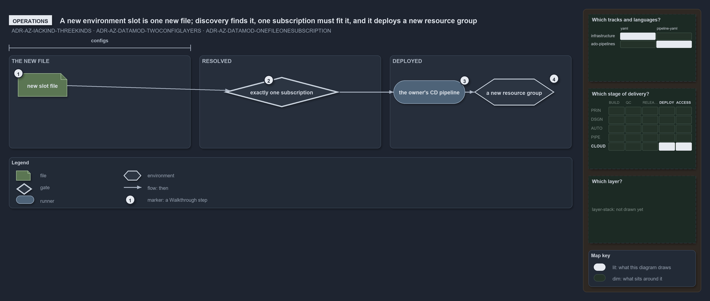

# A new configuration slot is one new file; discovery finds it, one subscription must fit it, and it deploys a new resource group

```text
A new configuration slot is one new file; discovery finds it, one subscription must fit it, and it deploys a new resource group.

1  configuration slot file    one <env>[-<slot>].yml added to a template's configuration folder
2  exactly one subscription   the check at discovery that the file's coordinate resolves to one subscription
3  the owner's CD pipeline    the shared pipeline for a root slot, the customer's for a slot under its subfolder
4  a new resource group       the one group the new configuration slot deploys, its name derived from the coordinate

Supports ADR-AZ-IACKIND-THREEKINDS, ADR-AZ-DATAMOD-TWOCONFIGLAYERS and ADR-AZ-DATAMOD-ONEFILEONESUBSCRIPTION (operations lens).
```

A new deployment of an existing template is a new file and nothing more. Slots are discovered from disk, never listed, so no catalogue
changes and no pipeline is edited: the file's place says whose deployment it is and which environment, and cats checks before deploying that
exactly one subscription serves it.



## Walkthrough

1. **Configuration slot file.** The operator adds `configuration/[<customer>/]<env>[-<slot>].yml` under the template, in the track's
   `configs` place. A root file is a deployment of the shared platform; a file under a customer subfolder is that customer's.
2. **Exactly one subscription.** Discovery reads the new file and matches its coordinate against the subscriptions that serve the
   environment. Zero or several matches stop discovery, so a slot that fits no subscription never reaches a pipeline.
3. **The owner's CD pipeline.** The owner's pipeline already includes its slots in its path filter, so the merge that adds the file runs it.
4. **A new resource group.** The slot is one resource group, and the namer derives its name from the coordinate, so nobody types it.

## Why it holds

- A configuration slot is one of the three kinds of infrastructure code (ADR-AZ-IACKIND-THREEKINDS).
- A config at the configuration root is the shared platform's and one under a customer subfolder is that customer's, and the subscription is
  resolved from that coordinate (ADR-AZ-DATAMOD-TWOCONFIGLAYERS).
- One config file is one (customer?, env, slot), one subscription and one Azure resource group (ADR-AZ-DATAMOD-ONEFILEONESUBSCRIPTION).

## See also

- [Infrastructure code is of three kinds](three-kinds-of-infrastructure-code.md) — the three kinds and their places.
- [A config file's path is a coordinate](config-path-is-a-coordinate.md) — how the coordinate resolves to one subscription.
- [The Azure explanations](index.md) · [How to read the diagrams](../index.md#how-to-read-the-diagrams)
