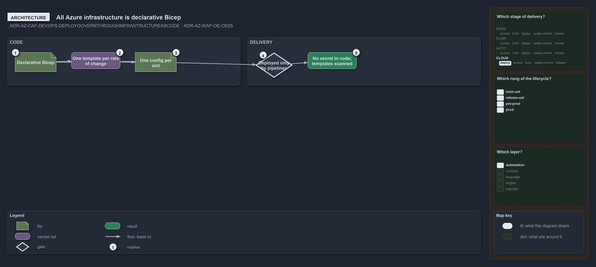

---
catzc:
  warning: "Experimental: this article merges two rules into one and holds nothing beyond what they say"
  edges:
    cites:
      - ADR-AZ-CAF-DEVOPS-DEPLOYGOVERNTHROUGHINFRASTRUCTUREASCODE
      - ADR-AZ-WAF-OE-OE05
---

# All azure infrastructure is declarative bicep deployed only by pipelines

This article is one rule:
[ADR-AZ-CAF-DEVOPS-DEPLOYGOVERNTHROUGHINFRASTRUCTUREASCODE](../../drs/azure/caf/platform-automation-and-devops.md#rule-adr-az-caf-devops-deploygovernthroughinfrastructureascode)
and [ADR-AZ-WAF-OE-OE05](../../drs/azure/waf/operational-excellence.md#rule-adr-az-waf-oe-oe05) merged into one. It holds nothing beyond
what those two rules say.

All Azure infrastructure is declarative Bicep: one parameterised template per rate of change, shared modules and one config per
configuration slot, deployed only by pipelines; no secret sits in the code, and the compiled templates are scanned for misconfiguration.

