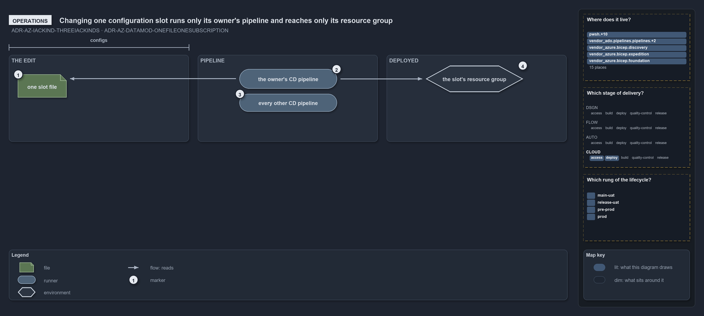

# Changing one configuration slot runs only its owner's pipeline and reaches only its resource group

```text
Changing one configuration slot runs only its owner's pipeline and reaches only its resource group.

1  one slot file             the edit: one <env>[-<slot>].yml in the configs place of the infrastructure track
2  the owner's CD pipeline   the one pipeline whose path filter holds the slot: the shared one or the customer's
3  every other CD pipeline   stays still, because its filter excludes the slot's folder
4  the slot's resource group the one resource group the slot deploys, and the only one the change reaches

Supports ADR-AZ-IACKIND-THREEKINDS and ADR-AZ-DATAMOD-ONEFILEONESUBSCRIPTION (operations lens).
```

The smallest infrastructure change is an edit to one configuration slot: a setting of one deployment, in one file. Because a slot is one
resource group and its folder says whose deployment it is, the change has a known, narrow reach before it is merged: one pipeline runs, and
one resource group changes.

```yml drawio
description:
  Changing one configuration slot edits one file in the configs place of the infrastructure track; only the CD pipeline of the slot's owner
  runs, and the change reaches the one resource group the slot deploys.
about:
  adrs: [ADR-AZ-IACKIND-THREEKINDS, ADR-AZ-DATAMOD-ONEFILEONESUBSCRIPTION]
  lens: operations
content:
  title: Changing one configuration slot runs only its owner's pipeline and reaches only its resource group
  kind: explanation
  flow: left-to-right
  relation: triggers
  theme: dark
  bands:
    - { id: band-edit, label: THE EDIT }
    - { id: band-pipeline, label: PIPELINE }
    - { id: band-deployed, label: DEPLOYED }
  spans:
    - id: span-configs
      label: configs
      over: [band-edit]
  glyphs:
    - { id: g-slot, kind: file, label: one slot file, in: band-edit }
    - { id: r-owner, kind: runner, label: the owner's CD pipeline, in: band-pipeline }
    - { id: r-others, kind: runner, label: every other CD pipeline, in: band-pipeline }
    - { id: e-group, kind: env, label: the slot's resource group, in: band-deployed }
  edges:
    - { from: g-slot, to: r-owner, kind: flow, label: "" }
    - { from: r-owner, to: e-group, kind: flow, label: "" }
  markers:
    - { at: g-slot, number: 1 }
    - { at: r-owner, number: 2 }
    - { at: r-others, number: 3 }
    - { at: e-group, number: 4 }
  legend: auto
  minimaps:
    axis:
      - cell: CLOUD/deploy
        by: [ADR-AZ-DATAMOD-ONEFILEONESUBSCRIPTION, ADR-AZ-IACKIND-THREEKINDS]
      - cell: CLOUD/access
        by: [ADR-AZ-DATAMOD-ONEFILEONESUBSCRIPTION]
    lifecycle-position:
      - cell: main-uat
        by: [docs/drs/index.md, pwsh/Catzc.Base.Drs/configs/drs.yml, ADR-AZ-DATAMOD-ONEFILEONESUBSCRIPTION, ADR-AZ-IACKIND-THREEKINDS]
      - cell: release-uat
        by: [docs/drs/index.md, pwsh/Catzc.Base.Drs/configs/drs.yml, ADR-AZ-DATAMOD-ONEFILEONESUBSCRIPTION, ADR-AZ-IACKIND-THREEKINDS]
      - cell: pre-prod
        by: [docs/drs/index.md, pwsh/Catzc.Base.Drs/configs/drs.yml, ADR-AZ-DATAMOD-ONEFILEONESUBSCRIPTION, ADR-AZ-IACKIND-THREEKINDS]
      - cell: prod
        by: [docs/drs/index.md, pwsh/Catzc.Base.Drs/configs/drs.yml, ADR-AZ-DATAMOD-ONEFILEONESUBSCRIPTION, ADR-AZ-IACKIND-THREEKINDS]
    layer-stack:
      - cell: automation
        by:
          - .ado/pipelines/cd-shared.yaml
          - .ado/pipelines/extends/cd-customer.yaml
          - docs/drs/azure/azure-data-model.md
          - docs/drs/azure/dora-explains.md
          - docs/drs/azure/infrastructure-kinds.md
          - docs/drs/glossary.md
          - docs/drs/index.md
          - docs/references/ado/pipelines/cd-shared.yaml.md
          - docs/references/ado/pipelines/extends/cd-customer.yaml.md
          - docs/references/infrastructure/templates/discovery/options.yml.md
          - docs/references/infrastructure/templates/expedition/options.yml.md
          - docs/references/infrastructure/templates/foundation/options.yml.md
          - docs/references/pwsh/catzc-azure-cli/Assert-AzCliCanAccess.ps1.md
          - docs/references/pwsh/catzc-azure-cli/Assert-AzCliIsConnected.ps1.md
          - docs/references/pwsh/catzc-azure-cli/Test-AzCliCanAccess.ps1.md
          - docs/references/pwsh/catzc-azure-templates/Deploy-Bicep.ps1.md
          - docs/references/pwsh/catzc-azure-templates/Get-AzureBicepEnvironmentKinds.ps1.md
          - docs/references/pwsh/catzc-azure-templates/Get-BicepDeploymentContext.ps1.md
          - docs/references/pwsh/catzc-azure-templates/Get-BicepTemplateConfiguration.ps1.md
          - docs/references/pwsh/catzc-azure-templates/Get-BicepTemplates.ps1.md
          - docs/references/pwsh/catzc-azure-templates/Set-BicepTemplateConfiguration.ps1.md
          - docs/references/pwsh/catzc-azure-templates/private/Get-BicepConfigName.ps1.md
          - docs/references/pwsh/catzc-azure-templates/private/Get-BicepConfigSubscriptionCandidates.ps1.md
          - docs/references/pwsh/catzc-azure-templates/private/Get-BicepParametersFileName.ps1.md
          - docs/references/pwsh/catzc-azure-templates/private/Resolve-BicepConfigName.ps1.md
          - docs/references/pwsh/catzc-azure/Get-AzureSubscriptionEnvironment.ps1.md
          - docs/references/pwsh/catzc-azure/configs/azure.yml.md
          - docs/references/pwsh/catzc-azure/tests/types/AzureConfig.Tests.ps1.md
          - docs/references/pwsh/catzc-azure/types/AzureConfig.cs.md
          - docs/references/pwsh/catzc-azure/types/AzureEnvironmentRecord.cs.md
          - docs/references/pwsh/catzc-azure/types/AzureSubscriptionRecord.cs.md
          - docs/references/pwsh/catzc-azure/types/AzureTenantRecord.cs.md
          - docs/references/pwsh/catzc-base-quality-gates/private/Get-MarkdownHeadingFinding.ps1.md
          - infrastructure/templates/discovery/options.yml
          - infrastructure/templates/expedition/options.yml
          - infrastructure/templates/foundation/options.yml
          - pwsh/Catzc.Azure.Cli/Assert-AzCliCanAccess.ps1
          - pwsh/Catzc.Azure.Cli/Assert-AzCliIsConnected.ps1
          - pwsh/Catzc.Azure.Cli/Test-AzCliCanAccess.ps1
          - pwsh/Catzc.Azure.Templates/Deploy-Bicep.ps1
          - pwsh/Catzc.Azure.Templates/Get-AzureBicepEnvironmentKinds.ps1
          - pwsh/Catzc.Azure.Templates/Get-BicepDeploymentContext.ps1
          - pwsh/Catzc.Azure.Templates/Get-BicepTemplateConfiguration.ps1
          - pwsh/Catzc.Azure.Templates/Get-BicepTemplates.ps1
          - pwsh/Catzc.Azure.Templates/Set-BicepTemplateConfiguration.ps1
          - pwsh/Catzc.Azure.Templates/configs/glossary.yml
          - pwsh/Catzc.Azure.Templates/private/Get-BicepConfigName.ps1
          - pwsh/Catzc.Azure.Templates/private/Get-BicepConfigSubscriptionCandidates.ps1
          - pwsh/Catzc.Azure.Templates/private/Get-BicepParametersFileName.ps1
          - pwsh/Catzc.Azure.Templates/private/Resolve-BicepConfigName.ps1
          - pwsh/Catzc.Azure/Get-AzureSubscriptionEnvironment.ps1
          - pwsh/Catzc.Azure/configs/azure.yml
          - pwsh/Catzc.Azure/tests/types/AzureConfig.Tests.ps1
          - pwsh/Catzc.Azure/types/AzureConfig.cs
          - pwsh/Catzc.Azure/types/AzureEnvironmentRecord.cs
          - pwsh/Catzc.Azure/types/AzureSubscriptionRecord.cs
          - pwsh/Catzc.Azure/types/AzureTenantRecord.cs
          - pwsh/Catzc.Base.Drs/configs/drs-index.yml
          - pwsh/Catzc.Base.Drs/configs/drs.yml
          - pwsh/Catzc.Base.QualityGates/private/Get-MarkdownHeadingFinding.ps1
          - ADR-AZ-DATAMOD-ONEFILEONESUBSCRIPTION
          - ADR-AZ-IACKIND-THREEKINDS
layout:
  r-owner: { x: 540, y: 140, w: 220, h: 44 }
  r-others: { x: 540, y: 196, w: 220, h: 40 }
  e-group: { x: 960, y: 132, w: 220, h: 60 }
```



## Walkthrough

1. **One slot file.** The operator edits `configuration/[<customer>/]<env>[-<slot>].yml` under one template. The file sits in the track's
   `configs` place, so nothing else is touched: no template, no module, no pipeline.
2. **The owner's CD pipeline.** A slot at the configuration root belongs to the shared platform and one under a customer subfolder belongs
   to that customer. Each CD pipeline's path filter includes its owner's slots, so the merge triggers exactly that pipeline.
3. **Every other CD pipeline.** The other pipelines exclude the slot's folder in their filters, so they do not run for this change.
4. **The slot's resource group.** One slot is one subscription and one resource group, so the deployment that follows changes that group and
   no other.

## Why it holds

- A configuration slot is one of the three kinds of infrastructure code, and every infrastructure file is of one kind
  (ADR-AZ-IACKIND-THREEKINDS).
- One config file is one (customer?, env, slot), one subscription and one Azure resource group, so a change to one file reaches one group
  (ADR-AZ-DATAMOD-ONEFILEONESUBSCRIPTION).

## See also

- [Infrastructure code is of three kinds](three-kinds-of-infrastructure-code.md) — the three kinds and their places.
- [A config file's path is a coordinate](config-path-is-a-coordinate.md) — how the slot's path resolves to its subscription.
- [The Azure explanations](index.md) · [How to read the diagrams](../index.md#how-to-read-the-diagrams)
