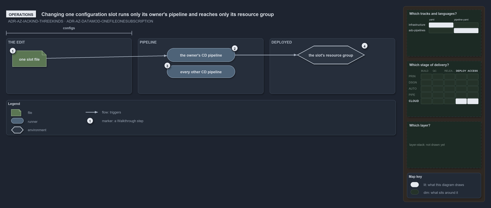

# Changing one configuration slot runs only its owner's pipeline and reaches only its resource group

```text
Changing one configuration slot runs only its owner's pipeline and reaches only its resource group.

1  one slot file             the edit: one <env>[-<slot>].yml in the configs place of the infrastructure track
2  the owner's CD pipeline   the one pipeline whose path filter holds the slot: the shared one or the customer's
3  every other CD pipeline   stays still, because its filter excludes the slot's folder
4  the slot's resource group the one resource group the slot deploys, and the only one the change reaches

Supports ADR-AZ-IACKIND-THREEKINDS and ADR-AZ-DATAMOD-ONEFILEONESUBSCRIPTION (operations lens).
```

The smallest infrastructure change is an edit to one configuration slot: a setting of one deployment, in one file. Because a slot is one
resource group and its folder says whose deployment it is, the change has a known, narrow reach before it is merged: one pipeline runs, and
one resource group changes.



## Walkthrough

1. **One slot file.** The operator edits `configuration/[<customer>/]<env>[-<slot>].yml` under one template. The file sits in the track's
   `configs` place, so nothing else is touched: no template, no module, no pipeline.
2. **The owner's CD pipeline.** A slot at the configuration root belongs to the shared platform and one under a customer subfolder belongs
   to that customer. Each CD pipeline's path filter includes its owner's slots, so the merge triggers exactly that pipeline.
3. **Every other CD pipeline.** The other pipelines exclude the slot's folder in their filters, so they do not run for this change.
4. **The slot's resource group.** One slot is one subscription and one resource group, so the deployment that follows changes that group and
   no other.

## Why it holds

- A configuration slot is one of the three kinds of infrastructure code, and every infrastructure file is of one kind
  (ADR-AZ-IACKIND-THREEKINDS).
- One config file is one (customer?, env, slot), one subscription and one Azure resource group, so a change to one file reaches one group
  (ADR-AZ-DATAMOD-ONEFILEONESUBSCRIPTION).

## See also

- [Infrastructure code is of three kinds](three-kinds-of-infrastructure-code.md) — the three kinds and their places.
- [A config file's path is a coordinate](config-path-is-a-coordinate.md) — how the slot's path resolves to its subscription.
- [The Azure explanations](index.md) · [How to read the diagrams](../index.md#how-to-read-the-diagrams)
