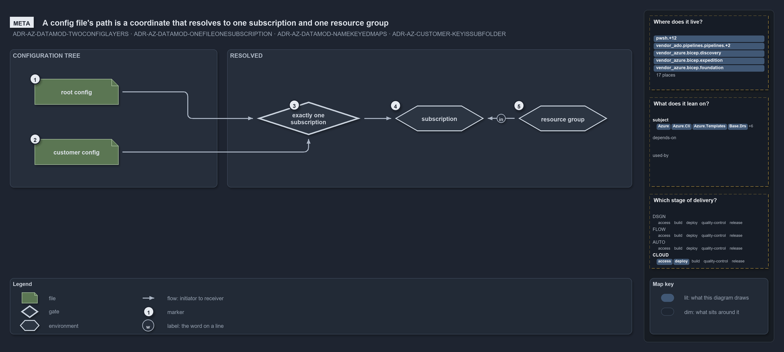

# A config file's path is a coordinate that resolves to one subscription and one resource group

```text
A config file's path is a coordinate that resolves to one subscription and one resource group.

1  root config               a config at the configuration root: a deployment of the shared platform
2  customer config           a config under configuration/<customer>/: a deployment of that customer
3  exactly one subscription  the check that the coordinate is served by exactly one subscription
4  subscription              the one subscription the coordinate resolves to, never spelled into the path
5  resource group            the one resource group the config deploys, its name derived from the coordinate

Supports ADR-AZ-DATAMOD-TWOCONFIGLAYERS, ADR-AZ-DATAMOD-ONEFILEONESUBSCRIPTION and ADR-AZ-DATAMOD-NAMEKEYEDMAPS, and ADR-AZ-CUSTOMER-KEYISSUBFOLDER (meta lens).
```

A Bicep template in cats keeps one config file per deployment under its `configuration/` folder, and where that file sits is its whole
address. The file's folder says whose deployment it is, and its name says which environment and which slot. Nothing in the file, and nothing
in any pipeline, names the subscription: cats resolves it from the path, and it insists that exactly one subscription fits. Because the
resolution is one-to-one all the way through, listing the `configuration/` tree is the inventory of a template's resource groups.

```yml drawio
description:
  "A config file's place under a template's configuration tree is its coordinate: a root config or a customer config, checked against
  exactly one subscription, resolves to that subscription and to one resource group."
about:
  adrs:
    - ADR-AZ-DATAMOD-TWOCONFIGLAYERS
    - ADR-AZ-DATAMOD-ONEFILEONESUBSCRIPTION
    - ADR-AZ-DATAMOD-NAMEKEYEDMAPS
    - ADR-AZ-CUSTOMER-KEYISSUBFOLDER
  lens: meta
content:
  title: A config file's path is a coordinate that resolves to one subscription and one resource group
  kind: explanation
  flow: left-to-right
  relation: resolves to
  theme: dark
  bands:
    - { id: band-tree, label: CONFIGURATION TREE }
    - { id: band-resolved, label: RESOLVED }
  glyphs:
    - { id: g-root, kind: file, label: root config, in: band-tree }
    - { id: g-customer, kind: file, label: customer config, in: band-tree }
    - { id: g-one, kind: gate, label: exactly one subscription, in: band-resolved }
    - { id: e-subscription, kind: env, label: subscription, in: band-resolved }
    - { id: e-group, kind: env, label: resource group, in: band-resolved }
  edges:
    - { from: g-root, to: g-one, kind: flow, label: "" }
    - { from: g-customer, to: g-one, kind: flow, label: "" }
    - { from: g-one, to: e-subscription, kind: flow, label: "" }
    - { from: e-subscription, to: e-group, kind: flow, label: "" }
  markers:
    - { at: g-root, number: 1 }
    - { at: g-customer, number: 2 }
    - { at: g-one, number: 3 }
    - { at: e-subscription, number: 4 }
    - { at: e-group, number: 5 }
  legend: auto
  minimaps: [code-locations, module-neighbourhood, axis]
layout:
  band-tree: { x: 20, y: 84, w: 420, h: 280 }
  band-resolved: { x: 460, y: 84, w: 820, h: 280 }
  g-root: { x: 70, y: 144, w: 170, h: 52 }
  g-customer: { x: 70, y: 266, w: 170, h: 52 }
  g-one: { x: 520, y: 190, w: 210, h: 68 }
  e-subscription: { x: 800, y: 198, w: 180, h: 52 }
  e-group: { x: 1050, y: 198, w: 180, h: 52 }
```



## Walkthrough

1. **Root config.** A file at the configuration root, `configuration/<env>[-<slot>].yml`, is a deployment of the shared platform. Its
   coordinate has no customer, so only the non-customer subscriptions can serve it.
2. **Customer config.** A file under a subfolder, `configuration/<customer>/<env>[-<slot>].yml`, is that customer's deployment. The
   subfolder is always a customer key from the customer catalogue, so a subfolder that names no customer is a discovery error.
3. **Exactly one subscription.** The coordinate (customer?, env) is matched against the subscriptions of `azure.yml`: those serving the
   environment, filtered to the non-customer ones for a root config or to the customer's own for a customer config. Exactly one must remain.
   Zero or several stop discovery, which is how the shared platform stays one platform and a customer's environments stay disjoint. The slot
   plays no part in this choice.
4. **Subscription.** The one match is the subscription the config deploys into. It is a resolved value, never an argument and never a path
   segment, so no subscription name appears anywhere in the templating layer.
5. **Resource group.** Each config is one slot and one resource group. The group's name is derived from the coordinate by the namer, never
   typed into a config, so the file, the subscription and the group stay one-to-one.

## Why it holds

- A config at the configuration root is the shared platform's and a config under a customer subfolder is that customer's; the subscription
  is always resolved from that coordinate and never spelled into a path (ADR-AZ-DATAMOD-TWOCONFIGLAYERS).
- One config file is one (customer?, env, slot), one subscription and one Azure resource group, at
  `configuration/[<customer>/]<env>[-<slot>].yml`, so listing the tree is the resource-group inventory
  (ADR-AZ-DATAMOD-ONEFILEONESUBSCRIPTION).
- A configuration subfolder is always a customer key, and every coordinate must resolve to exactly one subscription: a root config's
  environment to one non-customer subscription, a customer config's environment to one of that customer's, asserted per file at discovery
  and by integrity tests (ADR-AZ-DATAMOD-NAMEKEYEDMAPS).
- The customer key is the subfolder name, one spelling on disk; the shortcode never names a folder (ADR-AZ-CUSTOMER-KEYISSUBFOLDER).

## See also

- [Templating data model](../../drs/azure/azure-data-model.md) — the decision this article explains, with the
  [customer model](../../drs/azure/azure-customer-model.md) it pairs with.
- The other lenses on the same coordinate: [architecture](two-layers-join-through-one-resolver.md),
  [implementation](coordinate-resolved-file-by-file-at-discovery.md), [operations](a-bad-coordinate-stops-discovery.md) and
  [governance](coordinate-rules-and-their-gates.md).
- [The Azure explanations](index.md) · [How to read the diagrams](../index.md#how-to-read-the-diagrams)
