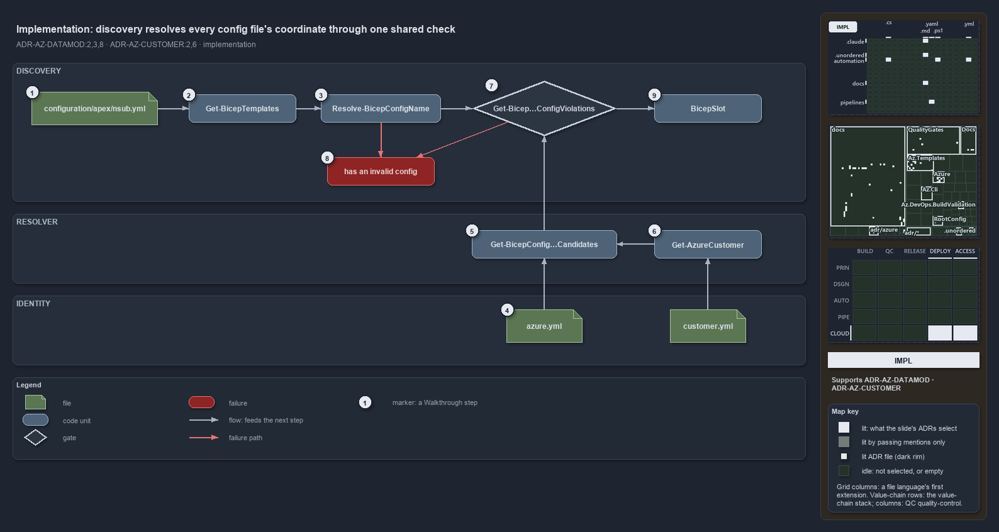

---
catzc:
  derived:
    path: docs/explanation/azure/coordinate-resolved-file-by-file-at-discovery.md
    kind: explanation
    language: markdown
    filekind: md
    track: docs
    body_sha: "5676684496e7"
    adrs:
      - ADR-AZ-CUSTOMER#{2,6}
      - ADR-AZ-DATAMOD#{2,3,8}
    links:
      - docs/.assets/explanation/adr-az-datamod--coordinate-resolved-file-by-file-at-discovery--implementation.drawio.md
      - docs/.assets/explanation/adr-az-datamod--coordinate-resolved-file-by-file-at-discovery--implementation.drawio.png
      - docs/adr/azure/azure-customer-model.md
      - docs/adr/azure/azure-data-model.md
      - docs/explanation/azure/a-bad-coordinate-stops-discovery.md
      - docs/explanation/azure/config-path-is-a-coordinate.md
      - docs/explanation/azure/coordinate-rules-and-their-gates.md
      - docs/explanation/azure/index.md
      - docs/explanation/azure/two-layers-join-through-one-resolver.md
      - docs/explanation/index.md#how-to-read-the-diagrams
---

# Discovery resolves every config file's coordinate through one shared check

```text
Discovery resolves every config file's coordinate through one shared check.

1  configuration/apex/nsub.yml            a shipped config of the foundation template: customer apex, environment nsub, base slot
2  Get-BicepTemplates                     discovery: loads azure.yml, gathers root files then subfolders, skips default.yml
3  Resolve-BicepConfigName                splits the filename on the first '-' into environment and slot; throws on a bad name
4  azure.yml                              the subscriptions the resolver filters: serving the env, with or without a customer
5  Get-BicepConfigSubscriptionCandidates  the resolver: the subscriptions the (customer?, env) coordinate can resolve to
6  Get-AzureCustomer                      resolves a subscription's shortcode token to its key through customer.yml
7  Get-BicepSubscriptionConfigViolations  the shared check: the subfolder is a key; exactly one candidate
8  has an invalid config                  the throw: Template '<name>' has an invalid config: <violations>.
9  BicepSlot                              the slot: name, environment, slot, subscription, customer; one per config file

Supports ADR-AZ-DATAMOD#2, #3 and #8, and ADR-AZ-CUSTOMER#2 and #6 (implementation lens).
```

Discovery is the moment cats turns a template's `configuration/` tree into slots, and it is where the coordinate of every config file is
resolved and checked. For each file, `Get-BicepTemplates` parses the filename, runs the shared check on the (customer?, env) coordinate, and
only then builds the slot with the one subscription the resolver returns. The shipped `foundation` template's `apex/nsub.yml` is the
example: its coordinate is customer `apex`, environment `nsub`, base slot, and it resolves to `apex_nonprod`.



The diagram is described element by element in
[its asset description](../../.assets/explanation/adr-az-datamod--coordinate-resolved-file-by-file-at-discovery--implementation.drawio.md).

## Walkthrough

1. **`configuration/apex/nsub.yml`.** The file lives under the `foundation` template. Its subfolder, `apex`, is its customer; its name,
   `nsub`, is its environment with the base slot. The whole coordinate is in the path.
2. **`Get-BicepTemplates`.** Discovery loads `azure.yml` once with `Get-Config -Config azure`, then gathers each template's config files:
   the root files first, then every subfolder's, both sorted, each tagged with its subfolder as its customer (empty for a root file).
   `default.yml` is reserved and skipped.
3. **`Resolve-BicepConfigName`.** The filename is split on the first `-`: the part before must be a defined environment, the remainder is
   the optional slot of one to three lowercase alphanumerics. An unknown environment throws, and so does a slot that is malformed. Discovery
   rethrows either with the template name and the file's location.
4. **`azure.yml`.** The identity config's subscriptions, each with the environments it serves and, for a customer subscription, a `customer`
   token by key or shortcode. The resolver receives it as `-AzureConfig`.
5. **`Get-BicepConfigSubscriptionCandidates`.** For each subscription serving the environment, the resolver reads its customer token through
   `Get-AzureSubscriptionCustomer`. A root coordinate keeps the subscriptions with no token; a customer coordinate keeps those whose token
   equals the subfolder's key, or resolves to it.
6. **`Get-AzureCustomer`.** When a token is not the key itself, the resolver resolves it through the catalogue, keys first and then
   shortcodes, so `ap` and `apex` bind the same customer. An unknown token throws at that moment.
7. **`Get-BicepSubscriptionConfigViolations`.** The shared check runs per file with the customer, the environment, the azure config and a
   human-readable location. It first checks that a subfolder is one of the customer keys and returns early if not; then it asks the resolver
   and flags zero candidates or more than one. The env-class and customer-class checks follow it, each a shared rule of its own.
8. **Has an invalid config.** Any violation throws `Template '<name>' has an invalid config: <violations>.`, and a bad filename throws
   `Template '<name>' has <location> — <message>`. Discovery stops at the first bad file.
9. **`BicepSlot`.** With the check passed, discovery asks the resolver once more and takes its only candidate as the slot's subscription,
   then builds the slot from the config name, the environment, the slot, the subscription and the customer. The slot's resource group is
   derived later, at deploy time, from that coordinate.

## Why it holds

- One config file is one (customer?, env, slot), one subscription and one Azure resource group, with the filename `<env>[-<slot>]` parsed by
  splitting on the first `-` (ADR-AZ-DATAMOD#2).
- A configuration subfolder is always a customer key, and every coordinate must resolve to exactly one subscription id, asserted per file at
  discovery (ADR-AZ-DATAMOD#3).
- The link across the two layers is enforced at discovery by `Get-BicepTemplates` through the shared `Get-BicepSubscriptionConfigViolations`
  (ADR-AZ-DATAMOD#8).
- A subscription binds a customer by either its key or its shortcode, and `Get-AzureCustomer` is the single resolver, keys first and then
  shortcodes (ADR-AZ-CUSTOMER#2).
- The customer key is the subfolder name, and a subfolder that is not a defined key is a discovery error (ADR-AZ-CUSTOMER#6).

## See also

- [Templating data model](../../adr/azure/azure-data-model.md) — the decision this article explains, with the
  [customer model](../../adr/azure/azure-customer-model.md) it pairs with.
- The other lenses on the same coordinate: [meta](config-path-is-a-coordinate.md), [architecture](two-layers-join-through-one-resolver.md),
  [operations](a-bad-coordinate-stops-discovery.md) and [governance](coordinate-rules-and-their-gates.md).
- [The Azure explanations](index.md) · [How to read the diagrams](../index.md#how-to-read-the-diagrams)
