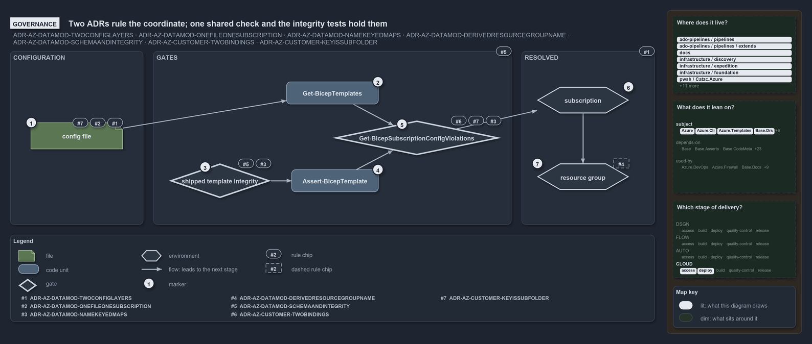

# Two ADRs rule the coordinate; one shared check and the integrity tests hold them

```text
Two ADRs rule the coordinate; one shared check and the integrity tests hold them.

1  config file                            the coordinate: root or customer subfolder, env and slot in the name (D1, D2, C6)
2  Get-BicepTemplates                     discovery runs the shared check per file, fail-fast (D8)
3  shipped template integrity             the integrity test that runs the validator over every shipped template (D3, D8)
4  Assert-BicepTemplate                   the collect-all validator, the second caller of the shared check (D8)
5  Get-BicepSubscriptionConfigViolations  the shared check: a subfolder is a key, one subscription, key or shortcode (D3, C6, C2)
6  subscription                           the resolved value, never a path segment or an argument (D1)
7  resource group                         its name derived by the namer; no gate checks a config for a typed one (D5, no gate)

Supports ADR-AZ-DATAMOD-TWOCONFIGLAYERS, ADR-AZ-DATAMOD-ONEFILEONESUBSCRIPTION, ADR-AZ-DATAMOD-NAMEKEYEDMAPS, ADR-AZ-DATAMOD-DERIVEDRESOURCEGROUPNAME and ADR-AZ-DATAMOD-SCHEMAANDINTEGRITY, and ADR-AZ-CUSTOMER-TWOBINDINGS and ADR-AZ-CUSTOMER-KEYISSUBFOLDER (governance lens).
```

Two decisions govern a config file's coordinate in cats: the templating data model, which says what the path means and that it resolves to
exactly one subscription, and the customer model, which says that a subfolder is a customer key and that a subscription may bind a customer
by key or shortcode. Every rule but one is held by a gate: the shared check that discovery and the validator both run, and the integrity
tests that run the validator over the shipped tree. The one rule without a gate, that the resource-group name is derived and never typed, is
held by the code that derives it.



## Walkthrough

1. **Config file.** The path `configuration/[<customer>/]<env>[-<slot>].yml` is ruled three times: the root is the shared platform and a
   subfolder a customer (ADR-AZ-DATAMOD-TWOCONFIGLAYERS), one file is one (customer?, env, slot), one subscription and one resource group
   (ADR-AZ-DATAMOD-ONEFILEONESUBSCRIPTION), and the subfolder is the customer key (ADR-AZ-CUSTOMER-KEYISSUBFOLDER).
2. **`Get-BicepTemplates`.** Discovery is the gate the data model names for joining the layers: it runs the shared check on every file and
   throws on the first violation (ADR-AZ-DATAMOD-SCHEMAANDINTEGRITY).
3. **Shipped template integrity.** An integrity test runs `Assert-BicepTemplate` over every shipped template without building it, and a
   second one checks the environment and customer of every slot discovery found against the identity configs. Together they are the
   "integrity tests" that ADR-AZ-DATAMOD-NAMEKEYEDMAPS and ADR-AZ-DATAMOD-SCHEMAANDINTEGRITY name beside discovery.
4. **`Assert-BicepTemplate`.** The validator is the second caller of the shared check, collecting rather than failing fast, so the rule has
   one implementation and two callers (ADR-AZ-DATAMOD-SCHEMAANDINTEGRITY).
5. **`Get-BicepSubscriptionConfigViolations`.** The shared check holds the exactly-one rule (ADR-AZ-DATAMOD-NAMEKEYEDMAPS) and the
   subfolder-is-a-key rule (ADR-AZ-CUSTOMER-KEYISSUBFOLDER), and through the resolver it honours the key-or-shortcode binding of a
   subscription's customer (ADR-AZ-CUSTOMER-TWOBINDINGS).
6. **Subscription.** The resolved subscription is a value the gate produced, never a path segment and never a deploy argument
   (ADR-AZ-DATAMOD-TWOCONFIGLAYERS).
7. **Resource group.** The group's name is derived by `Get-BicepResourceGroupName` for both the deploy target and the scope of the tracking
   tag, and never hand-typed (ADR-AZ-DATAMOD-DERIVEDRESOURCEGROUPNAME). No gate checks a resource-group-target config for a typed name,
   which is why the rule's chip is dashed: the code derives the name whatever a config says, and only a subscription-target config is
   asserted to carry none.

## Why it holds

- The subscription is resolved from the coordinate and never spelled into a path, and there is no subscription-group entity
  (ADR-AZ-DATAMOD-TWOCONFIGLAYERS).
- One config file is one (customer?, env, slot), one subscription and one resource group, and the tree is the inventory
  (ADR-AZ-DATAMOD-ONEFILEONESUBSCRIPTION).
- Every coordinate must resolve to exactly one subscription id, asserted per file at discovery and by integrity tests
  (ADR-AZ-DATAMOD-NAMEKEYEDMAPS).
- The resource-group name is derived by `Get-BicepResourceGroupName`, never hand-typed (ADR-AZ-DATAMOD-DERIVEDRESOURCEGROUPNAME).
- The link between the two layers is enforced at discovery through the shared `Get-BicepSubscriptionConfigViolations` and over the shipped
  tree by integrity tests (ADR-AZ-DATAMOD-SCHEMAANDINTEGRITY).
- A subscription binds a customer by key or shortcode through the single resolver (ADR-AZ-CUSTOMER-TWOBINDINGS), and the key is the
  subfolder name (ADR-AZ-CUSTOMER-KEYISSUBFOLDER).

## Where the code and the decision record differ

The data model states the exactly-one rule as ADR-AZ-DATAMOD-NAMEKEYEDMAPS, but the code that enforces it cites other rules: the shared
check cites ADR-AZ-DATAMOD-SCHEMAANDINTEGRITY and the filename parser cites ADR-AZ-DATAMOD-ONEFILEONESUBSCRIPTION, and no file cites #3.

## See also

- [Templating data model](../../drs/azure/azure-data-model.md) — the decision this article explains, with the
  [customer model](../../drs/azure/azure-customer-model.md) it pairs with.
- The other lenses on the same coordinate: [meta](config-path-is-a-coordinate.md), [architecture](two-layers-join-through-one-resolver.md),
  [implementation](coordinate-resolved-file-by-file-at-discovery.md) and [operations](a-bad-coordinate-stops-discovery.md).
- [The Azure explanations](index.md) · [How to read the diagrams](../index.md#how-to-read-the-diagrams)
