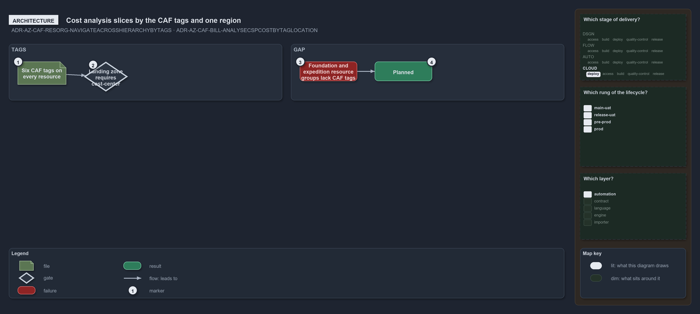

---
catzc:
  warning: "Experimental: this article merges two rules into one and holds nothing beyond what they say"
  edges:
    cites:
      - ADR-AZ-CAF-RESORG-NAVIGATEACROSSHIERARCHYBYTAGS
      - ADR-AZ-CAF-BILL-ANALYSECSPCOSTBYTAGLOCATION
---

# Cost analysis slices by the caf tags and one region

This article is one rule:
[ADR-AZ-CAF-RESORG-NAVIGATEACROSSHIERARCHYBYTAGS](../../drs/azure/caf/resource-organization.md#rule-adr-az-caf-resorg-navigateacrosshierarchybytags)
and
[ADR-AZ-CAF-BILL-ANALYSECSPCOSTBYTAGLOCATION](../../drs/azure/caf/billing-and-tenant.md#rule-adr-az-caf-bill-analysecspcostbytaglocation)
merged into one. It holds nothing beyond what those two rules say.

Every resource carries the six CAF tags and the landing zone requires `cost-center`, and every resource lands in one region, so cost can be
analysed by tag and location. Both are partly realised: the resource groups that `Deploy-Bicep` creates for `foundation` and `expedition`
carry deployment-tracking tags but not the CAF tags, which is planned.

