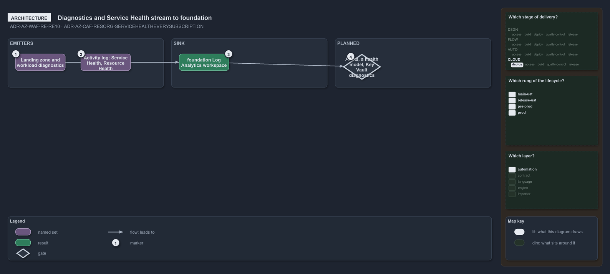

---
catzc:
  warning: "Experimental: this article merges two rules into one and holds nothing beyond what they say"
  edges:
    cites:
      - ADR-AZ-WAF-RE-RE10
      - ADR-AZ-CAF-RESORG-SERVICEHEALTHEVERYSUBSCRIPTION
---

# Diagnostics and service health stream to the foundation workspace and alerts are planned

This article is one rule: [ADR-AZ-WAF-RE-RE10](../../drs/azure/waf/reliability.md#rule-adr-az-waf-re-re10) and
[ADR-AZ-CAF-RESORG-SERVICEHEALTHEVERYSUBSCRIPTION](../../drs/azure/caf/resource-organization.md#rule-adr-az-caf-resorg-servicehealtheverysubscription)
merged into one. It holds nothing beyond what those two rules say.

The landing zone and the workload send their diagnostics to `foundation`'s Log Analytics workspace, and the subscription's activity log, its
Service Health and Resource Health events included, streams there too. This is partly adopted: every landing zone streams the activity log,
its `ServiceHealth` category included, to that workspace, while alerts on those signals, a Service Health alert per subscription, a health
model and diagnostics for `foundation`'s own Key Vault are planned.

