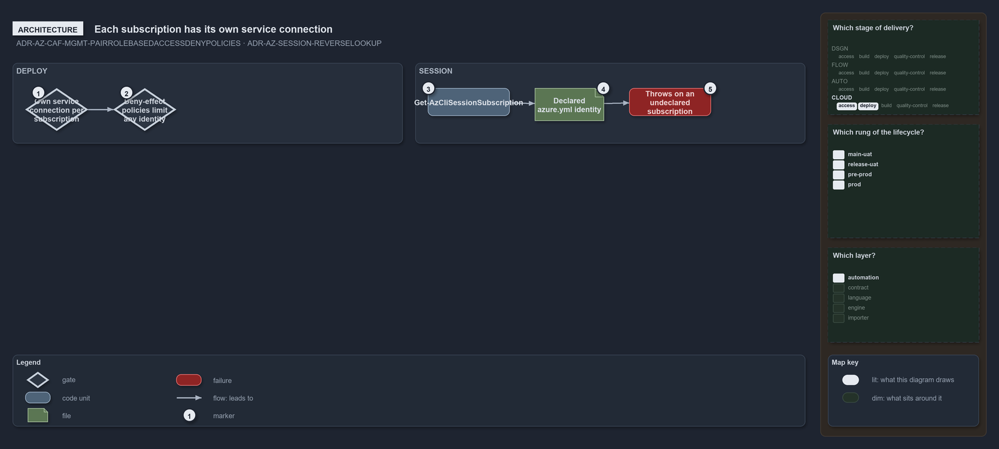

---
catzc:
  warning: "Experimental: this article merges two rules into one and holds nothing beyond what they say"
  edges:
    cites:
      - ADR-AZ-CAF-MGMT-PAIRROLEBASEDACCESSDENYPOLICIES
      - ADR-AZ-SESSION-REVERSELOOKUP
---

# Each subscription has its own service connection and session is looked up in azure yml

This article is one rule:
[ADR-AZ-CAF-MGMT-PAIRROLEBASEDACCESSDENYPOLICIES](../../drs/azure/caf/management.md#rule-adr-az-caf-mgmt-pairrolebasedaccessdenypolicies)
and [ADR-AZ-SESSION-REVERSELOOKUP](../../drs/azure/az-session-verification.md#rule-adr-az-session-reverselookup) merged into one. It holds
nothing beyond what those two rules say.

Each subscription is deployed by its own service connection, and the landing zone's deny-effect policies limit what any identity may deploy
there, enforcing in production and auditing outside it. The session is checked against the same declaration: `Get-AzCliSessionSubscription`
reads the session's active subscription and resolves its GUID to the declared `azure.yml` identity, throwing when the session targets a
subscription `azure.yml` does not declare.

