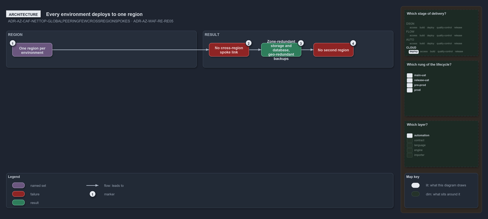

---
catzc:
  warning: "Experimental: this article merges two rules into one and holds nothing beyond what they say"
  edges:
    cites:
      - ADR-AZ-CAF-NETTOP-GLOBALPEERINGFEWCROSSREGIONSPOKES
      - ADR-AZ-WAF-RE-RE05
---

# Every environment deploys to one region so no spoke peers across regions

This article is one rule:
[ADR-AZ-CAF-NETTOP-GLOBALPEERINGFEWCROSSREGIONSPOKES](../../drs/azure/caf/network-topology.md#rule-adr-az-caf-nettop-globalpeeringfewcrossregionspokes)
and [ADR-AZ-WAF-RE-RE05](../../drs/azure/waf/reliability.md#rule-adr-az-waf-re-re05) merged into one. It holds nothing beyond what those two
rules say.

Every environment deploys to one region, so no spoke needs a cross-region link and global peering is not adopted. Redundancy stays inside
one region: storage is zone-redundant in every environment and a production database is zone-redundant with geo-redundant backups, and a
second region is not adopted.

