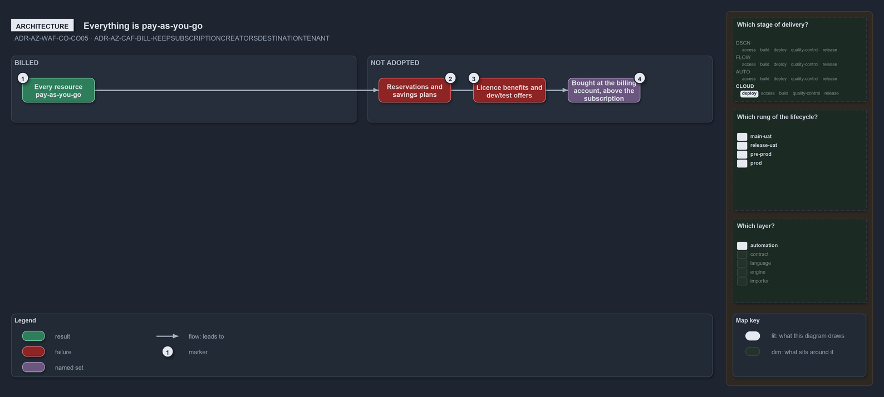

---
catzc:
  warning: "Experimental: this article merges two rules into one and holds nothing beyond what they say"
  edges:
    cites:
      - ADR-AZ-WAF-CO-CO05
      - ADR-AZ-CAF-BILL-KEEPSUBSCRIPTIONCREATORSDESTINATIONTENANT
---

# Every resource is pay as you go and billing roles sit above the repository

This article is one rule: [ADR-AZ-WAF-CO-CO05](../../drs/azure/waf/cost-optimization.md#rule-adr-az-waf-co-co05) and
[ADR-AZ-CAF-BILL-KEEPSUBSCRIPTIONCREATORSDESTINATIONTENANT](../../drs/azure/caf/billing-and-tenant.md#rule-adr-az-caf-bill-keepsubscriptioncreatorsdestinationtenant)
merged into one. It holds nothing beyond what those two rules say.

Every resource is billed pay-as-you-go; reservations, savings plans, licence benefits and dev/test offers are not adopted, because they are
bought at the billing account and the subscription offer, above the subscription the repository deploys into. Keeping the subscription
creator's destination tenant is not adopted for the same reason: billing roles are set above the repository, which declares the tenant of
every subscription.

