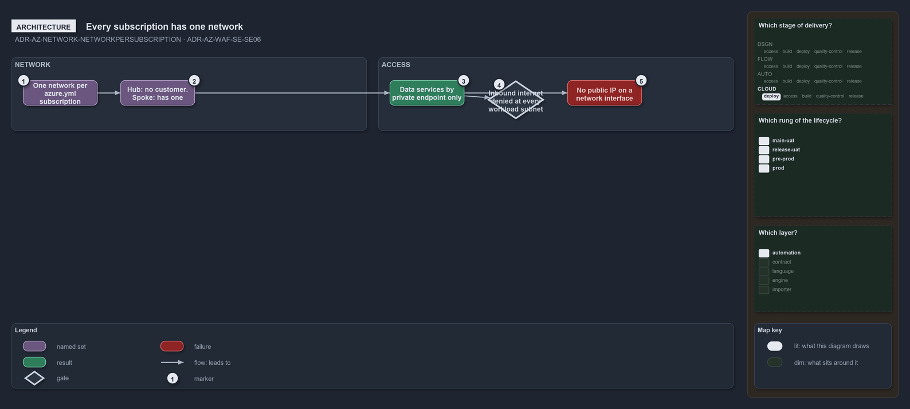

---
catzc:
  warning: "Experimental: this article merges two rules into one and holds nothing beyond what they say"
  edges:
    cites:
      - ADR-AZ-NETWORK-NETWORKPERSUBSCRIPTION
      - ADR-AZ-WAF-SE-SE06
---

# Every subscription has one network and data services are reached only by private endpoint

This article is one rule:
[ADR-AZ-NETWORK-NETWORKPERSUBSCRIPTION](../../drs/azure/azure-network-model.md#rule-adr-az-network-networkpersubscription) and
[ADR-AZ-WAF-SE-SE06](../../drs/azure/waf/security.md#rule-adr-az-waf-se-se06) merged into one. It holds nothing beyond what those two rules
say.

Every `azure.yml` subscription has one network in the plan's `subscriptions` block, a hub when the subscription has no `customer` and a
spoke when it has one. Data services in these networks have public network access off and are reached only through private endpoints
resolved by the hub's private DNS zones; inbound internet traffic is denied at every workload subnet and no network interface takes a public
IP address.

