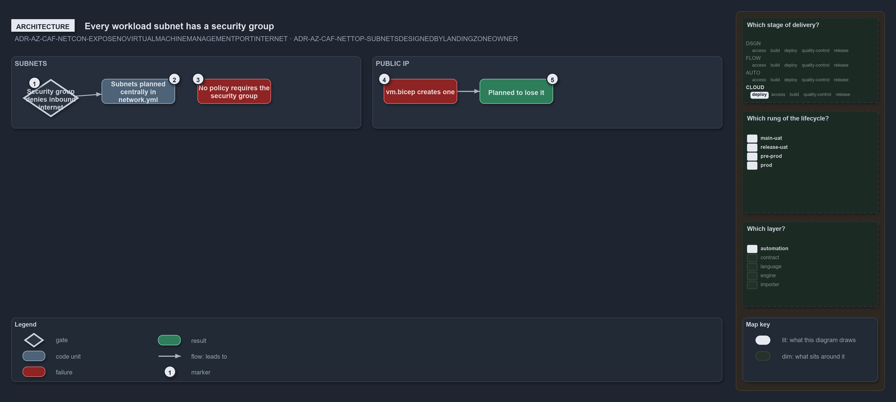

---
catzc:
  warning: "Experimental: this article merges two rules into one and holds nothing beyond what they say"
  edges:
    cites:
      - ADR-AZ-CAF-NETCON-EXPOSENOVIRTUALMACHINEMANAGEMENTPORTINTERNET
      - ADR-AZ-CAF-NETTOP-SUBNETSDESIGNEDBYLANDINGZONEOWNER
---

# Every workload subnet denies inbound internet traffic through a security group

This article is one rule:
[ADR-AZ-CAF-NETCON-EXPOSENOVIRTUALMACHINEMANAGEMENTPORTINTERNET](../../drs/azure/caf/network-connectivity.md#rule-adr-az-caf-netcon-exposenovirtualmachinemanagementportinternet)
and
[ADR-AZ-CAF-NETTOP-SUBNETSDESIGNEDBYLANDINGZONEOWNER](../../drs/azure/caf/network-topology.md#rule-adr-az-caf-nettop-subnetsdesignedbylandingzoneowner)
merged into one. It holds nothing beyond what those two rules say.

Every workload subnet denies inbound internet traffic and the landing zone's policy keeps public IP addresses off network interfaces, but
the unused `vm.bicep` creates one and is planned to lose it. `discovery` gives every workload subnet a security group that denies inbound
internet traffic; the subnets are planned centrally in `network.yml`, not by the landing zone's owner, and no policy requires a security
group.

