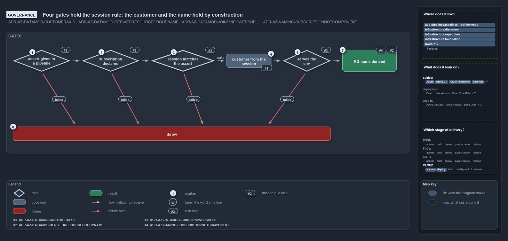

# Four gates hold the session rule; the customer and the name hold by construction

```text
Four throwing gates hold ADR-AZ-DATAMOD-JOINSINPOWERSHELL; rules #4, #5 and ADR-AZ-NAMING-SUBSCRIPTIONNOTCOMPONENT hold by construction, with no gate.

1  assert given in a pipeline  #7: Deploy-Bicep throws in a pipeline without -SubscriptionIdAssertIs
2  subscription declared       #7: Get-AzCliSessionSubscription throws on an id azure.yml does not declare
3  session matches the assert  #7: Get-BicepDeploymentContext throws when the session differs from the pin
4  customer from the session   #4: the customer is read off the session; Deploy-Bicep has no -Customer
5  serves the env              #7: Get-AzureEnvironment throws when the subscription does not serve the env
6  throw                       every gate ends here when it fails; nothing retargets or falls back
7  RG name derived             #5 and NAMING#8: Get-BicepResourceGroupName builds the name; no subscription in it

Supports ADR-AZ-DATAMOD-CUSTOMERAXIS, ADR-AZ-DATAMOD-DERIVEDRESOURCEGROUPNAME and ADR-AZ-DATAMOD-JOINSINPOWERSHELL, and ADR-AZ-NAMING-SUBSCRIPTIONNOTCOMPONENT (governance lens).
```

The rule that the az session is the deploy target has four parts, and cats holds each one behind a check that throws: a pipeline must give
the pin, the session must be declared, the session must match the pin, and the session's subscription must serve the environment. Two
neighbouring rules need no check at all. The customer comes from the session because the deploy has no way to say otherwise, and the
resource-group name is built by one function that never sees a subscription. No message or help text contradicts these rules; one help text
misstates a config path.

```yml drawio
description:
  Four throwing gates hold the rule that the az session is the deploy target; the customer and the resource-group name hold by construction,
  with no gate, and every gate ends in a throw.
about:
  adrs:
    - ADR-AZ-DATAMOD-CUSTOMERAXIS
    - ADR-AZ-DATAMOD-DERIVEDRESOURCEGROUPNAME
    - ADR-AZ-DATAMOD-JOINSINPOWERSHELL
    - ADR-AZ-NAMING-SUBSCRIPTIONNOTCOMPONENT
  lens: governance
content:
  title: Four gates hold the session rule; the customer and the name hold by construction
  kind: explanation
  flow: left-to-right
  theme: dark
  bands:
    - { id: band-gates, label: GATES }
  glyphs:
    - { id: g-pipeline-assert, kind: gate, label: assert given in a pipeline, in: band-gates }
    - { id: g-declared, kind: gate, label: subscription declared, in: band-gates }
    - { id: g-matches, kind: gate, label: session matches the assert, in: band-gates }
    - { id: g-customer, kind: code, label: customer from the session, in: band-gates }
    - { id: g-serves, kind: gate, label: serves the env, in: band-gates }
    - { id: f-throw, kind: failure, label: throw, in: band-gates }
    - { id: g-group, kind: result, label: RG name derived, in: band-gates }
  edges:
    - { from: g-pipeline-assert, to: g-declared, kind: flow, label: "" }
    - { from: g-declared, to: g-matches, kind: flow, label: "" }
    - { from: g-matches, to: g-customer, kind: flow, label: calls }
    - { from: g-customer, to: g-serves, kind: flow, label: "" }
    - { from: g-serves, to: g-group, kind: flow, label: "" }
    - { from: g-pipeline-assert, to: f-throw, kind: fail, label: failed }
    - { from: g-declared, to: f-throw, kind: fail, label: failed }
    - { from: g-matches, to: f-throw, kind: fail, label: failed }
    - { from: g-serves, to: f-throw, kind: fail, label: failed }
  markers:
    - { at: g-pipeline-assert, number: 1 }
    - { at: g-declared, number: 2 }
    - { at: g-matches, number: 3 }
    - { at: g-customer, number: 4 }
    - { at: g-serves, number: 5 }
    - { at: f-throw, number: 6 }
    - { at: g-group, number: 7, corner: top-left }
  chips:
    - { at: g-pipeline-assert, kind: rule, rule: ADR-AZ-DATAMOD-JOINSINPOWERSHELL }
    - { at: g-declared, kind: rule, rule: ADR-AZ-DATAMOD-JOINSINPOWERSHELL }
    - { at: g-matches, kind: rule, rule: ADR-AZ-DATAMOD-JOINSINPOWERSHELL }
    - { at: g-serves, kind: rule, rule: ADR-AZ-DATAMOD-JOINSINPOWERSHELL }
    - { at: g-customer, kind: rule, rule: ADR-AZ-DATAMOD-CUSTOMERAXIS, gated: false, corner: bottom-right }
    - { at: g-group, kind: rule, rule: ADR-AZ-DATAMOD-DERIVEDRESOURCEGROUPNAME, gated: false }
    - { at: g-group, kind: rule, rule: ADR-AZ-NAMING-SUBSCRIPTIONNOTCOMPONENT, gated: false }
  legend: auto
  minimaps: [code-locations, module-neighbourhood, axis]
layout:
  band-gates: { x: 20, y: 84, w: 1260, h: 380 }
  g-pipeline-assert: { x: 40, y: 140, w: 180, h: 68 }
  g-declared: { x: 256, y: 140, w: 180, h: 68 }
  g-matches: { x: 472, y: 140, w: 200, h: 68 }
  g-customer: { x: 708, y: 152, w: 140, h: 44 }
  g-serves: { x: 884, y: 140, w: 150, h: 68 }
  f-throw: { x: 40, y: 380, w: 994, h: 44 }
  g-group: { x: 1070, y: 140, w: 170, h: 68 }
```



## Walkthrough

1. **Assert given in a pipeline.** `Deploy-Bicep` checks, before resolving anything, that a pipeline run carries `-SubscriptionIdAssertIs`,
   and throws at the call site when it does not. On a devbox the check does not apply, so the pin stays optional there. The gate holds the
   "mandatory in a pipeline" half of ADR-AZ-DATAMOD-JOINSINPOWERSHELL.
2. **Subscription declared.** `Get-AzCliSessionSubscription` matches the session's subscription id against the subscriptions `azure.yml`
   declares and throws when none, or more than one, carries it. Config defines what is correct: an undeclared session is an error, never a
   fallback.
3. **Session matches the assert.** `Get-BicepDeploymentContext` compares the resolved session's id with the pin and throws on a mismatch,
   naming both subscriptions and the mis-wired service connection. The pin never changes the target; the gate only confirms it.
4. **Customer from the session.** The context reads the customer off the resolved session subscription. No gate checks that the customer was
   not passed in, because it cannot be: `Deploy-Bicep` and `Get-BicepDeploymentContext` have no `-Customer` parameter.
   ADR-AZ-DATAMOD-CUSTOMERAXIS holds by construction.
5. **Serves the env.** `Get-AzureEnvironment`, called with the session's subscription, asserts that the subscription's `environments` list
   contains the requested environment and throws otherwise. This is the check that a session cannot deploy an environment its subscription
   does not serve.
6. **Throw.** A gate that fails ends in a throw. A red arrow labelled `failed` runs from each of the four gates that can throw to it; the
   customer step has none, since it cannot fail. The throw stops the deploy before a build artifact is read or `az deployment` is called.
   Nothing is retargeted, defaulted or repaired along the way. It is the one red box in the band.
7. **RG name derived.** `Get-BicepResourceGroupName` builds the resource-group name from the template, the environment, the slot and the
   session's customer, through `Get-BicepResourceName` and the namer. No gate asserts that nobody typed the name or that the subscription
   stayed out of it: the function is the only source of the name, and it takes no subscription. ADR-AZ-DATAMOD-DERIVEDRESOURCEGROUPNAME and
   ADR-AZ-NAMING-SUBSCRIPTIONNOTCOMPONENT hold by construction. The name is the green outcome: it is what a deploy that passed every gate
   goes on with. It is the one green box in the band.

## Why it holds

- The customer is derived from the session subscription at deploy time, never a deploy argument (ADR-AZ-DATAMOD-CUSTOMERAXIS).
- The resource-group name is derived by `Get-BicepResourceGroupName`, never hand-typed (ADR-AZ-DATAMOD-DERIVEDRESOURCEGROUPNAME).
- The deploy-time subscription is the az session's, reverse-resolved against `azure.yml`; `-SubscriptionIdAssertIs` is mandatory in a
  pipeline and optional on a devbox, and it is a guard, never a selector (ADR-AZ-DATAMOD-JOINSINPOWERSHELL).
- The subscription is a resolution axis only and never a name component (ADR-AZ-NAMING-SUBSCRIPTIONNOTCOMPONENT).

## Where the code and the decision record differ

The ADR names `Deploy-Bicep` as the function that throws without the pin, and so does the code; `Get-BicepDeploymentContext` on its own
accepts a pipeline call without the pin, so the first gate guards the deploy surface, not the context function.

## See also

- [Templating data model](../../drs/azure/azure-data-model.md) — the decision this article explains.
- [Azure resource naming standard](../../drs/azure/azure-naming-standard.md) — why the subscription never enters a name.
- The other lenses on the same deploy target: [meta](the-session-is-the-deploy-target.md),
  [architecture](one-reverse-lookup-feeds-every-module.md), [implementation](read-the-session-guard-then-pick-slot.md) and
  [operations](pipeline-pins-devbox-picks-the-target.md).
- [The azure explanations](index.md) · [How to read the diagrams](../index.md#how-to-read-the-diagrams)
