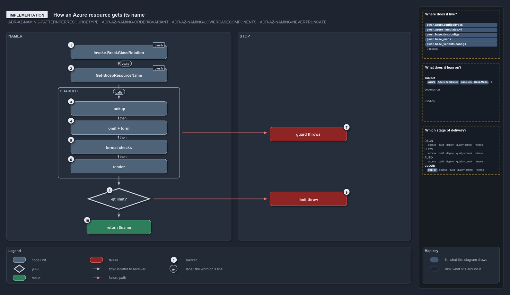

# How an Azure resource gets its name

```text
How an Azure resource gets its name.

1   Invoke-BreakGlassRotation  an in-tree caller, naming the sql server it rotates
2   Get-BicepResourceName  reads azure.yml, short_name, the customer and the order
3   lookup                 type, then order, then the type's pattern
4   omit + form            drops omitted components; picks the name or shortcode form
5   format checks          one case-sensitive -cnotmatch per component
6   render                 joins the non-empty segments with the pattern's separator
7   guard throws           seven throws across the four guarded steps
8   -gt limit?             compares the rendered name's length with the limit
9   limit throw            an over-limit name throws
10  return $name           a name within the limit is returned unchanged

Supports ADR-AZ-NAMING-PATTERNPERRESOURCETYPE, ADR-AZ-NAMING-ORDERISVARIANT, ADR-AZ-NAMING-LOWERCASECOMPONENTS
and ADR-AZ-NAMING-NEVERTRUNCATE (implementation lens).
```

`Get-AzureResourceName` is the one function that turns name components into an Azure name. It runs four steps in code order: it looks up the
type, the order and the pattern, forms the segment values, checks every component's format, and renders the name. Seven guard throws stop
bad input along the way, and one length check at the end either throws or returns the name. Knowing the order tells a reader which error a
given mistake produces.

```yml drawio
description:
  "Get-AzureResourceName runs four guarded steps in code order, lookup, omit and form, format checks and render, then compares the rendered
  length with the limit: any guard throws, an over-limit name throws, and a name within the limit is returned unchanged."
about:
  rules:
    [ADR-AZ-NAMING-PATTERNPERRESOURCETYPE, ADR-AZ-NAMING-ORDERISVARIANT, ADR-AZ-NAMING-LOWERCASECOMPONENTS, ADR-AZ-NAMING-NEVERTRUNCATE]
  lens: implementation
content:
  title: How an Azure resource gets its name
  kind: explanation
  flow: left-to-right
  theme: dark
  bands:
    - { id: band-namer, label: NAMER }
    - { id: band-stop, label: STOP }
  groups:
    - { id: grp-guarded, label: GUARDED, in: band-namer }
  glyphs:
    - { id: g-rotation, kind: code, label: Invoke-BreakGlassRotation, in: band-namer }
    - { id: g-resource-name, kind: code, label: Get-BicepResourceName, in: band-namer }
    - { id: g-lookup, kind: code, label: lookup, in: grp-guarded }
    - { id: g-form, kind: code, label: omit + form, in: grp-guarded }
    - { id: g-format, kind: code, label: format checks, in: grp-guarded }
    - { id: g-render, kind: code, label: render, in: grp-guarded }
    - { id: g-limit, kind: gate, label: "-gt limit?", in: band-namer }
    - { id: r-name, kind: result, label: return $name, in: band-namer }
    - { id: f-guard, kind: failure, label: guard throws, in: band-stop }
    - { id: f-limit, kind: failure, label: limit throw, in: band-stop }
  edges:
    - { from: g-rotation, to: g-resource-name, kind: flow, label: calls }
    - { from: g-resource-name, to: g-lookup, kind: flow, label: calls }
    - { from: g-lookup, to: g-form, kind: flow, label: then }
    - { from: g-form, to: g-format, kind: flow, label: then }
    - { from: g-format, to: g-render, kind: flow, label: then }
    - { from: g-render, to: g-limit, kind: flow, label: "" }
    - { from: g-limit, to: r-name, kind: flow, label: "" }
    - { from: grp-guarded, to: f-guard, kind: fail, label: "" }
    - { from: g-limit, to: f-limit, kind: fail, label: "" }
  markers:
    - { at: g-rotation, number: 1 }
    - { at: g-resource-name, number: 2 }
    - { at: g-lookup, number: 3 }
    - { at: g-form, number: 4 }
    - { at: g-format, number: 5 }
    - { at: g-render, number: 6 }
    - { at: f-guard, number: 7 }
    - { at: g-limit, number: 8 }
    - { at: f-limit, number: 9 }
    - { at: r-name, number: 10 }
  legend: auto
  minimaps: [code-locations, module-neighbourhood, axis]
layout:
  band-namer: { x: 20, y: 84, w: 700, h: 650 }
  band-stop: { x: 740, y: 84, w: 540, h: 650 }
  g-rotation: { x: 220, y: 124, w: 300, h: 44 }
  g-resource-name: { x: 220, y: 196, w: 300, h: 44 }
  grp-guarded: { x: 180, y: 256, w: 380, h: 284 }
  g-lookup: { x: 220, y: 300, w: 300, h: 44 }
  g-form: { x: 220, y: 360, w: 300, h: 44 }
  g-format: { x: 220, y: 420, w: 300, h: 44 }
  g-render: { x: 220, y: 480, w: 300, h: 44 }
  g-limit: { x: 270, y: 570, w: 200, h: 68 }
  r-name: { x: 270, y: 670, w: 200, h: 44 }
  f-guard: { x: 840, y: 380, w: 240, h: 44 }
  f-limit: { x: 840, y: 582, w: 240, h: 44 }
```



## Walkthrough

1. **Invoke-BreakGlassRotation.** It names the sql server it rotates with `Get-BicepResourceName -Type sql`, as
   `Set-AnomalyAlertRecipientSecret` names its vault with `-Type kv`. A resource group is never built here: the slot declares it under its
   top-level `ResourceGroup:` key (ADR-AZ-DATAMOD-DECLAREDGROUPNAME).
2. **Get-BicepResourceName.** It reads the environment's entry in `azure.yml` (its name, `shortcode` and `region_code`) and the repo-wide
   `org`, takes the template's `short_name`, resolves the customer through `Get-AzureCustomer` when `-Customer` is given, and sets `Order`
   from `Get-Naming`. Then it calls the namer.
3. **Lookup.** The namer looks up the type in `Get-AzureResourceTypeSet`, then the order in `Get-AzureNameOrderSet`, then the type's pattern
   in `Get-AzureNamePatternSet`.
4. **Omit and form.** The type's `omit` components are dropped. The `long` pattern takes the readable `-Env` and `-Customer`; the restricted
   `kv`, `storage` and `vm` patterns take the 2-char `-Shortcode` and `-CustomerShortcode`.
5. **Format checks.** One case-sensitive `-cnotmatch` per component holds every value to its lowercase format.
6. **Render.** The non-empty segments are joined with the pattern's separator, in the order's sequence. The limit is the pattern's own
   `limit`, or else the type's.
7. **Guard throws.** Seven throw statements across the four guarded steps: an unknown resource type, an unknown name order, an unknown name
   pattern, a missing `-Shortcode`, a missing `-CustomerShortcode`, an invalid component, and a type with no length limit.
8. **The limit check.** The length check compares the rendered name's length with the limit (`-gt`).
9. **Limit throw.** An over-limit name throws, for example
   `Resource name 'gm-001-weu-abc-discw-ac-hot-kv' (30 chars) exceeds the 'kv' limit of 24 — shorten short_name / slot / customer / role.`
10. **Return the name.** A name within the limit is returned unchanged.

Every function here lives in `Catzc.Azure.Templates`, except `Get-AzureCustomer` (`Catzc.Azure`) and `Get-Naming` (`Catzc.Base.Variants`).
The pattern caps are 24 for `kv` and `storage` and 15 for `vm`; each `long` type carries its own limit, such as 90 for `rg`, 64 for `vnet`
and 63 for `sql`.

## Why it holds

- Each resource type ties to one pattern, which fixes the separator, the length budget and the form of the environment and customer segments
  (ADR-AZ-NAMING-PATTERNPERRESOURCETYPE).
- The component order is the `naming` repo variant, handed to the namer as data, never chosen per name (ADR-AZ-NAMING-ORDERISVARIANT).
- Every component is lowercase and validated case-sensitively (ADR-AZ-NAMING-LOWERCASECOMPONENTS).
- A name is never truncated to fit; the namer throws at deploy time instead (ADR-AZ-NAMING-NEVERTRUNCATE).

## See also

- [Azure resource naming standard](../../drs/azure/azure-naming-standard.md) — the decision this article explains.
- The other lenses on the same naming standard: [meta](what-an-azure-name-is-made-from.md),
  [architecture](which-code-builds-azure-names.md), [operations](where-an-azure-name-comes-from.md) and
  [governance](how-the-azure-naming-rules-are-enforced.md).
- [The azure explanations](index.md) · [How to read the diagrams](../index.md#how-to-read-the-diagrams)
