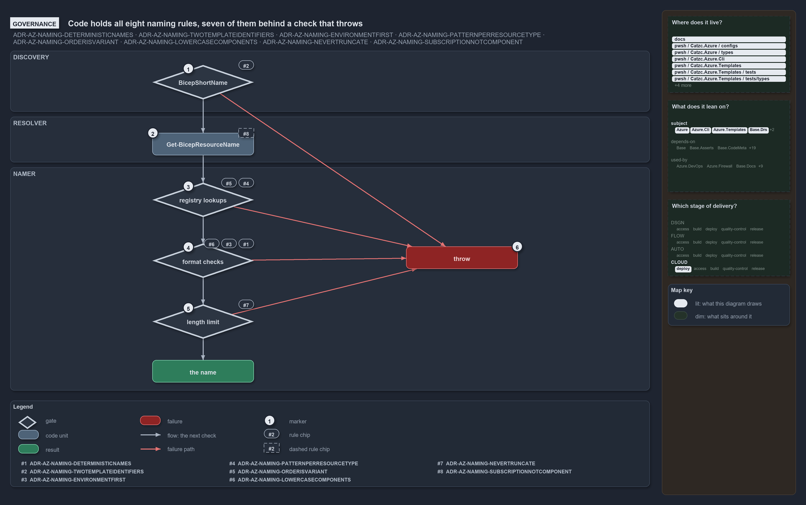

# Code holds all eight naming rules, seven of them behind a check that throws

```text
All eight naming rules are held in code; seven behind a check that throws, one by construction.

1  BicepShortName         #2: throws at discovery on a malformed or missing short_name
2  Get-BicepResourceName  #8: never reads a subscription; held by construction, no check
3  registry lookups       #4 #5: type, order and pattern; throws on any it does not know
4  format checks          #1 #3 #6: every component matched case-sensitively
5  length limit           #7: throws on every over-limit render; never truncates
6  throw                  every check ends here; nothing is truncated or repaired

Supports ADR-AZ-NAMING-DETERMINISTICNAMES, ADR-AZ-NAMING-TWOTEMPLATEIDENTIFIERS, ADR-AZ-NAMING-ENVIRONMENTFIRST, ADR-AZ-NAMING-PATTERNPERRESOURCETYPE, ADR-AZ-NAMING-ORDERISVARIANT, ADR-AZ-NAMING-LOWERCASECOMPONENTS, ADR-AZ-NAMING-NEVERTRUNCATE and ADR-AZ-NAMING-SUBSCRIPTIONNOTCOMPONENT (governance lens).
```

The Azure naming standard has eight rules, and cats holds every one of them in code. Seven sit behind a check that throws: one at template
discovery, the rest inside the namer, in the order a name is built. The eighth, that the subscription never enters a name, holds by
construction in the resolver, with no check and no dedicated test. Four comment or message texts still disagree with the ADR.



## Walkthrough

1. **BicepShortName.** When `Get-BicepTemplates` discovers the templates, `BicepShortName` throws on a malformed `short_name` override, or
   on a folder name that cannot derive a valid one. It has its own L0 tests. Uniqueness is held three times: discovery throws on a
   duplicate, `Assert-BicepTemplate` reports one, and the integrity test fails on one. The integrity test's message still says that
   `options.yml` must declare a `short_name`, although the rule makes `options.yml` optional; the test itself checks only the resolved
   value.
2. **Get-BicepResourceName.** The resolver reads only the environment's identity from `azure.yml` and never a subscription, so no
   subscription can reach a name. Nothing checks this and no test asserts it: it holds because the code is built that way. The resolver
   throws on an unknown customer.
3. **Registry lookups.** The namer first looks up the resource type, then the order, then the type's pattern, and throws on any it does not
   know. L0 tests pin the `standard` and `classic` orders and the four patterns, and check that every type ties to a known pattern. The
   order is fixed once per importer session by the `ado_naming` variant.
4. **Format checks.** Every component is matched case-sensitively against its format, and the namer throws on the first that fails. Just
   before, it throws when a restricted pattern lacks the 2-char environment or customer shortcode. The L0 content cases hold 12 rejects,
   seven of them format rejects.
5. **Length limit.** The namer throws on every render that exceeds the type's limit, and an L0 test overflows the `kv` limit to prove it. A
   name that passes every check is returned. The message always names the same four components to shorten, instead of the ones that actually
   overflowed.
6. **Throw.** Every check ends in a throw that stops discovery or the deploy. Nothing is truncated or repaired along the way.

## Why it holds

- Every name is assembled deterministically from one canonical component set (ADR-AZ-NAMING-DETERMINISTICNAMES).
- Each template has a readable folder name and a 2–5 char `short_name`, derived from the folder and optionally overridden in `options.yml`
  (ADR-AZ-NAMING-TWOTEMPLATEIDENTIFIERS).
- The environment comes first, and environment and customer take their 2-char shortcode in the restricted patterns
  (ADR-AZ-NAMING-ENVIRONMENTFIRST).
- Each resource type ties to one pattern, which fixes the separator, the length budget and the segment forms
  (ADR-AZ-NAMING-PATTERNPERRESOURCETYPE).
- The component order is the `ado_naming` repo variant, never a per-name argument (ADR-AZ-NAMING-ORDERISVARIANT).
- All components are lowercase, validated case-sensitively, and most must start with a letter (ADR-AZ-NAMING-LOWERCASECOMPONENTS).
- A name is never truncated to fit; the namer throws instead (ADR-AZ-NAMING-NEVERTRUNCATE).
- The subscription is a resolution axis only and never a name component (ADR-AZ-NAMING-SUBSCRIPTIONNOTCOMPONENT).

## See also

- [Azure resource naming standard](../../drs/azure/azure-naming-standard.md) — the decision this article explains.
- The other lenses on the same naming standard: [meta](names-are-pure-and-never-truncated.md),
  [architecture](one-namer-assembles-every-name.md), [implementation](lookup-form-check-render-in-order.md) and
  [operations](names-are-derived-never-typed.md).
- [The azure explanations](index.md) · [How to read the diagrams](../index.md#how-to-read-the-diagrams)
