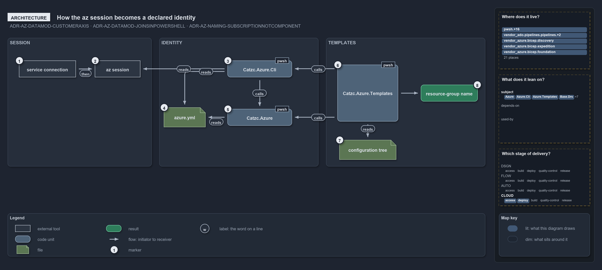

# How the az session becomes a declared identity

```text
How the az session becomes a declared identity.

1  service connection     the Azure DevOps login a pipeline deploy runs under
2  az session             the az CLI's active subscription
3  Catzc.Azure.Cli        Get-AzCliSessionSubscription: the session's id resolved to its azure.yml identity
4  azure.yml              the identity layer: tenants, customers, environments and subscriptions
5  Catzc.Azure            the identity joins: Get-AzureSubscription, Get-AzureEnvironment and the namer
6  Catzc.Azure.Templates  Get-BicepDeploymentContext and Deploy-Bicep: the deploy surface
7  configuration tree     configuration/[<customer>/]<env>[-<slot>].yml, one file per slot
8  resource-group name    declared by the slot the env, the slot and the session's customer select

Supports ADR-AZ-DATAMOD-CUSTOMERAXIS and ADR-AZ-DATAMOD-JOINSINPOWERSHELL, and ADR-AZ-NAMING-SUBSCRIPTIONNOTCOMPONENT (architecture lens).
```

Cats keeps Azure identity in one file, `azure.yml`, and the deploy target in one place, the az session. The two meet in a single reverse
lookup: `Catzc.Azure.Cli` resolves the session's subscription id to the identity the file declares, and every module further along reads
that identity instead of asking the session again. The templating module picks the configuration slot from it, the Azure root module checks
it against the environment, and the slot it selects declares the resource-group name.

```yml drawio
description:
  One reverse lookup in Catzc.Azure.Cli turns the az session's subscription id into the identity azure.yml declares, and the identity module
  and the templating module read that identity instead of asking the session again.
about:
  rules: [ADR-AZ-DATAMOD-CUSTOMERAXIS, ADR-AZ-DATAMOD-JOINSINPOWERSHELL, ADR-AZ-NAMING-SUBSCRIPTIONNOTCOMPONENT]
  lens: architecture
content:
  title: How the az session becomes a declared identity
  kind: explanation
  flow: left-to-right
  theme: dark
  bands:
    - { id: band-session, label: SESSION }
    - { id: band-identity, label: IDENTITY }
    - { id: band-templates, label: TEMPLATES }
  glyphs:
    - { id: x-connection, kind: external, label: service connection, in: band-session }
    - { id: x-session, kind: external, label: az session, in: band-session }
    - { id: g-cli, kind: code, label: Catzc.Azure.Cli, in: band-identity }
    - { id: g-azure-file, kind: file, label: azure.yml, in: band-identity }
    - { id: g-azure, kind: code, label: Catzc.Azure, in: band-identity }
    - { id: g-templates, kind: code, label: Catzc.Azure.Templates, in: band-templates }
    - { id: g-tree, kind: file, label: configuration tree, in: band-templates }
    - { id: r-group, kind: result, label: resource-group name, in: band-templates }
  edges:
    - { from: x-connection, to: x-session, kind: flow, label: then }
    - { from: g-cli, to: x-session, kind: flow, label: "" }
    - { from: g-cli, to: g-azure-file, kind: flow, label: reads }
    - { from: g-cli, to: g-azure, kind: flow, label: calls }
    - { from: g-azure, to: g-azure-file, kind: flow, label: reads }
    - { from: g-templates, to: g-cli, kind: flow, label: calls }
    - { from: g-templates, to: g-azure, kind: flow, label: calls }
    - { from: g-templates, to: g-tree, kind: flow, label: reads }
    - { from: g-templates, to: r-group, kind: flow, label: "" }
  markers:
    - { at: x-connection, number: 1 }
    - { at: x-session, number: 2 }
    - { at: g-cli, number: 3 }
    - { at: g-azure-file, number: 4 }
    - { at: g-azure, number: 5 }
    - { at: g-templates, number: 6 }
    - { at: g-tree, number: 7 }
    - { at: r-group, number: 8 }
  legend: auto
  minimaps: [code-locations, module-neighbourhood, axis]
layout:
  band-session: { x: 20, y: 84, w: 380, h: 340 }
  band-identity: { x: 420, y: 84, w: 420, h: 340 }
  band-templates: { x: 860, y: 84, w: 420, h: 340 }
  x-connection: { x: 50, y: 144, w: 150, h: 44 }
  x-session: { x: 250, y: 144, w: 120, h: 44 }
  g-cli: { x: 600, y: 144, w: 170, h: 44 }
  g-azure-file: { x: 432, y: 268, w: 110, h: 52 }
  g-azure: { x: 600, y: 272, w: 170, h: 44 }
  g-templates: { x: 890, y: 155, w: 160, h: 150 }
  g-tree: { x: 895, y: 354, w: 150, h: 52 }
  r-group: { x: 1110, y: 208, w: 150, h: 44 }
```



The arrows point at what each part depends on. `Catzc.Azure.Cli` reads the az session and `azure.yml` and calls `Catzc.Azure`;
`Catzc.Azure.Templates` calls both modules and reads the configuration tree; a config file never acts, the code that reads it does.

## Walkthrough

1. **Service connection.** A pipeline deploy runs inside an `AzureCLI@2` task whose `azureSubscription` is the service connection. Logging
   in is the only thing it does for the target: the subscription it signs into becomes the session.
2. **Az session.** The az CLI's active subscription, read with `az account show`. On a devbox `az account set` chooses it; in a pipeline the
   service connection has already chosen it.
3. **Catzc.Azure.Cli.** `Get-AzCliSessionSubscription` takes the session's subscription id and finds the one `azure.yml` subscription with
   that id. It returns the declared identity, `{ name, id, customer, tenant }`, and throws when no declared subscription carries the id. It
   is read-only: it never logs in or switches context.
4. **azure.yml.** The config layer for identity: tenants, customers, environments and subscriptions, each a map keyed by name. A
   subscription declares its tenant, the environments it serves and, optionally, its customer. The file is read through
   `Get-Config -Config azure`.
5. **Catzc.Azure.** The root Azure module holds the joins over `azure.yml`: `Get-AzureSubscription` resolves a named subscription with its
   tenant and customer, `Get-AzureEnvironment` asserts that a subscription serves an environment, and `Get-AzureResourceName` assembles
   every name. `Catzc.Azure.Cli` depends on it, and it depends on Base alone.
6. **Catzc.Azure.Templates.** The deploy surface. `Get-BicepDeploymentContext` composes the plan, the artifacts and the identity from the
   session's subscription, and `Deploy-Bicep` reads that one resolved identity off the context so config, artifacts and tags all agree. The
   module depends on `Catzc.Azure.Cli` for the session and on `Catzc.Azure` for the joins.
7. **Configuration tree.** A template's configs live at `configuration/[<customer>/]<env>[-<slot>].yml`, one file per slot. The session's
   customer decides whether the deploy reads the customer's subfolder or the configuration root; the environment and the slot are the
   deploy's own arguments.
8. **Resource-group name.** The slot the session's customer, the environment and the slot select declares it under its top-level
   `ResourceGroup:` key (ADR-AZ-DATAMOD-DECLAREDGROUPNAME). The subscription is a resolution axis only and never a name component.

## Why it holds

- The joins between the two layers live in PowerShell and resolve on demand; the deploy-time subscription is the az session's,
  reverse-resolved against `azure.yml` by `Get-AzCliSessionSubscription` (ADR-AZ-DATAMOD-JOINSINPOWERSHELL).
- Customer is a configuration axis, the subfolder, and at deploy time it is derived from the session subscription, never a deploy argument;
  it addresses the customer's config and renders into the names (ADR-AZ-DATAMOD-CUSTOMERAXIS).
- The subscription is never a name component; the customer that renders is derived from it (ADR-AZ-NAMING-SUBSCRIPTIONNOTCOMPONENT).

## See also

- [Templating data model](../../drs/azure/azure-data-model.md) — the decision this article explains.
- [Azure resource naming standard](../../drs/azure/azure-naming-standard.md) — why the subscription never enters a name.
- The other lenses on the same deploy target: [meta](what-the-azure-deploy-target-is.md),
  [implementation](how-a-bicep-deployment-context-is-built.md), [operations](how-a-deploy-target-is-chosen.md) and
  [governance](what-holds-the-azure-session-rule.md).
- [The azure explanations](index.md) · [How to read the diagrams](../index.md#how-to-read-the-diagrams)
