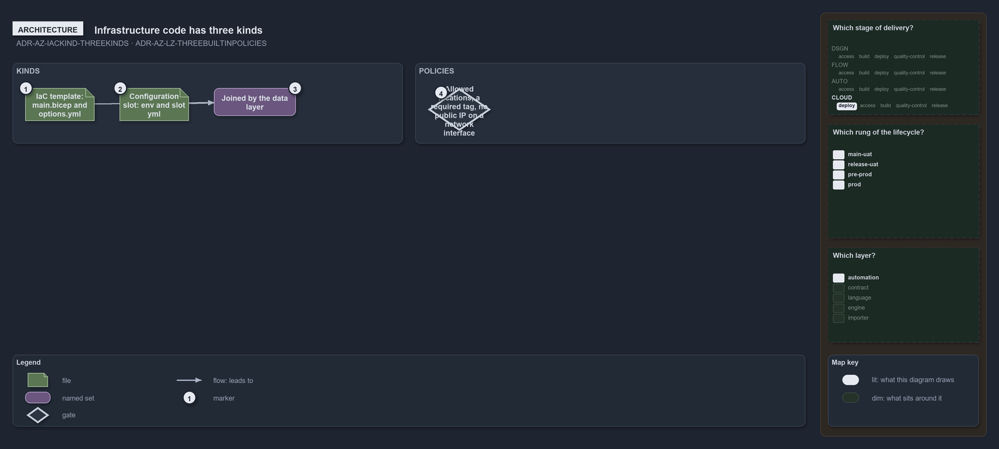

---
catzc:
  warning: "Experimental: this article merges two rules into one and holds nothing beyond what they say"
  edges:
    cites:
      - ADR-AZ-IACKIND-THREEKINDS
      - ADR-AZ-LZ-THREEBUILTINPOLICIES
---

# Infrastructure code has three kinds and each landing zone assigns three built in policies

This article is one rule: [ADR-AZ-IACKIND-THREEKINDS](../../drs/azure/infrastructure-kinds.md#rule-adr-az-iackind-threekinds) and
[ADR-AZ-LZ-THREEBUILTINPOLICIES](../../drs/azure/landing-zones.md#rule-adr-az-lz-threebuiltinpolicies) merged into one. It holds nothing
beyond what those two rules say.

The infrastructure code has three kinds: IaC templates, a folder holding a deployable `main.bicep` and its `options.yml`, their
configuration slots, the `<env>[-<slot>].yml` files under each template's configuration folder, and the layer that joins them. Every landing
zone assigns three built-in policies: allowed locations, a required tag on resources, and no public IP address on a network interface,
enforcing or only auditing by the repository-wide `policy_enforcement` setting.

