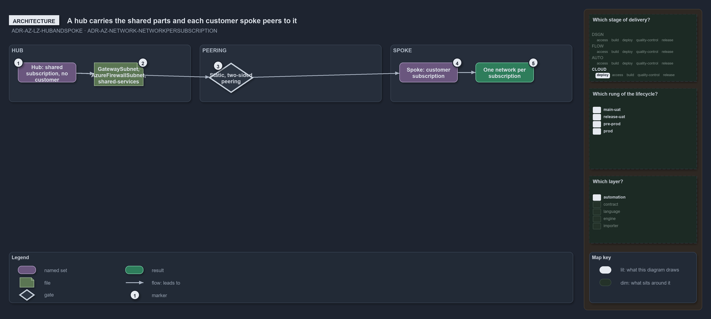

---
catzc:
  warning: "Experimental: this article merges two rules into one and holds nothing beyond what they say"
  edges:
    cites:
      - ADR-AZ-LZ-HUBANDSPOKE
      - ADR-AZ-NETWORK-NETWORKPERSUBSCRIPTION
---

# Landing zones form a hub and spoke network with one network per subscription

This article is one rule: [ADR-AZ-LZ-HUBANDSPOKE](../../drs/azure/landing-zones.md#rule-adr-az-lz-hubandspoke) and
[ADR-AZ-NETWORK-NETWORKPERSUBSCRIPTION](../../drs/azure/azure-network-model.md#rule-adr-az-network-networkpersubscription) merged into one.
It holds nothing beyond what those two rules say.

The landing zones form a hub-and-spoke network. A hub is the landing zone of a shared subscription and a spoke is the landing zone of a
customer subscription, peered to the hub of its tier; peering is static and two-sided, a spoke's config naming its hub and a hub's config
listing its spokes. Every `azure.yml` subscription has one network in the plan's `subscriptions` block, a hub when it has no `customer` and
a spoke when it has one.

