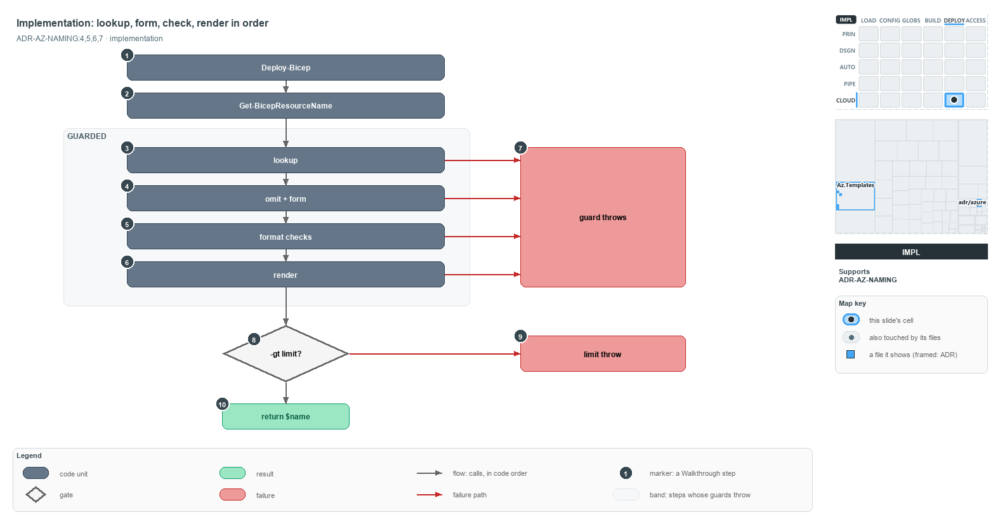

---
catzc:
  derived:
    path: docs/explanation/azure/lookup-form-check-render-in-order.md
    kind: explanation
    language: markdown
    track: docs
    body_sha: cd0312dc18af
    adrs:
      - ADR-AZ-NAMING#{4-7}
    links:
      - docs/.assets/explanation/adr-az-naming--lookup-form-check-render-in-order--implementation.drawio.md
      - docs/.assets/explanation/adr-az-naming--lookup-form-check-render-in-order--implementation.drawio.png
      - docs/adr/azure/azure-naming-standard.md
      - docs/explanation/azure/how-each-naming-rule-is-held.md
      - docs/explanation/azure/index.md
      - docs/explanation/azure/names-are-derived-never-typed.md
      - docs/explanation/azure/names-are-pure-and-never-truncated.md
      - docs/explanation/azure/one-namer-assembles-every-name.md
      - docs/explanation/index.md#how-to-read-the-diagrams
---

# The namer looks up, forms, checks and renders a name in that order

```text
Get-AzureResourceName looks up, forms, checks and renders, then throws or returns.

1   Deploy-Bicep           the in-tree caller, through the resource-group name
2   Get-BicepResourceName  reads azure.yml, short_name, the customer and the order
3   lookup                 type, then order, then the type's pattern
4   omit + form            drops omitted components; picks the name or shortcode form
5   format checks          one case-sensitive -cnotmatch per component
6   render                 joins the non-empty segments with the pattern's separator
7   guard throws           seven throws across the four guarded steps
8   -gt limit?             compares the rendered name's length with the limit
9   limit throw            an over-limit name throws
10  return $name           a name within the limit is returned unchanged

Supports ADR-AZ-NAMING#4, #5, #6 and #7 (implementation lens).
```

`Get-AzureResourceName` is the one function that turns name components into an Azure name. It runs four steps in code order: it looks up the
type, the order and the pattern, forms the segment values, checks every component's format, and renders the name. Seven guard throws stop
bad input along the way, and one length check at the end either throws or returns the name. Knowing the order tells a reader which error a
given mistake produces.



The diagram is described element by element in
[its asset description](../../.assets/explanation/adr-az-naming--lookup-form-check-render-in-order--implementation.drawio.md).

## Walkthrough

1. **Deploy-Bicep.** The in-tree caller. It calls `Get-BicepDeploymentContext`, which for a resource-group template calls the private
   `Get-BicepResourceGroupName`, which in turn calls `Get-BicepResourceName -Type rg`.
2. **Get-BicepResourceName.** It reads the environment's entry in `azure.yml` (its name, `shortcode` and `region_code`) and the repo-wide
   `org`, takes the template's `short_name`, resolves the customer through `Get-AzureCustomer` when `-Customer` is given, and sets `Order`
   from `Get-AdoNaming`. Then it calls the namer.
3. **Lookup.** The namer looks up the type in `Get-AzureResourceTypeSet`, then the order in `Get-AzureNameOrderSet`, then the type's pattern
   in `Get-AzureNamePatternSet`.
4. **Omit and form.** The type's `omit` components are dropped. The `long` pattern takes the readable `-Env` and `-Customer`; the restricted
   `kv`, `storage` and `vm` patterns take the 2-char `-Shortcode` and `-CustomerShortcode`.
5. **Format checks.** One case-sensitive `-cnotmatch` per component holds every value to its lowercase format.
6. **Render.** The non-empty segments are joined with the pattern's separator, in the order's sequence. The limit is the pattern's own
   `limit`, or else the type's.
7. **Guard throws.** Seven throw statements across the four guarded steps: an unknown resource type, an unknown name order, an unknown name
   pattern, a missing `-Shortcode`, a missing `-CustomerShortcode`, an invalid component, and a type with no length limit.
8. **The limit check.** The length check compares the rendered name's length with the limit (`-gt`).
9. **Limit throw.** An over-limit name throws, for example
   `Resource name 'gm-001-weu-abc-discw-ac-hot-kv' (30 chars) exceeds the 'kv' limit of 24 — shorten short_name / slot / customer / role.`
10. **Return the name.** A name within the limit is returned unchanged.

Every function here lives in `Catzc.Azure.Templates`, except `Get-AzureCustomer` (`Catzc.Azure`) and `Get-AdoNaming`
(`Catzc.Base.Variants`). The pattern caps are 24 for `kv` and `storage` and 15 for `vm`; each `long` type carries its own limit, such as 90
for `rg`, 64 for `vnet` and 63 for `sql`.

## Why it holds

- Each resource type ties to one pattern, which fixes the separator, the length budget and the form of the environment and customer segments
  (ADR-AZ-NAMING#4).
- The component order is the `ado_naming` repo variant, handed to the namer as data, never chosen per name (ADR-AZ-NAMING#5).
- Every component is lowercase and validated case-sensitively (ADR-AZ-NAMING#6).
- A name is never truncated to fit; the namer throws at deploy time instead (ADR-AZ-NAMING#7).

## Where the code and the ADR differ

The ADR says the limit throw names which components to shorten; the code always lists the same four, `short_name`, slot, customer and role,
and the namer's help text repeats the ADR's wording.

## See also

- [Azure resource naming standard](../../adr/azure/azure-naming-standard.md) — the decision this article explains.
- The other lenses on the same naming standard: [meta](names-are-pure-and-never-truncated.md),
  [architecture](one-namer-assembles-every-name.md), [operations](names-are-derived-never-typed.md) and
  [governance](how-each-naming-rule-is-held.md).
- [The azure explanations](index.md) · [How to read the diagrams](../index.md#how-to-read-the-diagrams)
