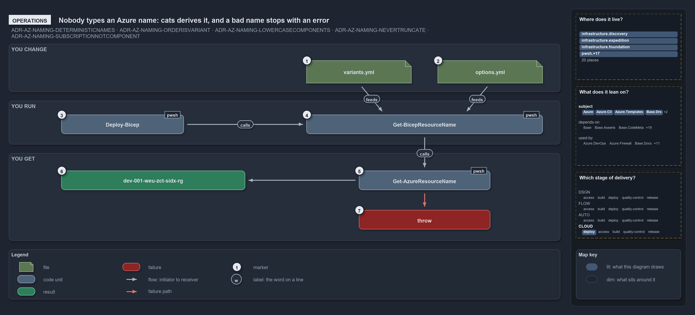

# Nobody types an Azure name: cats derives it, and a bad name stops with an error

```text
An operator changes settings and runs a command; cats derives the name or stops with an error.

1  variants.yml             the ado_naming variant: the component order for every name
2  options.yml              an optional short_name: the setting to shorten or pin
3  Deploy-Bicep             deploys, deriving the resource-group name it targets
4  Get-BicepResourceName    prints a name without deploying anything
5  Get-AzureResourceName    the namer; nobody calls it directly in this flow
6  dev-001-weu-zct-sidx-rg  the name that passes: printed, or the deploy's resource group
7  throw                    an error to act on: fix a setting and rerun

Supports ADR-AZ-NAMING-DETERMINISTICNAMES, ADR-AZ-NAMING-ORDERISVARIANT, ADR-AZ-NAMING-LOWERCASECOMPONENTS, ADR-AZ-NAMING-NEVERTRUNCATE and ADR-AZ-NAMING-SUBSCRIPTIONNOTCOMPONENT (operations lens).
```

An Azure resource name in cats is never typed by an operator. A person runs a deploy or asks for a name, and the naming standard derives it
from settings the repository already holds. A bad or over-long name stops with an error that says what is wrong, and the fix is always a
setting, never a hand-typed or truncated name.

```yml drawio
description:
  An operator changes the naming variant or a template's short name and runs a deploy or asks for a name; cats derives the name or stops
  with an error to act on, and nobody types a name.
about:
  adrs:
    - ADR-AZ-NAMING-DETERMINISTICNAMES
    - ADR-AZ-NAMING-ORDERISVARIANT
    - ADR-AZ-NAMING-LOWERCASECOMPONENTS
    - ADR-AZ-NAMING-NEVERTRUNCATE
    - ADR-AZ-NAMING-SUBSCRIPTIONNOTCOMPONENT
  lens: operations
content:
  title: "Nobody types an Azure name: cats derives it, and a bad name stops with an error"
  kind: explanation
  flow: left-to-right
  theme: dark
  bands:
    - { id: band-change, label: YOU CHANGE }
    - { id: band-run, label: YOU RUN }
    - { id: band-get, label: YOU GET }
  glyphs:
    - { id: g-variants, kind: file, label: variants.yml, in: band-change }
    - { id: g-options, kind: file, label: options.yml, in: band-change }
    - { id: g-deploy, kind: code, label: Deploy-Bicep, in: band-run }
    - { id: g-resource-name, kind: code, label: Get-BicepResourceName, in: band-run }
    - { id: g-namer, kind: code, label: Get-AzureResourceName, in: band-get }
    - { id: r-name, kind: result, label: dev-001-weu-zct-sidx-rg, in: band-get }
    - { id: f-throw, kind: failure, label: throw, in: band-get }
  edges:
    - { from: g-variants, to: g-resource-name, kind: flow, label: feeds }
    - { from: g-options, to: g-resource-name, kind: flow, label: feeds }
    - { from: g-deploy, to: g-resource-name, kind: flow, label: calls }
    - { from: g-resource-name, to: g-namer, kind: flow, label: calls }
    - { from: g-namer, to: r-name, kind: flow, label: "" }
    - { from: g-namer, to: f-throw, kind: fail, label: "" }
  markers:
    - { at: g-variants, number: 1 }
    - { at: g-options, number: 2 }
    - { at: g-deploy, number: 3 }
    - { at: g-resource-name, number: 4 }
    - { at: g-namer, number: 5 }
    - { at: r-name, number: 6 }
    - { at: f-throw, number: 7 }
  legend: auto
  minimaps: [code-locations, module-neighbourhood, axis]
layout:
  band-change: { x: 20, y: 84, w: 1260, h: 110 }
  band-run: { x: 20, y: 214, w: 1260, h: 100 }
  band-get: { x: 20, y: 334, w: 1260, h: 200 }
  g-variants: { x: 700, y: 122, w: 240, h: 52 }
  g-options: { x: 1000, y: 122, w: 240, h: 52 }
  g-deploy: { x: 140, y: 246, w: 280, h: 44 }
  g-resource-name: { x: 700, y: 246, w: 540, h: 44 }
  g-namer: { x: 820, y: 374, w: 300, h: 44 }
  r-name: { x: 140, y: 374, w: 420, h: 44 }
  f-throw: { x: 820, y: 464, w: 300, h: 44 }
```



## Walkthrough

1. **variants.yml.** Its `ado_naming` variant picks the component order for every name, `standard` by default. Changing it re-spells every
   derived name, so it is deliberately not a flip-the-switch option.
2. **options.yml.** A template's optional `options.yml` can set an explicit `short_name`. That is the setting to shorten when a name runs
   over its limit, and the way to pin a template's Azure identity against a folder rename.
3. **Deploy-Bicep.** `Deploy-Bicep -Environment -Template [-Slot]` derives the resource-group name it deploys to. The customer comes from
   the az session's subscription, not from an argument, and in a pipeline the command also needs `-SubscriptionIdAssertIs`.
4. **Get-BicepResourceName.** `Get-BicepResourceName <template> <env> <type> [-Slot] [-Customer] [-Role]` prints a name without deploying
   anything. It tab-completes templates, environments, types, slots and customers.
5. **Get-AzureResourceName.** The namer applies the naming standard. Nobody calls it directly in this flow, and the same inputs always give
   the same name.
6. **dev-001-weu-zct-sidx-rg.** The name that passes: printed, or used as the deploy's resource group. It comes from
   `Get-BicepResourceName -Template sample-indexed -Environment dev -Slot 001 -Type rg`.
7. **Throw.** An error to act on, such as `Invalid Org 'X' — must be 2-3 alphanumeric, leading letter, lowercase.`,
   `Unknown customer 'X' — not a customer key or shortcode in customer.yml …`, or
   `Resource name '…' (30 chars) exceeds the 'kv' limit of 24 — shorten short_name / slot / customer / role.` The fix is to shorten and
   rerun: set a shorter `short_name` in `options.yml`, or pass a shorter `-Slot` or `-Role`.

## Why it holds

- Every name is assembled deterministically from one canonical component set, so nobody types one (ADR-AZ-NAMING-DETERMINISTICNAMES).
- The component order is the `ado_naming` repo variant, and changing it re-spells every derived name (ADR-AZ-NAMING-ORDERISVARIANT).
- Components are lowercase and validated case-sensitively, so a malformed value stops the run (ADR-AZ-NAMING-LOWERCASECOMPONENTS).
- A name is never truncated to fit; the namer throws at deploy time instead (ADR-AZ-NAMING-NEVERTRUNCATE).
- The subscription picks the deploy target and the customer, never a name segment (ADR-AZ-NAMING-SUBSCRIPTIONNOTCOMPONENT).

An external name collision on a globally unique type also fails the deploy. That is Azure's behaviour, which the ADR states: the fix is the
same, adjust the slot or the `short_name`, and there is no automatic hash.

## See also

- [Azure resource naming standard](../../drs/azure/azure-naming-standard.md) — the decision this article explains.
- The other lenses on the same naming standard: [meta](names-are-pure-and-never-truncated.md),
  [architecture](one-namer-assembles-every-name.md), [implementation](lookup-form-check-render-in-order.md) and
  [governance](how-each-naming-rule-is-held.md).
- [The azure explanations](index.md) · [How to read the diagrams](../index.md#how-to-read-the-diagrams)
