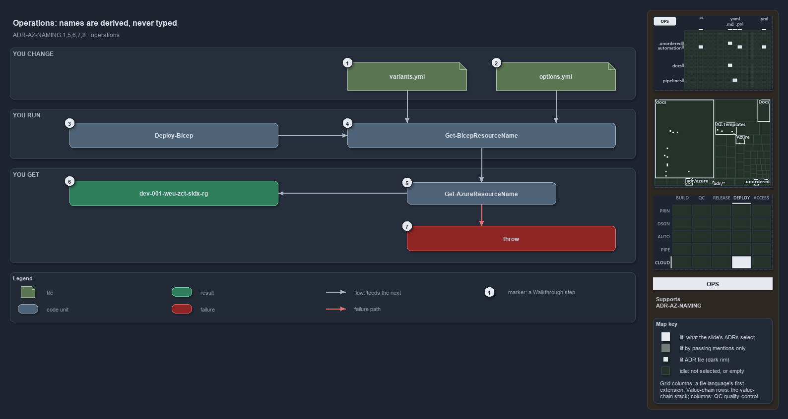

---
catzc:
  immutable:
    with_body_sha: f226abbc9486
    repo_status: clean
    path: docs/explanation/azure/names-are-derived-never-typed.md
    folder: docs/explanation/azure
    name: names-are-derived-never-typed
    filetype: md
    kind: explanation
    language: markdown
    track: docs
    tracktype: documentation
  edges:
    cites:
      - ADR-AZ-NAMING#{1,5-8}
    links:
      - docs/adr/azure/azure-naming-standard.md
      - docs/explanation/.assets/adr-az-naming--names-are-derived-never-typed--operations.drawio.png
      - docs/explanation/azure/how-each-naming-rule-is-held.md
      - docs/explanation/azure/index.md
      - docs/explanation/azure/lookup-form-check-render-in-order.md
      - docs/explanation/azure/names-are-derived-never-typed.drawio.md
      - docs/explanation/azure/names-are-pure-and-never-truncated.md
      - docs/explanation/azure/one-namer-assembles-every-name.md
      - docs/explanation/index.md#how-to-read-the-diagrams
---

# Nobody types an Azure name: cats derives it, and a bad name stops with an error

```text
An operator changes settings and runs a command; cats derives the name or stops with an error.

1  variants.yml             the ado_naming variant: the component order for every name
2  options.yml              an optional short_name: the setting to shorten or pin
3  Deploy-Bicep             deploys, deriving the resource-group name it targets
4  Get-BicepResourceName    prints a name without deploying anything
5  Get-AzureResourceName    the namer; nobody calls it directly in this flow
6  dev-001-weu-zct-sidx-rg  the name that passes: printed, or the deploy's resource group
7  throw                    an error to act on: fix a setting and rerun

Supports ADR-AZ-NAMING#1, #5, #6, #7 and #8 (operations lens).
```

An Azure resource name in cats is never typed by an operator. A person runs a deploy or asks for a name, and the naming standard derives it
from settings the repository already holds. A bad or over-long name stops with an error that says what is wrong, and the fix is always a
setting, never a hand-typed or truncated name.



The diagram is described element by element in [its asset description](names-are-derived-never-typed.drawio.md).

## Walkthrough

1. **variants.yml.** Its `ado_naming` variant picks the component order for every name, `standard` by default. Changing it re-spells every
   derived name, so it is deliberately not a flip-the-switch option.
2. **options.yml.** A template's optional `options.yml` can set an explicit `short_name`. That is the setting to shorten when a name runs
   over its limit, and the way to pin a template's Azure identity against a folder rename.
3. **Deploy-Bicep.** `Deploy-Bicep -Environment -Template [-Slot]` derives the resource-group name it deploys to. The customer comes from
   the az session's subscription, not from an argument, and in a pipeline the command also needs `-SubscriptionIdAssertIs`.
4. **Get-BicepResourceName.** `Get-BicepResourceName <template> <env> <type> [-Slot] [-Customer] [-Role]` prints a name without deploying
   anything. It tab-completes templates, environments, types, slots and customers.
5. **Get-AzureResourceName.** The namer applies the naming standard. Nobody calls it directly in this flow, and the same inputs always give
   the same name.
6. **dev-001-weu-zct-sidx-rg.** The name that passes: printed, or used as the deploy's resource group. It comes from
   `Get-BicepResourceName -Template sample-indexed -Environment dev -Slot 001 -Type rg`.
7. **Throw.** An error to act on, such as `Invalid Org 'X' — must be 2-3 alphanumeric, leading letter, lowercase.`,
   `Unknown customer 'X' — not a customer key or shortcode in customer.yml …`, or
   `Resource name '…' (30 chars) exceeds the 'kv' limit of 24 — shorten short_name / slot / customer / role.` The fix is to shorten and
   rerun: set a shorter `short_name` in `options.yml`, or pass a shorter `-Slot` or `-Role`.

## Why it holds

- Every name is assembled deterministically from one canonical component set, so nobody types one (ADR-AZ-NAMING#1).
- The component order is the `ado_naming` repo variant, and changing it re-spells every derived name (ADR-AZ-NAMING#5).
- Components are lowercase and validated case-sensitively, so a malformed value stops the run (ADR-AZ-NAMING#6).
- A name is never truncated to fit; the namer throws at deploy time instead (ADR-AZ-NAMING#7).
- The subscription picks the deploy target and the customer, never a name segment (ADR-AZ-NAMING#8).

An external name collision on a globally unique type also fails the deploy. That is Azure's behaviour, which the ADR states: the fix is the
same, adjust the slot or the `short_name`, and there is no automatic hash.

## Where the code and the ADR differ

- The ADR says the limit throw names which components to shorten; the code always lists the same four.
- The help text of `Get-AdoNaming` says resource names are typed into each slot config and that a build-time check flags a mismatch, which
  contradicts "derived, never typed": no in-tree caller compares configured names.

## See also

- [Azure resource naming standard](../../adr/azure/azure-naming-standard.md) — the decision this article explains.
- The other lenses on the same naming standard: [meta](names-are-pure-and-never-truncated.md),
  [architecture](one-namer-assembles-every-name.md), [implementation](lookup-form-check-render-in-order.md) and
  [governance](how-each-naming-rule-is-held.md).
- [The azure explanations](index.md) · [How to read the diagrams](../index.md#how-to-read-the-diagrams)
