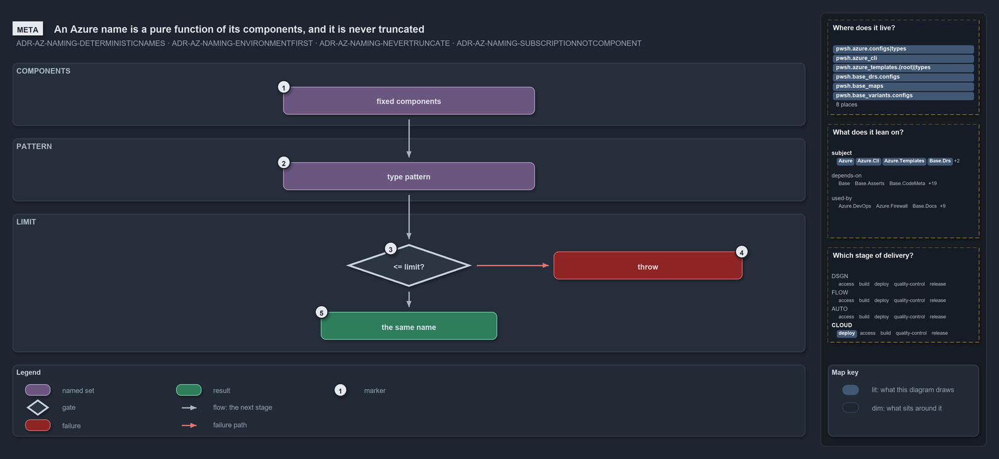

# An Azure name is a pure function of its components, and it is never truncated

<!-- cspell:ignore weufindiscxaphotst weudiscvm -->

```text
An Azure name is computed from fixed components; it fits its limit or the deploy stops.

1  fixed components  one canonical set in a fixed order, environment first
2  type pattern      picks the environment and customer form, and the length limit
3  <= limit?         the rendered name is checked against that limit
4  throw             a name that is too long stops the deploy, never truncated
5  the same name     a name that fits; the same inputs give it every time

Supports ADR-AZ-NAMING-DETERMINISTICNAMES, ADR-AZ-NAMING-ENVIRONMENTFIRST, ADR-AZ-NAMING-NEVERTRUNCATE and ADR-AZ-NAMING-SUBSCRIPTIONNOTCOMPONENT (meta lens).
```

An Azure resource name in cats is not chosen; it is computed. Fixed components go in, the resource type's pattern decides their form and the
length budget, and the name either fits that budget or the deploy stops. The same inputs give the same name every time, so a name can be
predicted, compared and reproduced without looking anything up in Azure.

```yml drawio
description:
  An Azure name is computed from fixed components and the type's pattern; it fits the pattern's length limit and is the same every time, or
  the deploy stops, and it is never truncated.
about:
  adrs:
    - ADR-AZ-NAMING-DETERMINISTICNAMES
    - ADR-AZ-NAMING-ENVIRONMENTFIRST
    - ADR-AZ-NAMING-NEVERTRUNCATE
    - ADR-AZ-NAMING-SUBSCRIPTIONNOTCOMPONENT
  lens: meta
content:
  title: An Azure name is a pure function of its components, and it is never truncated
  kind: explanation
  flow: top-to-bottom
  relation: the next stage
  theme: dark
  bands:
    - { id: band-components, label: COMPONENTS }
    - { id: band-pattern, label: PATTERN }
    - { id: band-limit, label: LIMIT }
  glyphs:
    - { id: s-components, kind: set, label: fixed components, in: band-components }
    - { id: s-pattern, kind: set, label: type pattern, in: band-pattern }
    - { id: g-limit, kind: gate, label: "<= limit?", in: band-limit }
    - { id: f-throw, kind: failure, label: throw, in: band-limit }
    - { id: r-name, kind: result, label: the same name, in: band-limit }
  edges:
    - { from: s-components, to: s-pattern, kind: flow, label: "" }
    - { from: s-pattern, to: g-limit, kind: flow, label: "" }
    - { from: g-limit, to: f-throw, kind: fail, label: "" }
    - { from: g-limit, to: r-name, kind: flow, label: "" }
  markers:
    - { at: s-components, number: 1 }
    - { at: s-pattern, number: 2 }
    - { at: g-limit, number: 3 }
    - { at: f-throw, number: 4 }
    - { at: r-name, number: 5 }
  legend: auto
  minimaps: [code-locations, module-neighbourhood, axis]
layout:
  band-components: { x: 20, y: 84, w: 1260, h: 100 }
  band-pattern: { x: 20, y: 204, w: 1260, h: 100 }
  band-limit: { x: 20, y: 324, w: 1260, h: 220 }
  s-components: { x: 450, y: 122, w: 400, h: 44 }
  s-pattern: { x: 450, y: 242, w: 400, h: 44 }
  g-limit: { x: 550, y: 372, w: 200, h: 68 }
  f-throw: { x: 880, y: 384, w: 300, h: 44 }
  r-name: { x: 510, y: 480, w: 280, h: 44 }
```



## Walkthrough

1. **Fixed components.** A name is built from one canonical set of components in a fixed order, with the environment first, so names sort by
   environment. An optional component that is empty is dropped.
2. **Type pattern.** The resource type's pattern picks the form of the environment and customer segments, either the readable name or the
   2-char shortcode, and sets the length limit.
3. **≤ limit?** The rendered name is checked against that limit.
4. **Throw.** A name that is too long throws and stops the deploy. It is never truncated and never hashed.
5. **The same name.** A name that fits is returned, and the same inputs return the same name every time. The naming standard's own examples
   render exactly as written: `prod-weu-fin-disc-rg` (20 characters), `pr001weufindiscxaphotst` (23) and `pr001weudiscvm` (14).

## Why it holds

- No random suffix, hash or truncation ever enters a name: every name is assembled deterministically from one canonical component set
  (ADR-AZ-NAMING-DETERMINISTICNAMES), and a name over its limit throws instead of being cut (ADR-AZ-NAMING-NEVERTRUNCATE).
- The environment is the first segment, and the restricted patterns use its 2-char shortcode, so a readable name never costs a tight name a
  byte (ADR-AZ-NAMING-ENVIRONMENTFIRST).
- The subscription selects where a deploy goes but never enters the name (ADR-AZ-NAMING-SUBSCRIPTIONNOTCOMPONENT).

## See also

- [Azure resource naming standard](../../drs/azure/azure-naming-standard.md) — the decision this article explains.
- The other lenses on the same naming standard: [architecture](one-namer-assembles-every-name.md),
  [implementation](lookup-form-check-render-in-order.md), [operations](names-are-derived-never-typed.md) and
  [governance](how-each-naming-rule-is-held.md).
- [The azure explanations](index.md) · [How to read the diagrams](../index.md#how-to-read-the-diagrams)
