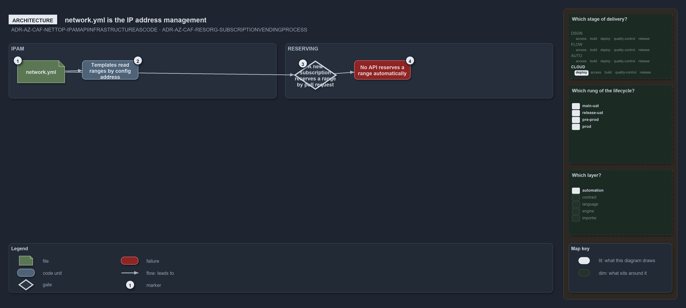

---
catzc:
  warning: "Experimental: this article merges two rules into one and holds nothing beyond what they say"
  edges:
    cites:
      - ADR-AZ-CAF-NETTOP-IPAMAPIINFRASTRUCTUREASCODE
      - ADR-AZ-CAF-RESORG-SUBSCRIPTIONVENDINGPROCESS
---

# Network yml is the ip plan and subscription vending is a pull request

This article is one rule:
[ADR-AZ-CAF-NETTOP-IPAMAPIINFRASTRUCTUREASCODE](../../drs/azure/caf/network-topology.md#rule-adr-az-caf-nettop-ipamapiinfrastructureascode)
and
[ADR-AZ-CAF-RESORG-SUBSCRIPTIONVENDINGPROCESS](../../drs/azure/caf/resource-organization.md#rule-adr-az-caf-resorg-subscriptionvendingprocess)
merged into one. It holds nothing beyond what those two rules say.

`network.yml` is the IP address management: templates read their ranges by config address and a new subscription reserves its range by pull
request, validated on load, though no API reserves a range automatically. Subscription vending is likewise a pull request, an `azure.yml`
entry, its range in `network.yml` and one config per template, and creating the subscription itself is not adopted.

