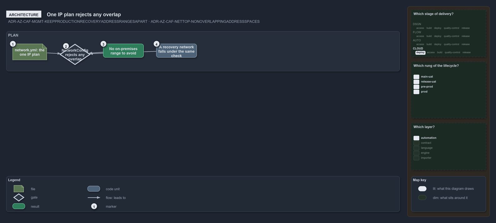

---
catzc:
  warning: "Experimental: this article merges two rules into one and holds nothing beyond what they say"
  edges:
    cites:
      - ADR-AZ-CAF-MGMT-KEEPPRODUCTIONRECOVERYADDRESSRANGESAPART
      - ADR-AZ-CAF-NETTOP-NONOVERLAPPINGADDRESSSPACES
---

# One ip plan rejects any overlap between networks including a recovery network

This article is one rule:
[ADR-AZ-CAF-MGMT-KEEPPRODUCTIONRECOVERYADDRESSRANGESAPART](../../drs/azure/caf/management.md#rule-adr-az-caf-mgmt-keepproductionrecoveryaddressrangesapart)
and
[ADR-AZ-CAF-NETTOP-NONOVERLAPPINGADDRESSSPACES](../../drs/azure/caf/network-topology.md#rule-adr-az-caf-nettop-nonoverlappingaddressspaces)
merged into one. It holds nothing beyond what those two rules say.

No two networks of the IP plan overlap: `network.yml` is the one IP plan and `NetworkConfig` rejects any overlap between its networks when
`network.yml` loads; there is no on-premises range to avoid. A recovery network added to the plan falls under the same check, so production
and recovery address ranges stay apart.

