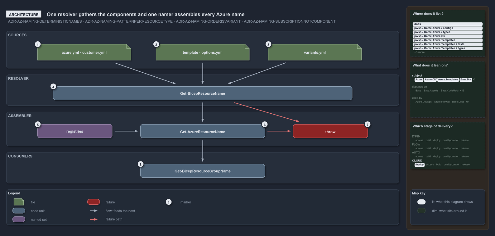

---
catzc:
  warning: "Header is generated by Format-FileMeta via Format-Code; do not change it"
  edges:
    cites:
      - ADR-AZ-NAMING-DETERMINISTICNAMES
      - ADR-AZ-NAMING-PATTERNPERRESOURCETYPE
      - ADR-AZ-NAMING-ORDERISVARIANT
      - ADR-AZ-NAMING-SUBSCRIPTIONNOTCOMPONENT
    drs_total: 4
---

# One resolver gathers the components and one namer assembles every Azure name

```text
Every Azure name comes out of one resolver and one namer; nothing else builds names.

1  azure.yml, customer.yml     environment identity, org, and the customer key and shortcode
2  template, options.yml       the template folder derives short_name; options.yml may override it
3  variants.yml                the ado_naming repo variant picks the component order
4  Get-BicepResourceName       the resolver: reads all three sources, adds type, slot, customer, role
5  registries                  three pure-data sets: 2 orders, 20 resource types, 4 patterns
6  Get-AzureResourceName       the namer: validates, renders in order, asserts the length limit
7  throw                       a bad component, unknown customer or over-limit name stops here
8  Get-BicepResourceGroupName  the one in-tree consumer: the resource-group name

Supports ADR-AZ-NAMING-DETERMINISTICNAMES, ADR-AZ-NAMING-PATTERNPERRESOURCETYPE, ADR-AZ-NAMING-ORDERISVARIANT and ADR-AZ-NAMING-SUBSCRIPTIONNOTCOMPONENT (architecture lens).
```

Every Azure resource name in cats comes out of one place. A resolver gathers the name components from three config files, and a single
namer, reading three pure-data registries, assembles and checks the name. A bad component or an over-limit name throws; a name that passes
is the resource-group name the deploy uses. Because nothing else builds names, a rule changed in the namer reaches every name at once.

```yml drawio
description:
  Every Azure name comes out of one resolver, which gathers the components from three config sources, and one namer, which reads three
  registries and assembles and checks the name; the resource-group name is the one in-tree consumer.
about:
  adrs:
    - ADR-AZ-NAMING-DETERMINISTICNAMES
    - ADR-AZ-NAMING-PATTERNPERRESOURCETYPE
    - ADR-AZ-NAMING-ORDERISVARIANT
    - ADR-AZ-NAMING-SUBSCRIPTIONNOTCOMPONENT
  lens: architecture
content:
  title: One resolver gathers the components and one namer assembles every Azure name
  kind: explanation
  flow: top-to-bottom
  relation: feeds the next
  theme: dark
  bands:
    - { id: band-sources, label: SOURCES }
    - { id: band-resolver, label: RESOLVER }
    - { id: band-assembler, label: ASSEMBLER }
    - { id: band-consumers, label: CONSUMERS }
  glyphs:
    - { id: g-azure, kind: file, label: azure.yml · customer.yml, in: band-sources }
    - { id: g-options, kind: file, label: template · options.yml, in: band-sources }
    - { id: g-variants, kind: file, label: variants.yml, in: band-sources }
    - { id: g-resolver, kind: code, label: Get-BicepResourceName, in: band-resolver }
    - { id: s-registries, kind: set, label: registries, in: band-assembler }
    - { id: g-namer, kind: code, label: Get-AzureResourceName, in: band-assembler }
    - { id: f-throw, kind: failure, label: throw, in: band-assembler }
    - { id: g-group, kind: code, label: Get-BicepResourceGroupName, in: band-consumers }
  edges:
    - { from: g-azure, to: g-resolver, kind: flow, label: "" }
    - { from: g-options, to: g-resolver, kind: flow, label: "" }
    - { from: g-variants, to: g-resolver, kind: flow, label: "" }
    - { from: g-resolver, to: g-namer, kind: flow, label: "" }
    - { from: s-registries, to: g-namer, kind: flow, label: "" }
    - { from: g-namer, to: g-group, kind: flow, label: "" }
    - { from: g-namer, to: f-throw, kind: fail, label: "" }
    - { from: g-resolver, to: f-throw, kind: fail, label: "" }
  markers:
    - { at: g-azure, number: 1 }
    - { at: g-options, number: 2 }
    - { at: g-variants, number: 3 }
    - { at: g-resolver, number: 4 }
    - { at: s-registries, number: 5 }
    - { at: g-namer, number: 6 }
    - { at: f-throw, number: 7 }
    - { at: g-group, number: 8 }
  legend: auto
  minimaps: [code-locations, module-neighbourhood, axis]
layout:
  band-sources: { x: 20, y: 84, w: 1260, h: 120 }
  band-resolver: { x: 20, y: 224, w: 1260, h: 100 }
  band-assembler: { x: 20, y: 344, w: 1260, h: 110 }
  band-consumers: { x: 20, y: 474, w: 1260, h: 100 }
  g-azure: { x: 120, y: 126, w: 300, h: 52 }
  g-options: { x: 500, y: 126, w: 300, h: 52 }
  g-variants: { x: 860, y: 126, w: 300, h: 52 }
  g-resolver: { x: 170, y: 262, w: 960, h: 44 }
  s-registries: { x: 120, y: 384, w: 240, h: 44 }
  g-namer: { x: 450, y: 384, w: 400, h: 44 }
  f-throw: { x: 940, y: 384, w: 240, h: 44 }
  g-group: { x: 450, y: 512, w: 400, h: 44 }
```



## Walkthrough

1. **azure.yml and customer.yml.** The `Catzc.Azure` configs. `azure.yml` supplies the environment's readable name and its 2-char shortcode,
   the environment's `region_code`, and the repo-wide `org`. `customer.yml` supplies the customer key and its 2-char shortcode, which
   `Get-AzureCustomer` resolves from either form.
2. **The template and its options.yml.** The template folder under `infrastructure/templates/<folder>/` and its optional `options.yml`. The
   folder name derives the `short_name` (its first 5 `[a-z0-9]` characters) through `BicepShortName`, and an explicit `short_name` in
   `options.yml` overrides it.
3. **variants.yml.** It carries the `ado_naming` repo variant, which `Get-AdoNaming` reads with `standard` as the default. The variant picks
   the component order for every name.
4. **Get-BicepResourceName.** The resolver in the templating layer reads all three sources side by side. The caller adds only what is
   genuinely per call: the resource type and the optional slot, customer and role. An unknown customer stops it here.
5. **The registries.** Three pure-data registries: `Get-AzureNameOrderSet` holds the two orders `standard` and `classic`,
   `Get-AzureResourceTypeSet` holds 20 resource types, each tied to one pattern, and `Get-AzureNamePatternSet` holds the four patterns
   `long`, `kv`, `storage` and `vm`. Adding an order or a type changes no assembler code.
6. **Get-AzureResourceName.** The namer validates every component, renders the name in the order the registry gives, and asserts the length
   limit. It is order-agnostic: the order is data it is handed.
7. **Throw.** A bad component, an unknown customer or an over-limit name throws. A name is never truncated to fit.
8. **Get-BicepResourceGroupName.** The one in-tree consumer, so only the `rg` type is generated in the tree today. It is the single source
   of the resource-group name for both the deploy target (`Get-BicepDeploymentContext`) and the tracking-tag scope
   (`Set-BicepTrackingTagSet`), so the two never drift. Other types call `Get-BicepResourceName` directly.

## Why it holds

- Every name is assembled deterministically from one canonical component set, with no random suffix or hash
  (ADR-AZ-NAMING-DETERMINISTICNAMES).
- Each resource type ties to one pattern in the type registry, and the pattern fixes the separator, the length budget and the form of the
  environment and customer segments (ADR-AZ-NAMING-PATTERNPERRESOURCETYPE).
- The component order is the `ado_naming` repo variant, not a per-name argument, so changing it re-spells every derived name
  (ADR-AZ-NAMING-ORDERISVARIANT).
- The subscription only selects the deploy target. It is never a name component and never an input to the resolver; the customer that
  renders is derived from it by the caller (ADR-AZ-NAMING-SUBSCRIPTIONNOTCOMPONENT).

## See also

- [Azure resource naming standard](../../drs/azure/azure-naming-standard.md) — the decision this article explains.
- The other lenses on the same naming standard: [meta](names-are-pure-and-never-truncated.md),
  [implementation](lookup-form-check-render-in-order.md), [operations](names-are-derived-never-typed.md) and
  [governance](how-each-naming-rule-is-held.md).
- [The azure explanations](index.md) · [How to read the diagrams](../index.md#how-to-read-the-diagrams)
