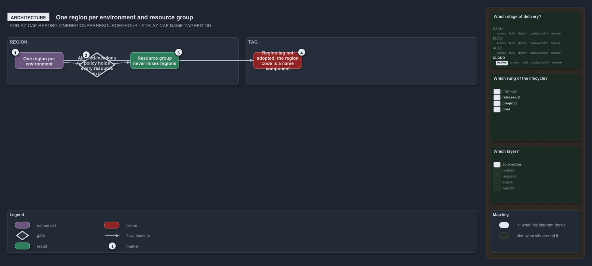

---
catzc:
  warning: "Experimental: this article merges two rules into one and holds nothing beyond what they say"
  edges:
    cites:
      - ADR-AZ-CAF-RESORG-ONEREGIONPERRESOURCEGROUP
      - ADR-AZ-CAF-NAME-TAGREGION
---

# One region per environment and resource group makes a region tag unnecessary

This article is one rule:
[ADR-AZ-CAF-RESORG-ONEREGIONPERRESOURCEGROUP](../../drs/azure/caf/resource-organization.md#rule-adr-az-caf-resorg-oneregionperresourcegroup)
and [ADR-AZ-CAF-NAME-TAGREGION](../../drs/azure/caf/naming-and-tagging.md#rule-adr-az-caf-name-tagregion) merged into one. It holds nothing
beyond what those two rules say.

A resource group never mixes regions: there is one region per environment, and the landing zone's allowed-locations policy keeps every
resource in it. For that reason a region tag is not adopted: each environment maps to one region, the region code is already a name
component, and the same policy holds each landing zone to its region.

