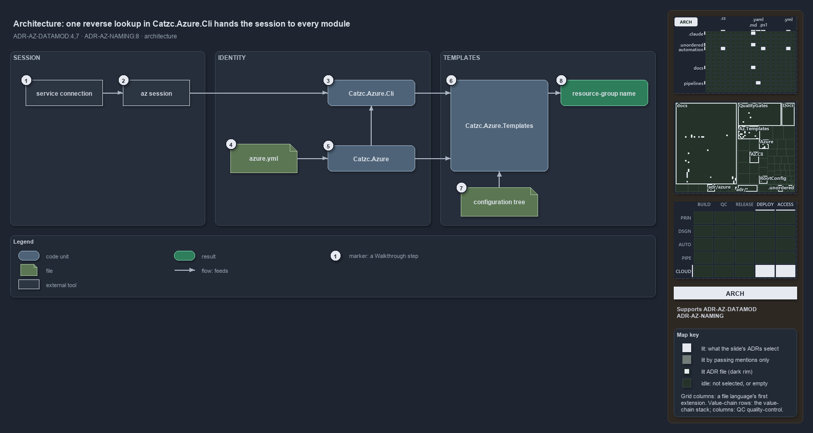

---
catzc:
  immutable:
    with_body_sha: "8e1cfbc526e4"
    repo_status: clean
    path: docs/explanation/azure/one-reverse-lookup-feeds-every-module.md
    folder: docs/explanation/azure
    name: one-reverse-lookup-feeds-every-module
    filetype: md
    kind: explanation
    language: markdown
    track: docs
    tracktype: documentation
  edges:
    cites:
      - ADR-AZ-DATAMOD#{4,7}
      - ADR-AZ-NAMING#8
    links:
      - docs/adr/azure/azure-data-model.md
      - docs/adr/azure/azure-naming-standard.md
      - docs/explanation/.assets/adr-az-datamod--one-reverse-lookup-feeds-every-module--architecture.drawio.png
      - docs/explanation/azure/four-gates-hold-the-session-rule.md
      - docs/explanation/azure/index.md
      - docs/explanation/azure/one-reverse-lookup-feeds-every-module.drawio.md
      - docs/explanation/azure/pipeline-pins-devbox-picks-the-target.md
      - docs/explanation/azure/read-the-session-guard-then-pick-slot.md
      - docs/explanation/azure/the-session-is-the-deploy-target.md
      - docs/explanation/index.md#how-to-read-the-diagrams
---

# One reverse lookup in Catzc.Azure.Cli hands the session to every module

```text
One reverse lookup turns the az session into a declared identity that every Azure module reads.

1  service connection     the Azure DevOps login a pipeline deploy runs under
2  az session             the az CLI's active subscription
3  Catzc.Azure.Cli        Get-AzCliSessionSubscription: the session's id resolved to its azure.yml identity
4  azure.yml              the identity layer: tenants, customers, environments and subscriptions
5  Catzc.Azure            the identity joins: Get-AzureSubscription, Get-AzureEnvironment and the namer
6  Catzc.Azure.Templates  Get-BicepDeploymentContext and Deploy-Bicep: the deploy surface
7  configuration tree     configuration/[<customer>/]<env>[-<slot>].yml, one file per slot
8  resource-group name    derived from the env, the slot and the session's customer; never typed

Supports ADR-AZ-DATAMOD#4 and #7, and ADR-AZ-NAMING#8 (architecture lens).
```

Cats keeps Azure identity in one file, `azure.yml`, and the deploy target in one place, the az session. The two meet in a single reverse
lookup: `Catzc.Azure.Cli` resolves the session's subscription id to the identity the file declares, and every module further along reads
that identity instead of asking the session again. The templating module picks the configuration slot from it, the Azure root module checks
it against the environment, and the namer renders its customer into the resource-group name.



The diagram is described element by element in [its asset description](one-reverse-lookup-feeds-every-module.drawio.md).

## Walkthrough

1. **Service connection.** A pipeline deploy runs inside an `AzureCLI@2` task whose `azureSubscription` is the service connection. Logging
   in is the only thing it does for the target: the subscription it signs into becomes the session.
2. **Az session.** The az CLI's active subscription, read with `az account show`. On a devbox `az account set` chooses it; in a pipeline the
   service connection has already chosen it.
3. **Catzc.Azure.Cli.** `Get-AzCliSessionSubscription` takes the session's subscription id and finds the one `azure.yml` subscription with
   that id. It returns the declared identity, `{ name, id, customer, tenant }`, and throws when no declared subscription carries the id. It
   is read-only: it never logs in or switches context.
4. **azure.yml.** The config layer for identity: tenants, customers, environments and subscriptions, each a map keyed by name. A
   subscription declares its tenant, the environments it serves and, optionally, its customer. The file is read through
   `Get-Config -Config azure`.
5. **Catzc.Azure.** The root Azure module holds the joins over `azure.yml`: `Get-AzureSubscription` resolves a named subscription with its
   tenant and customer, `Get-AzureEnvironment` asserts that a subscription serves an environment, and `Get-AzureResourceName` assembles
   every name. `Catzc.Azure.Cli` depends on it, and it depends on Base alone.
6. **Catzc.Azure.Templates.** The deploy surface. `Get-BicepDeploymentContext` composes the plan, the artifacts and the identity from the
   session's subscription, and `Deploy-Bicep` reads that one resolved identity off the context so config, artifacts and tags all agree. The
   module depends on `Catzc.Azure.Cli` for the session and on `Catzc.Azure` for the joins.
7. **Configuration tree.** A template's configs live at `configuration/[<customer>/]<env>[-<slot>].yml`, one file per slot. The session's
   customer decides whether the deploy reads the customer's subfolder or the configuration root; the environment and the slot are the
   deploy's own arguments.
8. **Resource-group name.** `Get-BicepResourceGroupName` derives it from the environment, the slot and the session's customer through the
   namer. The subscription is a resolution axis only and never a name component.

## Why it holds

- The joins between the two layers live in PowerShell and resolve on demand; the deploy-time subscription is the az session's,
  reverse-resolved against `azure.yml` by `Get-AzCliSessionSubscription` (ADR-AZ-DATAMOD#7).
- Customer is a configuration axis, the subfolder, and at deploy time it is derived from the session subscription, never a deploy argument;
  it addresses the customer's config and renders into the names (ADR-AZ-DATAMOD#4).
- The subscription is never a name component; the customer that renders is derived from it (ADR-AZ-NAMING#8).

## Where the code and the ADR differ

- The help text of `Get-BicepDeploymentContext` says a Subscription-target config lives at `configuration/<slot>.yml`; the code reads every
  config at `configuration/[<customer>/]<env>[-<slot>].yml`, as the ADR states.

## See also

- [Templating data model](../../adr/azure/azure-data-model.md) — the decision this article explains.
- [Azure resource naming standard](../../adr/azure/azure-naming-standard.md) — why the subscription never enters a name.
- The other lenses on the same deploy target: [meta](the-session-is-the-deploy-target.md),
  [implementation](read-the-session-guard-then-pick-slot.md), [operations](pipeline-pins-devbox-picks-the-target.md) and
  [governance](four-gates-hold-the-session-rule.md).
- [The azure explanations](index.md) · [How to read the diagrams](../index.md#how-to-read-the-diagrams)
