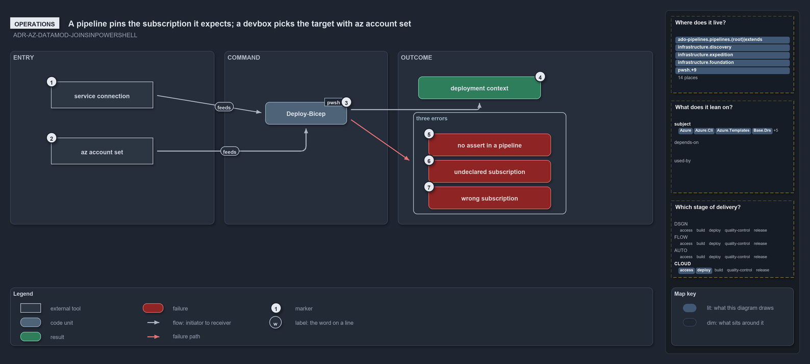

# A pipeline pins the subscription it expects; a devbox picks the target with az account set

```text
A pipeline deploy pins its expected subscription; a devbox deploy picks the target with az account set.

1  service connection       the AzureCLI@2 login a pipeline deploy runs under
2  az account set           how a developer picks the session's subscription on a devbox
3  Deploy-Bicep             the one deploy command, with -SubscriptionIdAssertIs in a pipeline
4  deployment context       what a resolved deploy prints before it deploys: plan, artifacts and identity
5  no assert in a pipeline  the throw when a pipeline deploy omits -SubscriptionIdAssertIs
6  undeclared subscription  the throw when the session targets a subscription azure.yml does not declare
7  wrong subscription       the throw when the session differs from the pinned subscription id

Supports ADR-AZ-DATAMOD-JOINSINPOWERSHELL (operations lens).
```

Nobody passes a subscription to a deploy in cats. A pipeline signs in through its service connection and states, with
`-SubscriptionIdAssertIs`, the subscription it expects that connection to have signed into; a developer sets the session with
`az account set` and runs the same command without the pin. Either way `Deploy-Bicep` resolves the session, prints the deployment context it
is about to act on, and stops with one of three errors when the session is missing a pin, undeclared, or not the one expected.

```yml drawio
description:
  A pipeline signs in through its service connection and pins the subscription it expects; a developer sets the session with az account set;
  Deploy-Bicep resolves the session, prints the deployment context, or stops with one of three errors.
about:
  adrs: [ADR-AZ-DATAMOD-JOINSINPOWERSHELL]
  lens: operations
content:
  title: A pipeline pins the subscription it expects; a devbox picks the target with az account set
  kind: explanation
  flow: left-to-right
  relation: feeds the next step
  theme: dark
  bands:
    - { id: band-entry, label: ENTRY }
    - { id: band-command, label: COMMAND }
    - { id: band-outcome, label: OUTCOME }
  groups:
    - { id: grp-errors, label: three errors, in: band-outcome }
  glyphs:
    - { id: x-connection, kind: external, label: service connection, in: band-entry }
    - { id: x-account, kind: external, label: az account set, in: band-entry }
    - { id: g-deploy, kind: code, label: Deploy-Bicep, in: band-command }
    - { id: r-context, kind: result, label: deployment context, in: band-outcome }
    - { id: f-no-assert, kind: failure, label: no assert in a pipeline, in: grp-errors }
    - { id: f-undeclared, kind: failure, label: undeclared subscription, in: grp-errors }
    - { id: f-wrong, kind: failure, label: wrong subscription, in: grp-errors }
  edges:
    - { from: x-connection, to: g-deploy, kind: flow, label: "" }
    - { from: x-account, to: g-deploy, kind: flow, label: "" }
    - { from: g-deploy, to: r-context, kind: flow, label: "" }
    - { from: g-deploy, to: grp-errors, kind: fail, label: "" }
  markers:
    - { at: x-connection, number: 1 }
    - { at: x-account, number: 2 }
    - { at: g-deploy, number: 3 }
    - { at: r-context, number: 4 }
    - { at: f-no-assert, number: 5 }
    - { at: f-undeclared, number: 6 }
    - { at: f-wrong, number: 7 }
  legend: auto
  minimaps: [code-locations, module-neighbourhood, axis]
layout:
  band-entry: { x: 20, y: 84, w: 400, h: 340 }
  band-command: { x: 440, y: 84, w: 320, h: 340 }
  band-outcome: { x: 780, y: 84, w: 500, h: 340 }
  x-connection: { x: 100, y: 144, w: 200, h: 52 }
  x-account: { x: 100, y: 254, w: 200, h: 52 }
  g-deploy: { x: 520, y: 184, w: 160, h: 44 }
  r-context: { x: 820, y: 134, w: 240, h: 44 }
  grp-errors: { x: 810, y: 204, w: 300, h: 200 }
  f-no-assert: { x: 840, y: 246, w: 240, h: 44 }
  f-undeclared: { x: 840, y: 298, w: 240, h: 44 }
  f-wrong: { x: 840, y: 350, w: 240, h: 44 }
```



## Walkthrough

1. **Service connection.** A pipeline deploy step is an `AzureCLI@2` task whose `azureSubscription` names the service connection. The shared
   platform's `cd-shared.yaml` uses one connection per tier, and a customer pipeline such as `cd-nova.yaml` lists, per deploy entry, its
   `serviceConnection` and the matching `subscriptionIdAssertIs` from `azure.yml`.
2. **Az account set.** On a devbox the developer runs `az login` and `az account set` to pick the session's subscription. Cats never logs in
   or switches the session itself; the deploy only reads it.
3. **Deploy-Bicep.** The one deploy command. A pipeline runs it as
   `Deploy-Bicep -Environment nsub -Template foundation -SubscriptionIdAssertIs <guid> -ArtifactsFolder "$(Pipeline.Workspace)/foundation"`;
   a devbox runs `Deploy-Bicep -Environment dev -Template expedition`, with the pin optional and the build run locally. The customer is not
   an argument: it comes from the session's subscription.
4. **Deployment context.** When the session resolves and passes the guard, the command writes the `deployment context` it is about to use:
   the plan with the derived resource group, the build artifacts, and the environment with its subscription. It then runs the pre-deploy
   hook, ensures the resource group, and calls `az deployment … create` in the session's subscription. `-DryRun` previews with `--what-if`
   and stops there.
5. **No assert in a pipeline.** A pipeline deploy without the pin stops at the call site with
   `Deploy-Bicep requires -SubscriptionIdAssertIs in a pipeline …`, which goes on to say that the pipeline must pin the subscription GUID
   its service connection is expected to target. The fix is to add the pin to the pipeline's deploy entry.
6. **Undeclared subscription.** A session pointed at a subscription `azure.yml` does not declare stops with
   `The az session's subscription '<name>' (<id>) is not declared in azure.yml …`, which goes on to name `az account set` and the declared
   subscriptions. The fix is `az account set`, or a declaration in `azure.yml`.
7. **Wrong subscription.** A session that differs from the pin stops with
   `-SubscriptionIdAssertIs failed: the az session targets subscription '<name>' (<id>), not <guid> …`, which goes on to say that in a
   pipeline this means the service connection is wired to the wrong subscription. The fix is to re-wire the service connection, or to
   correct the pin; the deploy is never retargeted. A session whose customer has no config for the requested environment and slot stops as
   well, naming the coordinate and the configs the template does have.

## Why it holds

- The deploy-time subscription is the az session's, in a pipeline exactly what the service connection logged into, and a pipeline deploy
  must still pin its target: `-SubscriptionIdAssertIs` is mandatory in a pipeline, where `Deploy-Bicep` throws without it, and optional on a
  devbox (ADR-AZ-DATAMOD-JOINSINPOWERSHELL).
- The assert is a guard, never a selector: a mismatch means a mis-wired service connection and fails loudly
  (ADR-AZ-DATAMOD-JOINSINPOWERSHELL).

## See also

- [Templating data model](../../drs/azure/azure-data-model.md) — the decision this article explains.
- The other lenses on the same deploy target: [meta](the-session-is-the-deploy-target.md),
  [architecture](one-reverse-lookup-feeds-every-module.md), [implementation](read-the-session-guard-then-pick-slot.md) and
  [governance](four-gates-hold-the-session-rule.md).
- [The azure explanations](index.md) · [How to read the diagrams](../index.md#how-to-read-the-diagrams)
