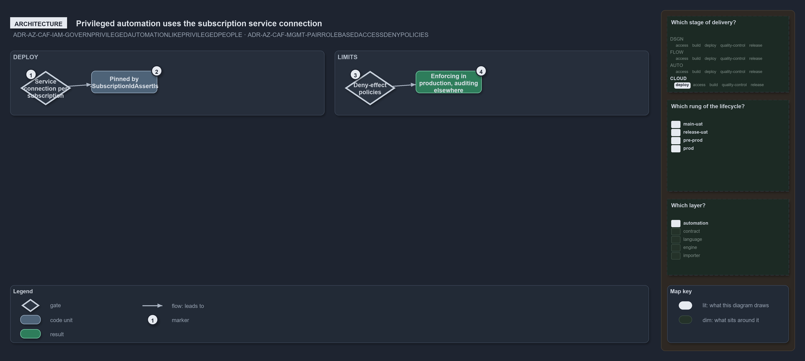

---
catzc:
  warning: "Experimental: this article merges two rules into one and holds nothing beyond what they say"
  edges:
    cites:
      - ADR-AZ-CAF-IAM-GOVERNPRIVILEGEDAUTOMATIONLIKEPRIVILEGEDPEOPLE
      - ADR-AZ-CAF-MGMT-PAIRROLEBASEDACCESSDENYPOLICIES
---

# Privileged automation runs through the subscriptions service connection under deny policies

This article is one rule:
[ADR-AZ-CAF-IAM-GOVERNPRIVILEGEDAUTOMATIONLIKEPRIVILEGEDPEOPLE](../../drs/azure/caf/identity-and-access.md#rule-adr-az-caf-iam-governprivilegedautomationlikeprivilegedpeople)
and
[ADR-AZ-CAF-MGMT-PAIRROLEBASEDACCESSDENYPOLICIES](../../drs/azure/caf/management.md#rule-adr-az-caf-mgmt-pairrolebasedaccessdenypolicies)
merged into one. It holds nothing beyond what those two rules say.

Every deploy runs through the service connection of its subscription, pinned by `-SubscriptionIdAssertIs`, and the infrastructure CI needs
no Azure identity. The landing zone's deny-effect policies limit what any identity may deploy there, enforcing in production and auditing
outside it; separating the landing-zone identity from the workload identity is planned.

