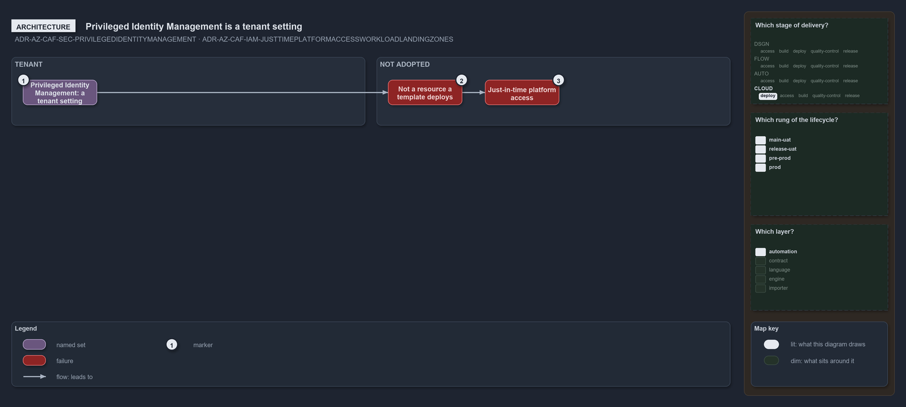

---
catzc:
  warning: "Experimental: this article merges two rules into one and holds nothing beyond what they say"
  edges:
    cites:
      - ADR-AZ-CAF-SEC-PRIVILEGEDIDENTITYMANAGEMENT
      - ADR-AZ-CAF-IAM-JUSTTIMEPLATFORMACCESSWORKLOADLANDINGZONES
---

# Privileged identity management is a tenant setting so just in time access is not adopted

This article is one rule:
[ADR-AZ-CAF-SEC-PRIVILEGEDIDENTITYMANAGEMENT](../../drs/azure/caf/landing-zone-security.md#rule-adr-az-caf-sec-privilegedidentitymanagement)
and
[ADR-AZ-CAF-IAM-JUSTTIMEPLATFORMACCESSWORKLOADLANDINGZONES](../../drs/azure/caf/identity-and-access.md#rule-adr-az-caf-iam-justtimeplatformaccessworkloadlandingzones)
merged into one. It holds nothing beyond what those two rules say.

Privileged Identity Management is not adopted, because it is a tenant setting, not a resource a template deploys. Just-in-time platform
access is not adopted for the same reason, since it rests on Privileged Identity Management, which is a tenant setting.

