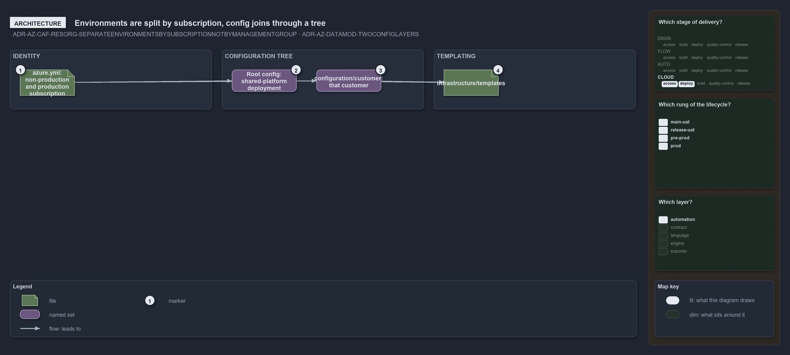

---
catzc:
  warning: "Experimental: this article merges two rules into one and holds nothing beyond what they say"
  edges:
    cites:
      - ADR-AZ-DATAMOD-TWOCONFIGLAYERS
      - ADR-AZ-CAF-RESORG-SEPARATEENVIRONMENTSBYSUBSCRIPTIONNOTBYMANAGEMENTGROUP
---

# Production and non production are separated by subscription never by management group

This article is one rule: [ADR-AZ-DATAMOD-TWOCONFIGLAYERS](../../drs/azure/azure-data-model.md#rule-adr-az-datamod-twoconfiglayers) and
[ADR-AZ-CAF-RESORG-SEPARATEENVIRONMENTSBYSUBSCRIPTIONNOTBYMANAGEMENTGROUP](../../drs/azure/caf/resource-organization.md#rule-adr-az-caf-resorg-separateenvironmentsbysubscriptionnotbymanagementgroup)
merged into one. It holds nothing beyond what those two rules say.

Production and non-production are separated by subscription, never by a management group: `azure.yml` maps the standard environments onto a
non-production and a production subscription per customer and for the shared platform. The two config layers, identity in `azure.yml` and
templating in `infrastructure/templates/`, join through the conventional configuration tree, where a config at the root is a shared-platform
deployment and one under `configuration/<customer>/` is that customer's.

