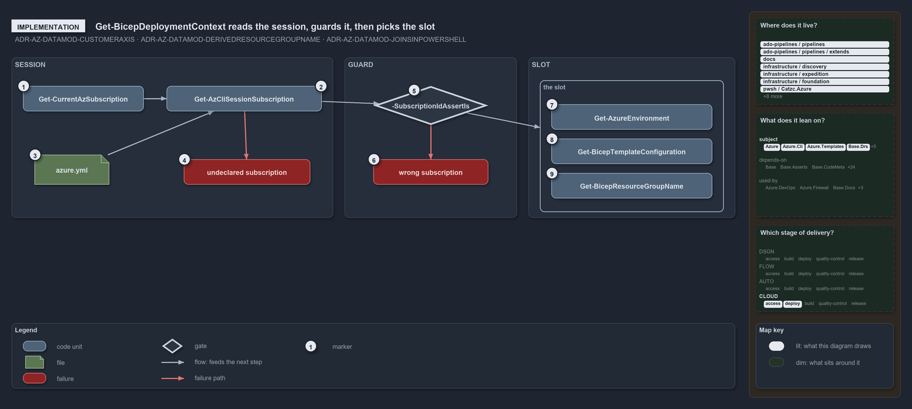

---
catzc:
  warning: "Header is generated by Format-FileMeta via Format-Code; do not change it"
  edges:
    cites:
      - ADR-AZ-DATAMOD-CUSTOMERAXIS
      - ADR-AZ-DATAMOD-DERIVEDRESOURCEGROUPNAME
      - ADR-AZ-DATAMOD-JOINSINPOWERSHELL
    drs_total: 3
---

# Get-BicepDeploymentContext reads the session, guards it, then picks the slot

```text
Get-BicepDeploymentContext resolves the session, applies the guard, then addresses the slot, in that order.

1  Get-CurrentAzSubscription       az account show: the session's active subscription
2  Get-AzCliSessionSubscription    the reverse lookup: the session's id -> { name, id, customer, tenant }
3  azure.yml                       the declared subscriptions the session's id is matched against
4  undeclared subscription         the throw when no declared subscription carries the id
5  -SubscriptionIdAssertIs         the optional guard: the session's id must equal the given one
6  wrong subscription              the throw when they differ: a mis-wired service connection
7  Get-AzureEnvironment            asserts that the session's subscription serves the environment
8  Get-BicepTemplateConfiguration  reads configuration/[<customer>/]<env>[-<slot>].yml
9  Get-BicepResourceGroupName      derives the resource-group name from the env, the slot and the customer

Supports ADR-AZ-DATAMOD-CUSTOMERAXIS, ADR-AZ-DATAMOD-DERIVEDRESOURCEGROUPNAME and ADR-AZ-DATAMOD-JOINSINPOWERSHELL (implementation lens).
```

`Get-BicepDeploymentContext` is where cats turns an az session into a deployment. It runs three stages in a fixed order: it reads the
session and resolves it against `azure.yml`, it applies the optional guard, and only then does it address the slot, with the session's
customer deciding which config file, which environment check and which resource-group name apply. Everything downstream reads the one
identity resolved here.

```yml drawio
description:
  "Get-BicepDeploymentContext reads the az session and resolves it against azure.yml, applies the optional subscription guard, and only then
  addresses the slot: the environment check, the configuration file and the resource-group name."
about:
  adrs: [ADR-AZ-DATAMOD-CUSTOMERAXIS, ADR-AZ-DATAMOD-DERIVEDRESOURCEGROUPNAME, ADR-AZ-DATAMOD-JOINSINPOWERSHELL]
  lens: implementation
content:
  title: Get-BicepDeploymentContext reads the session, guards it, then picks the slot
  kind: explanation
  flow: left-to-right
  relation: feeds the next step
  theme: dark
  bands:
    - { id: band-session, label: SESSION }
    - { id: band-guard, label: GUARD }
    - { id: band-slot, label: SLOT }
  groups:
    - { id: grp-slot, label: the slot, in: band-slot }
  glyphs:
    - { id: g-current, kind: code, label: Get-CurrentAzSubscription, in: band-session }
    - { id: g-session, kind: code, label: Get-AzCliSessionSubscription, in: band-session }
    - { id: g-azure, kind: file, label: azure.yml, in: band-session }
    - { id: f-undeclared, kind: failure, label: undeclared subscription, in: band-session }
    - { id: g-assert, kind: gate, label: -SubscriptionIdAssertIs, in: band-guard }
    - { id: f-wrong, kind: failure, label: wrong subscription, in: band-guard }
    - { id: g-environment, kind: code, label: Get-AzureEnvironment, in: grp-slot }
    - { id: g-configuration, kind: code, label: Get-BicepTemplateConfiguration, in: grp-slot }
    - { id: g-group, kind: code, label: Get-BicepResourceGroupName, in: grp-slot }
  edges:
    - { from: g-current, to: g-session, kind: flow, label: "" }
    - { from: g-azure, to: g-session, kind: flow, label: "" }
    - { from: g-session, to: f-undeclared, kind: fail, label: "" }
    - { from: g-session, to: g-assert, kind: flow, label: "" }
    - { from: g-assert, to: f-wrong, kind: fail, label: "" }
    - { from: g-assert, to: grp-slot, kind: flow, label: "" }
  markers:
    - { at: g-current, number: 1 }
    - { at: g-session, number: 2 }
    - { at: g-azure, number: 3 }
    - { at: f-undeclared, number: 4 }
    - { at: g-assert, number: 5 }
    - { at: f-wrong, number: 6 }
    - { at: g-environment, number: 7 }
    - { at: g-configuration, number: 8 }
    - { at: g-group, number: 9 }
  legend: auto
  minimaps:
    code-locations:
      - cell: ado-pipelines/pipelines/.
        by:
          - .ado/pipelines/cd-shared.yaml
          - ADR-AZ-DATAMOD-CUSTOMERAXIS
          - ADR-AZ-DATAMOD-DERIVEDRESOURCEGROUPNAME
          - ADR-AZ-DATAMOD-JOINSINPOWERSHELL
      - cell: ado-pipelines/pipelines/extends
        by:
          - .ado/pipelines/extends/cd-customer.yaml
          - ADR-AZ-DATAMOD-CUSTOMERAXIS
          - ADR-AZ-DATAMOD-DERIVEDRESOURCEGROUPNAME
          - ADR-AZ-DATAMOD-JOINSINPOWERSHELL
      - cell: docs/-/.
        by:
          - docs/drs/azure/azure-data-model.md
          - docs/drs/azure/dora-explains.md
          - docs/drs/index.md
          - docs/references/ado/pipelines/cd-shared.yaml.md
          - docs/references/ado/pipelines/extends/cd-customer.yaml.md
          - docs/references/infrastructure/templates/discovery/options.yml.md
          - docs/references/infrastructure/templates/expedition/options.yml.md
          - docs/references/infrastructure/templates/foundation/options.yml.md
          - docs/references/pwsh/catzc-azure-cli/Assert-AzCliCanAccess.ps1.md
          - docs/references/pwsh/catzc-azure-cli/Assert-AzCliIsConnected.ps1.md
          - docs/references/pwsh/catzc-azure-cli/Get-AzCliSessionSubscription.ps1.md
          - docs/references/pwsh/catzc-azure-cli/Test-AzCliCanAccess.ps1.md
          - docs/references/pwsh/catzc-azure-templates/Deploy-Bicep.ps1.md
          - docs/references/pwsh/catzc-azure-templates/Get-AzureBicepEnvironmentKinds.ps1.md
          - docs/references/pwsh/catzc-azure-templates/Get-BicepDeploymentContext.ps1.md
          - docs/references/pwsh/catzc-azure-templates/Get-BicepTemplateConfiguration.ps1.md
          - docs/references/pwsh/catzc-azure-templates/Get-BicepTemplates.ps1.md
          - docs/references/pwsh/catzc-azure-templates/Set-BicepTemplateConfiguration.ps1.md
          - docs/references/pwsh/catzc-azure-templates/private/Get-BicepConfigSubscriptionCandidates.ps1.md
          - docs/references/pwsh/catzc-azure-templates/private/Get-BicepParametersFileName.ps1.md
          - docs/references/pwsh/catzc-azure/Get-AzureEnvironment.ps1.md
          - docs/references/pwsh/catzc-azure/Get-AzureSubscription.ps1.md
          - docs/references/pwsh/catzc-azure/Get-AzureSubscriptionEnvironment.ps1.md
          - docs/references/pwsh/catzc-azure/configs/azure.yml.md
          - docs/references/pwsh/catzc-azure/tests/types/AzureConfig.Tests.ps1.md
          - docs/references/pwsh/catzc-azure/types/AzureConfig.cs.md
          - docs/references/pwsh/catzc-azure/types/AzureEnvironmentRecord.cs.md
          - docs/references/pwsh/catzc-azure/types/AzureSubscriptionRecord.cs.md
          - docs/references/pwsh/catzc-azure/types/AzureTenantRecord.cs.md
          - docs/references/pwsh/catzc-base-quality-gates/private/Get-MarkdownHeadingFinding.ps1.md
          - ADR-AZ-DATAMOD-CUSTOMERAXIS
          - ADR-AZ-DATAMOD-DERIVEDRESOURCEGROUPNAME
          - ADR-AZ-DATAMOD-JOINSINPOWERSHELL
      - cell: infrastructure/discovery/.
        by:
          - infrastructure/templates/discovery/options.yml
          - ADR-AZ-DATAMOD-CUSTOMERAXIS
          - ADR-AZ-DATAMOD-DERIVEDRESOURCEGROUPNAME
          - ADR-AZ-DATAMOD-JOINSINPOWERSHELL
      - cell: infrastructure/expedition/.
        by:
          - infrastructure/templates/expedition/options.yml
          - ADR-AZ-DATAMOD-CUSTOMERAXIS
          - ADR-AZ-DATAMOD-DERIVEDRESOURCEGROUPNAME
          - ADR-AZ-DATAMOD-JOINSINPOWERSHELL
      - cell: infrastructure/foundation/.
        by:
          - infrastructure/templates/foundation/options.yml
          - ADR-AZ-DATAMOD-CUSTOMERAXIS
          - ADR-AZ-DATAMOD-DERIVEDRESOURCEGROUPNAME
          - ADR-AZ-DATAMOD-JOINSINPOWERSHELL
      - cell: pwsh/Catzc.Azure/.
        by:
          - pwsh/Catzc.Azure/Get-AzureEnvironment.ps1
          - pwsh/Catzc.Azure/Get-AzureSubscription.ps1
          - pwsh/Catzc.Azure/Get-AzureSubscriptionEnvironment.ps1
          - ADR-AZ-DATAMOD-CUSTOMERAXIS
          - ADR-AZ-DATAMOD-DERIVEDRESOURCEGROUPNAME
          - ADR-AZ-DATAMOD-JOINSINPOWERSHELL
      - cell: pwsh/Catzc.Azure/configs
        by:
          - pwsh/Catzc.Azure/configs/azure.yml
          - ADR-AZ-DATAMOD-CUSTOMERAXIS
          - ADR-AZ-DATAMOD-DERIVEDRESOURCEGROUPNAME
          - ADR-AZ-DATAMOD-JOINSINPOWERSHELL
      - cell: pwsh/Catzc.Azure/tests/types
        by:
          - pwsh/Catzc.Azure/tests/types/AzureConfig.Tests.ps1
          - ADR-AZ-DATAMOD-CUSTOMERAXIS
          - ADR-AZ-DATAMOD-DERIVEDRESOURCEGROUPNAME
          - ADR-AZ-DATAMOD-JOINSINPOWERSHELL
      - cell: pwsh/Catzc.Azure/types
        by:
          - pwsh/Catzc.Azure/types/AzureConfig.cs
          - pwsh/Catzc.Azure/types/AzureEnvironmentRecord.cs
          - pwsh/Catzc.Azure/types/AzureSubscriptionRecord.cs
          - pwsh/Catzc.Azure/types/AzureTenantRecord.cs
          - ADR-AZ-DATAMOD-CUSTOMERAXIS
          - ADR-AZ-DATAMOD-DERIVEDRESOURCEGROUPNAME
          - ADR-AZ-DATAMOD-JOINSINPOWERSHELL
      - cell: pwsh/Catzc.Azure.Cli/.
        by:
          - pwsh/Catzc.Azure.Cli/Assert-AzCliCanAccess.ps1
          - pwsh/Catzc.Azure.Cli/Assert-AzCliIsConnected.ps1
          - pwsh/Catzc.Azure.Cli/Get-AzCliSessionSubscription.ps1
          - pwsh/Catzc.Azure.Cli/Test-AzCliCanAccess.ps1
          - ADR-AZ-DATAMOD-CUSTOMERAXIS
          - ADR-AZ-DATAMOD-DERIVEDRESOURCEGROUPNAME
          - ADR-AZ-DATAMOD-JOINSINPOWERSHELL
      - cell: pwsh/Catzc.Azure.Templates/.
        by:
          - pwsh/Catzc.Azure.Templates/Deploy-Bicep.ps1
          - pwsh/Catzc.Azure.Templates/Get-AzureBicepEnvironmentKinds.ps1
          - pwsh/Catzc.Azure.Templates/Get-BicepDeploymentContext.ps1
          - pwsh/Catzc.Azure.Templates/Get-BicepTemplateConfiguration.ps1
          - pwsh/Catzc.Azure.Templates/Get-BicepTemplates.ps1
          - pwsh/Catzc.Azure.Templates/Set-BicepTemplateConfiguration.ps1
          - ADR-AZ-DATAMOD-CUSTOMERAXIS
          - ADR-AZ-DATAMOD-DERIVEDRESOURCEGROUPNAME
          - ADR-AZ-DATAMOD-JOINSINPOWERSHELL
      - cell: pwsh/Catzc.Azure.Templates/private
        by:
          - pwsh/Catzc.Azure.Templates/private/Get-BicepConfigSubscriptionCandidates.ps1
          - pwsh/Catzc.Azure.Templates/private/Get-BicepParametersFileName.ps1
          - ADR-AZ-DATAMOD-CUSTOMERAXIS
          - ADR-AZ-DATAMOD-DERIVEDRESOURCEGROUPNAME
          - ADR-AZ-DATAMOD-JOINSINPOWERSHELL
      - cell: pwsh/Catzc.Base.Drs/configs
        by:
          - pwsh/Catzc.Base.Drs/configs/drs.yml
          - ADR-AZ-DATAMOD-CUSTOMERAXIS
          - ADR-AZ-DATAMOD-DERIVEDRESOURCEGROUPNAME
          - ADR-AZ-DATAMOD-JOINSINPOWERSHELL
      - cell: pwsh/Catzc.Base.QualityGates/private
        by:
          - pwsh/Catzc.Base.QualityGates/private/Get-MarkdownHeadingFinding.ps1
          - ADR-AZ-DATAMOD-CUSTOMERAXIS
          - ADR-AZ-DATAMOD-DERIVEDRESOURCEGROUPNAME
          - ADR-AZ-DATAMOD-JOINSINPOWERSHELL
    module-neighbourhood:
      - cell: subject/Catzc.Azure
        by:
          - pwsh/Catzc.Azure/Get-AzureEnvironment.ps1
          - pwsh/Catzc.Azure/Get-AzureSubscription.ps1
          - pwsh/Catzc.Azure/Get-AzureSubscriptionEnvironment.ps1
          - pwsh/Catzc.Azure/configs/azure.yml
          - pwsh/Catzc.Azure/tests/types/AzureConfig.Tests.ps1
          - pwsh/Catzc.Azure/types/AzureConfig.cs
          - pwsh/Catzc.Azure/types/AzureEnvironmentRecord.cs
          - pwsh/Catzc.Azure/types/AzureSubscriptionRecord.cs
          - pwsh/Catzc.Azure/types/AzureTenantRecord.cs
          - ADR-AZ-DATAMOD-CUSTOMERAXIS
          - ADR-AZ-DATAMOD-DERIVEDRESOURCEGROUPNAME
          - ADR-AZ-DATAMOD-JOINSINPOWERSHELL
      - cell: subject/Catzc.Azure.Cli
        by:
          - pwsh/Catzc.Azure.Cli/Assert-AzCliCanAccess.ps1
          - pwsh/Catzc.Azure.Cli/Assert-AzCliIsConnected.ps1
          - pwsh/Catzc.Azure.Cli/Get-AzCliSessionSubscription.ps1
          - pwsh/Catzc.Azure.Cli/Test-AzCliCanAccess.ps1
          - ADR-AZ-DATAMOD-CUSTOMERAXIS
          - ADR-AZ-DATAMOD-DERIVEDRESOURCEGROUPNAME
          - ADR-AZ-DATAMOD-JOINSINPOWERSHELL
      - cell: subject/Catzc.Azure.Templates
        by:
          - pwsh/Catzc.Azure.Templates/Deploy-Bicep.ps1
          - pwsh/Catzc.Azure.Templates/Get-AzureBicepEnvironmentKinds.ps1
          - pwsh/Catzc.Azure.Templates/Get-BicepDeploymentContext.ps1
          - pwsh/Catzc.Azure.Templates/Get-BicepTemplateConfiguration.ps1
          - pwsh/Catzc.Azure.Templates/Get-BicepTemplates.ps1
          - pwsh/Catzc.Azure.Templates/Set-BicepTemplateConfiguration.ps1
          - pwsh/Catzc.Azure.Templates/private/Get-BicepConfigSubscriptionCandidates.ps1
          - pwsh/Catzc.Azure.Templates/private/Get-BicepParametersFileName.ps1
          - ADR-AZ-DATAMOD-CUSTOMERAXIS
          - ADR-AZ-DATAMOD-DERIVEDRESOURCEGROUPNAME
          - ADR-AZ-DATAMOD-JOINSINPOWERSHELL
      - cell: subject/Catzc.Base.Drs
        by:
          - pwsh/Catzc.Base.Drs/configs/drs.yml
          - ADR-AZ-DATAMOD-CUSTOMERAXIS
          - ADR-AZ-DATAMOD-DERIVEDRESOURCEGROUPNAME
          - ADR-AZ-DATAMOD-JOINSINPOWERSHELL
      - cell: subject/Catzc.Base.QualityGates
        by:
          - pwsh/Catzc.Base.QualityGates/private/Get-MarkdownHeadingFinding.ps1
          - ADR-AZ-DATAMOD-CUSTOMERAXIS
          - ADR-AZ-DATAMOD-DERIVEDRESOURCEGROUPNAME
          - ADR-AZ-DATAMOD-JOINSINPOWERSHELL
      - cell: subject/discovery
        by:
          - infrastructure/templates/discovery/options.yml
          - ADR-AZ-DATAMOD-CUSTOMERAXIS
          - ADR-AZ-DATAMOD-DERIVEDRESOURCEGROUPNAME
          - ADR-AZ-DATAMOD-JOINSINPOWERSHELL
      - cell: subject/expedition
        by:
          - infrastructure/templates/expedition/options.yml
          - ADR-AZ-DATAMOD-CUSTOMERAXIS
          - ADR-AZ-DATAMOD-DERIVEDRESOURCEGROUPNAME
          - ADR-AZ-DATAMOD-JOINSINPOWERSHELL
      - cell: subject/foundation
        by:
          - infrastructure/templates/foundation/options.yml
          - ADR-AZ-DATAMOD-CUSTOMERAXIS
          - ADR-AZ-DATAMOD-DERIVEDRESOURCEGROUPNAME
          - ADR-AZ-DATAMOD-JOINSINPOWERSHELL
      - cell: subject/pipelines
        by:
          - .ado/pipelines/cd-shared.yaml
          - .ado/pipelines/extends/cd-customer.yaml
          - ADR-AZ-DATAMOD-CUSTOMERAXIS
          - ADR-AZ-DATAMOD-DERIVEDRESOURCEGROUPNAME
          - ADR-AZ-DATAMOD-JOINSINPOWERSHELL
    axis:
      - cell: CLOUD/deploy
        by: [ADR-AZ-DATAMOD-CUSTOMERAXIS, ADR-AZ-DATAMOD-DERIVEDRESOURCEGROUPNAME, ADR-AZ-DATAMOD-JOINSINPOWERSHELL]
      - cell: CLOUD/access
        by: [ADR-AZ-DATAMOD-CUSTOMERAXIS, ADR-AZ-DATAMOD-DERIVEDRESOURCEGROUPNAME, ADR-AZ-DATAMOD-JOINSINPOWERSHELL]
layout:
  band-session: { x: 20, y: 84, w: 560, h: 280 }
  band-guard: { x: 600, y: 84, w: 300, h: 280 }
  band-slot: { x: 920, y: 84, w: 360, h: 280 }
  g-current: { x: 40, y: 134, w: 210, h: 44 }
  g-session: { x: 290, y: 134, w: 270, h: 44 }
  g-azure: { x: 60, y: 254, w: 130, h: 52 }
  f-undeclared: { x: 320, y: 262, w: 220, h: 44 }
  g-assert: { x: 650, y: 134, w: 200, h: 68 }
  f-wrong: { x: 650, y: 262, w: 200, h: 44 }
  grp-slot: { x: 940, y: 124, w: 320, h: 230 }
  g-environment: { x: 960, y: 166, w: 280, h: 44 }
  g-configuration: { x: 960, y: 226, w: 280, h: 44 }
  g-group: { x: 960, y: 286, w: 280, h: 44 }
```



## Walkthrough

1. **Get-CurrentAzSubscription.** Runs `az account show` and returns the session's active subscription as an object with its id, name and
   tenant. With no active context it throws and names `az login` and `az account set` as the remedy.
2. **Get-AzCliSessionSubscription.** The reverse lookup in `Catzc.Azure.Cli`. It calls `Get-CurrentAzSubscription`, finds the `azure.yml`
   subscription whose id matches, and returns `{ name, id, customer, tenant }` from `Get-AzureSubscription`. The `customer` is the canonical
   customer key, or the empty string for a non-customer subscription. `Get-BicepDeploymentContext` calls it first, before any guard or slot
   work.
3. **azure.yml.** The declared subscriptions, read through `Get-Config -Config azure`. The lookup compares the session's id with every
   declared subscription's `id`.
4. **Undeclared subscription.** When no declared subscription carries the session's id, the lookup throws, naming the session's
   subscription, the declared ones and `az account set`. An id declared more than once throws too, since subscription ids must be unique.
5. **-SubscriptionIdAssertIs.** When the parameter is set, it must be a GUID and must equal the resolved session's id. When it is unset, the
   check is skipped. The session's `name` and `customer` are then taken as the deploy's subscription and customer.
6. **Wrong subscription.** When the ids differ, the context throws: the session targets one subscription, the caller expected another, and
   in a pipeline that means the service connection is wired to the wrong subscription.
7. **Get-AzureEnvironment.** Called with the environment argument and the session's subscription name. It asserts that the subscription
   serves the environment and embeds the resolved subscription, customer included, into the environment descriptor. Just before it, the
   context checks that the template has a config for the (customer, env, slot) coordinate and throws with the coordinate otherwise.
8. **Get-BicepTemplateConfiguration.** Reads the slot's config file. With a customer it is `configuration/<customer>/<env>[-<slot>].yml`;
   without one it is the configuration-root file. The coordinate is the file address, with no resolution machinery.
9. **Get-BicepResourceGroupName.** For a ResourceGroup-target template, derives the resource-group name from the template, the environment,
   the slot and the session's customer through the namer. Nothing is hand-typed; a Subscription-target template leaves the resource group
   unset.

## Why it holds

- The customer is derived from the session subscription (`subscription.customer`), never a deploy argument: `Deploy-Bicep` has no
  `-Customer` parameter, and a customer-subscription session addresses the customer's subfolder config (ADR-AZ-DATAMOD-CUSTOMERAXIS).
- The resource-group name is derived by `Get-BicepResourceGroupName`, never hand-typed (ADR-AZ-DATAMOD-DERIVEDRESOURCEGROUPNAME).
- The joins resolve on demand in `Get-AzureEnvironment` and `Get-BicepDeploymentContext`; the deploy-time subscription is the az session's,
  reverse-resolved by `Get-AzCliSessionSubscription`, and `-SubscriptionIdAssertIs` is a guard, never a selector
  (ADR-AZ-DATAMOD-JOINSINPOWERSHELL).

## See also

- [Templating data model](../../drs/azure/azure-data-model.md) — the decision this article explains.
- The other lenses on the same deploy target: [meta](the-session-is-the-deploy-target.md),
  [architecture](one-reverse-lookup-feeds-every-module.md), [operations](pipeline-pins-devbox-picks-the-target.md) and
  [governance](four-gates-hold-the-session-rule.md).
- [The azure explanations](index.md) · [How to read the diagrams](../index.md#how-to-read-the-diagrams)
