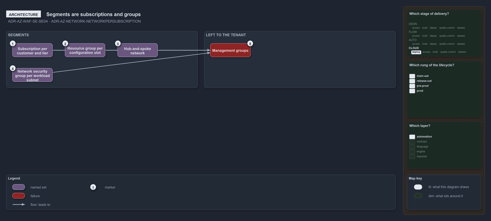

---
catzc:
  warning: "Experimental: this article merges two rules into one and holds nothing beyond what they say"
  edges:
    cites:
      - ADR-AZ-WAF-SE-SE04
      - ADR-AZ-NETWORK-NETWORKPERSUBSCRIPTION
---

# Segments are subscriptions groups and a hub and spoke network with one network per subscription

This article is one rule: [ADR-AZ-WAF-SE-SE04](../../drs/azure/waf/security.md#rule-adr-az-waf-se-se04) and
[ADR-AZ-NETWORK-NETWORKPERSUBSCRIPTION](../../drs/azure/azure-network-model.md#rule-adr-az-network-networkpersubscription) merged into one.
It holds nothing beyond what those two rules say.

Segments are the subscription per customer and tier, the resource group per configuration slot, the hub-and-spoke network and a network
security group per workload subnet, each deployed by its own service connection; management groups are left to the tenant's administrators.
Every `azure.yml` subscription has one network, a hub when it has no `customer` and a spoke when it has one.

