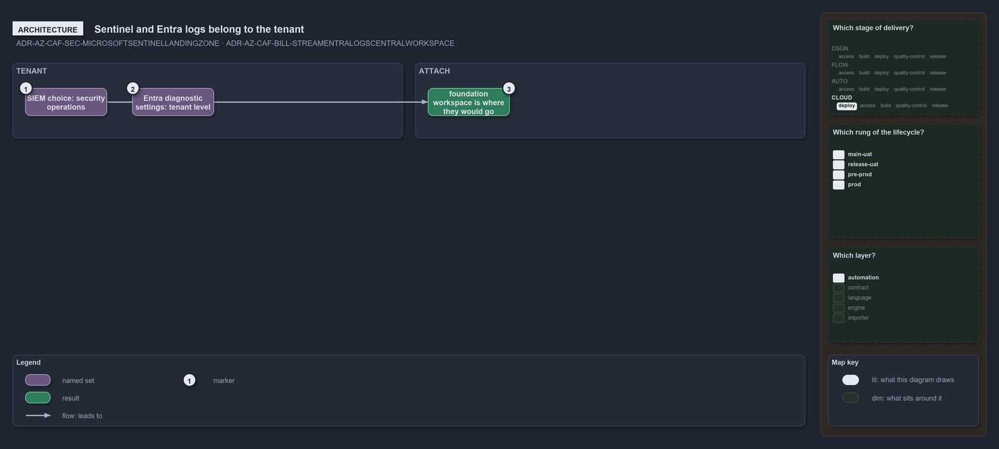

---
catzc:
  warning: "Experimental: this article merges two rules into one and holds nothing beyond what they say"
  edges:
    cites:
      - ADR-AZ-CAF-SEC-MICROSOFTSENTINELLANDINGZONE
      - ADR-AZ-CAF-BILL-STREAMENTRALOGSCENTRALWORKSPACE
---

# Sentinel and entra log streaming belong to tenant and workspace is where they would attach

This article is one rule:
[ADR-AZ-CAF-SEC-MICROSOFTSENTINELLANDINGZONE](../../drs/azure/caf/landing-zone-security.md#rule-adr-az-caf-sec-microsoftsentinellandingzone)
and
[ADR-AZ-CAF-BILL-STREAMENTRALOGSCENTRALWORKSPACE](../../drs/azure/caf/billing-and-tenant.md#rule-adr-az-caf-bill-streamentralogscentralworkspace)
merged into one. It holds nothing beyond what those two rules say.

Microsoft Sentinel is not adopted, because the choice of a security information and event management tool belongs to the tenant's security
operations. Streaming Entra logs to a central workspace is not adopted either, because Entra's diagnostic settings are made at tenant level,
where the repository deploys nothing. In both cases `foundation`'s workspace is where they would attach.

