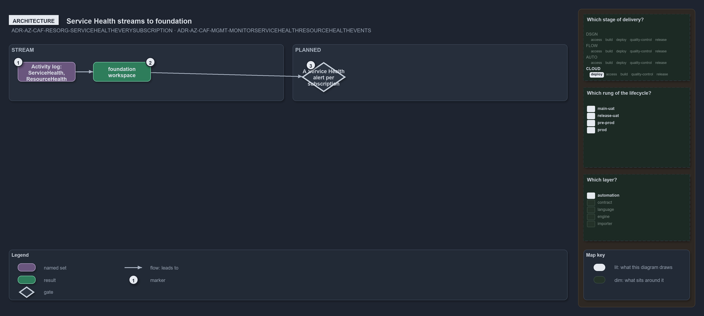

---
catzc:
  warning: "Experimental: this article merges two rules into one and holds nothing beyond what they say"
  edges:
    cites:
      - ADR-AZ-CAF-RESORG-SERVICEHEALTHEVERYSUBSCRIPTION
      - ADR-AZ-CAF-MGMT-MONITORSERVICEHEALTHRESOURCEHEALTHEVENTS
---

# Service health events stream to the foundation workspace and alerts are planned

This article is one rule:
[ADR-AZ-CAF-RESORG-SERVICEHEALTHEVERYSUBSCRIPTION](../../drs/azure/caf/resource-organization.md#rule-adr-az-caf-resorg-servicehealtheverysubscription)
and
[ADR-AZ-CAF-MGMT-MONITORSERVICEHEALTHRESOURCEHEALTHEVENTS](../../drs/azure/caf/management.md#rule-adr-az-caf-mgmt-monitorservicehealthresourcehealthevents)
merged into one. It holds nothing beyond what those two rules say.

Every landing zone streams the subscription's activity log, its `ServiceHealth` and `ResourceHealth` categories included, to `foundation`'s
workspace, which is partly realised: a Service Health alert per subscription, and alerts on those events, are planned.

