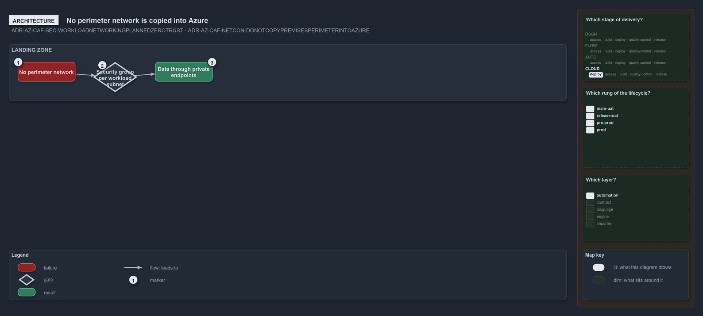

---
catzc:
  warning: "Experimental: this article merges two rules into one and holds nothing beyond what they say"
  edges:
    cites:
      - ADR-AZ-CAF-SEC-WORKLOADNETWORKINGPLANNEDZEROTRUST
      - ADR-AZ-CAF-NETCON-DONOTCOPYPREMISESPERIMETERINTOAZURE
---

# The landing zone has no perimeter network and each subnet carries its own security group

This article is one rule:
[ADR-AZ-CAF-SEC-WORKLOADNETWORKINGPLANNEDZEROTRUST](../../drs/azure/caf/landing-zone-security.md#rule-adr-az-caf-sec-workloadnetworkingplannedzerotrust)
and
[ADR-AZ-CAF-NETCON-DONOTCOPYPREMISESPERIMETERINTOAZURE](../../drs/azure/caf/network-connectivity.md#rule-adr-az-caf-netcon-donotcopypremisesperimeterintoazure)
merged into one. It holds nothing beyond what those two rules say.

Workload networking is private by plan: `network.yml`, a network security group per workload subnet and private endpoints, with egress
filtering through a hub firewall planned. The on-premises perimeter is not copied into Azure: the landing zone has no perimeter network,
each workload subnet carries its own network security group and data is reached through private endpoints.

