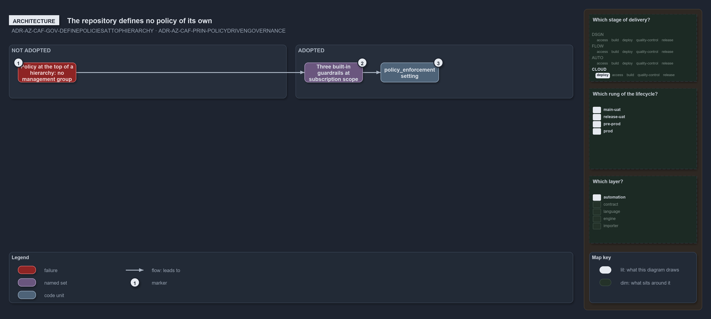

---
catzc:
  warning: "Experimental: this article merges two rules into one and holds nothing beyond what they say"
  edges:
    cites:
      - ADR-AZ-CAF-GOV-DEFINEPOLICIESATTOPHIERARCHY
      - ADR-AZ-CAF-PRIN-POLICYDRIVENGOVERNANCE
---

# The repository defines no policy of its own and assigns three built in guardrails

This article is one rule:
[ADR-AZ-CAF-GOV-DEFINEPOLICIESATTOPHIERARCHY](../../drs/azure/caf/governance.md#rule-adr-az-caf-gov-definepoliciesattophierarchy) and
[ADR-AZ-CAF-PRIN-POLICYDRIVENGOVERNANCE](../../drs/azure/caf/design-principles.md#rule-adr-az-caf-prin-policydrivengovernance) merged into
one. It holds nothing beyond what those two rules say.

Defining policies at the top of the hierarchy is not adopted, because the repository owns no management group and defines no policy of its
own: the built-in definitions it assigns exist in every tenant. Policy-driven governance is partly adopted at the level it does own: every
landing zone assigns three built-in Azure Policy guardrails at subscription scope, enforced or audited by the repository-wide
`policy_enforcement` setting.

