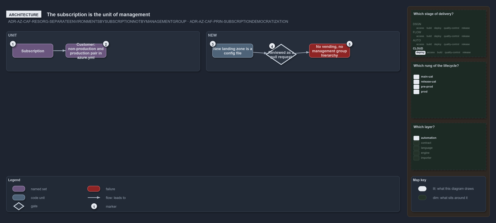

---
catzc:
  warning: "Experimental: this article merges two rules into one and holds nothing beyond what they say"
  edges:
    cites:
      - ADR-AZ-CAF-RESORG-SEPARATEENVIRONMENTSBYSUBSCRIPTIONNOTBYMANAGEMENTGROUP
      - ADR-AZ-CAF-PRIN-SUBSCRIPTIONDEMOCRATIZATION
---

# The subscription is the unit of management and environments are split by subscription

This article is one rule:
[ADR-AZ-CAF-RESORG-SEPARATEENVIRONMENTSBYSUBSCRIPTIONNOTBYMANAGEMENTGROUP](../../drs/azure/caf/resource-organization.md#rule-adr-az-caf-resorg-separateenvironmentsbysubscriptionnotbymanagementgroup)
and [ADR-AZ-CAF-PRIN-SUBSCRIPTIONDEMOCRATIZATION](../../drs/azure/caf/design-principles.md#rule-adr-az-caf-prin-subscriptiondemocratization)
merged into one. It holds nothing beyond what those two rules say.

Production and non-production are separated by subscription, never by a management group. The subscription is the unit of management: each
customer holds its own non-production and production subscription pair declared in `azure.yml`, and a new subscription's landing zone is a
config file reviewed as a pull request; subscription vending and a management group hierarchy are not adopted.

