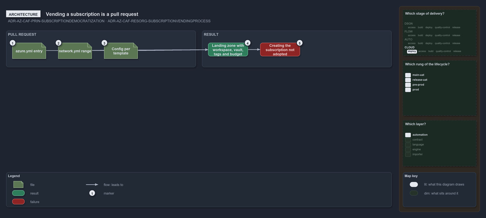

---
catzc:
  warning: "Experimental: this article merges two rules into one and holds nothing beyond what they say"
  edges:
    cites:
      - ADR-AZ-CAF-PRIN-SUBSCRIPTIONDEMOCRATIZATION
      - ADR-AZ-CAF-RESORG-SUBSCRIPTIONVENDINGPROCESS
---

# The subscription is the unit of management and vending a subscription is a pull request

This article is one rule:
[ADR-AZ-CAF-PRIN-SUBSCRIPTIONDEMOCRATIZATION](../../drs/azure/caf/design-principles.md#rule-adr-az-caf-prin-subscriptiondemocratization) and
[ADR-AZ-CAF-RESORG-SUBSCRIPTIONVENDINGPROCESS](../../drs/azure/caf/resource-organization.md#rule-adr-az-caf-resorg-subscriptionvendingprocess)
merged into one. It holds nothing beyond what those two rules say.

The subscription is the unit of management: each customer holds its own non-production and production subscription pair declared in
`azure.yml`. Subscription vending is a pull request: an `azure.yml` entry, its range in `network.yml` (the IP address plan), and one config
per template that gives it its workspace, vault, landing zone, tags and budget; creating the subscription itself is not adopted.

