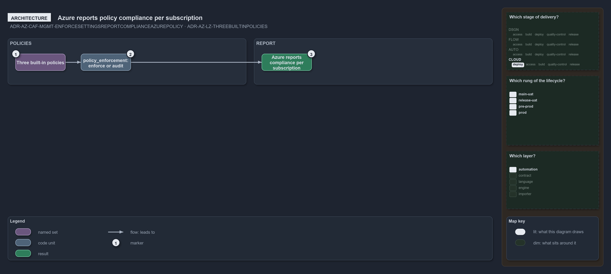

---
catzc:
  warning: "Experimental: this article merges two rules into one and holds nothing beyond what they say"
  edges:
    cites:
      - ADR-AZ-CAF-MGMT-ENFORCESETTINGSREPORTCOMPLIANCEAZUREPOLICY
      - ADR-AZ-LZ-THREEBUILTINPOLICIES
---

# Three built in policies are assigned and azure reports their compliance

This article is one rule:
[ADR-AZ-CAF-MGMT-ENFORCESETTINGSREPORTCOMPLIANCEAZUREPOLICY](../../drs/azure/caf/management.md#rule-adr-az-caf-mgmt-enforcesettingsreportcomplianceazurepolicy)
and [ADR-AZ-LZ-THREEBUILTINPOLICIES](../../drs/azure/landing-zones.md#rule-adr-az-lz-threebuiltinpolicies) merged into one. It holds nothing
beyond what those two rules say.

Every landing zone assigns three built-in policies: allowed locations (its region), a required tag on resources, and no public IP address on
a network interface. Azure reports their compliance per subscription, so settings are enforced and compliance is reported by Azure Policy;
whether they enforce or only audit is the repository-wide setting `policy_enforcement`.

