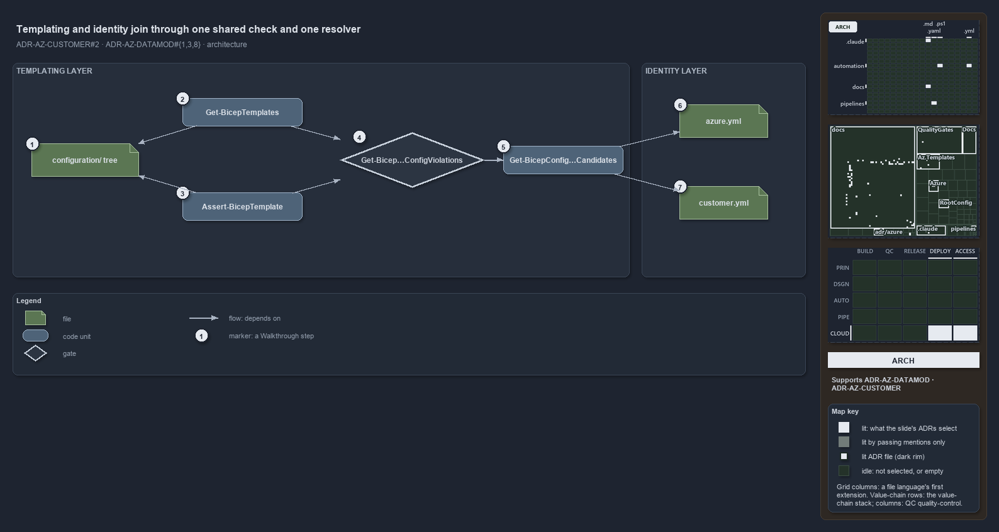

# Templating and identity join through one shared check and one resolver

```text
Templating and identity join through one shared check and one resolver.

1  configuration/ tree                    the templating layer: one config file per deployment, under a template
2  Get-BicepTemplates                     discovery; runs the shared check per file and throws on the first violation
3  Assert-BicepTemplate                   the collect-all validator; runs the same shared check and reports everything
4  Get-BicepSubscriptionConfigViolations  the shared check: subfolder is a customer key, coordinate resolves to one subscription
5  Get-BicepConfigSubscriptionCandidates  the resolver: the subscriptions a (customer?, env) coordinate can resolve to
6  azure.yml                              the identity layer: subscriptions, the environments they serve, an optional customer
7  customer.yml                           the customer catalogue: each key with its two-letter shortcode

Supports ADR-AZ-DATAMOD#1, #3 and #8, and ADR-AZ-CUSTOMER#2 (architecture lens).
```

Two config layers describe what cats deploys onto Azure. The config layer for identity, `azure.yml` and `customer.yml`, says which
subscriptions exist, which environments each serves and which customer, if any, owns it. The templating layer, the `configuration/` tree
under each template, says which deployments exist. The two never reference each other by name: they join through one resolver that turns a
config's coordinate into its subscription, and one shared check that both discovery and the collect-all validator run, so the rule cannot
drift between its two callers.



The diagram is described element by element in [its asset description](.assets/two-layers-join-through-one-resolver/diagram.drawio.md).

## Walkthrough

1. **`configuration/` tree.** Every template under `infrastructure/templates/<name>/` carries a `configuration/` folder: root files for the
   shared platform and one subfolder per customer. The tree is the templating layer's coordinate space, and nothing in it names a
   subscription.
2. **`Get-BicepTemplates`.** Discovery scans the tree, root files first and then each subfolder, and runs the shared check on every file.
   The first violation throws, so a template with a bad config never becomes a discovered template. Discovery also asks the resolver for the
   slot's subscription once the check has passed.
3. **`Assert-BicepTemplate`.** The explicit validator scans the same tree the same way but collects every problem of a template before
   throwing one consolidated error, so it can describe a template that discovery rejects.
4. **`Get-BicepSubscriptionConfigViolations`.** The shared check holds the two conventional rules for one file: a subfolder must be a key of
   the customer catalogue, and the coordinate must resolve to exactly one subscription. It reads the customer keys for the first rule and
   asks the resolver for the second, returning human-readable violations that the caller prefixes with the template's name.
5. **`Get-BicepConfigSubscriptionCandidates`.** The resolver is the single implementation of the resolution rule. For each subscription
   serving the environment it reads the `customer` token through the one accessor that naming also uses: a root coordinate keeps the
   subscriptions with no token, a customer coordinate keeps those whose token is the customer's key or resolves to it.
6. **`azure.yml`.** The subscriptions of the identity configs are maps keyed by name, each with the environments it serves and, for a
   customer subscription, a `customer` token. The shared platform pair are the only subscriptions without one.
7. **`customer.yml`.** The catalogue of customers, each a readable key and a two-letter shortcode. A subscription may bind a customer by
   either, so a shortcode token is resolved to its key through the catalogue; the catalogue itself reads nothing back from `azure.yml`.

## Why it holds

- Two config layers, identity and templating, join through the conventional configuration tree, and the subscription is always resolved from
  that coordinate, never spelled into a path (ADR-AZ-DATAMOD#1).
- Every config's coordinate must resolve to exactly one subscription id, asserted per file at discovery and by integrity tests
  (ADR-AZ-DATAMOD#3).
- The link between the two layers is enforced at discovery by `Get-BicepTemplates` through the shared
  `Get-BicepSubscriptionConfigViolations`, and over the shipped tree by integrity tests (ADR-AZ-DATAMOD#8).
- A subscription binds a customer by key or by shortcode, both resolved to the same record by the single resolver `Get-AzureCustomer`
  (ADR-AZ-CUSTOMER#2).

## See also

- [Templating data model](../../adr/azure/azure-data-model.md) — the decision this article explains, with the
  [customer model](../../adr/azure/azure-customer-model.md) it pairs with.
- The other lenses on the same coordinate: [meta](config-path-is-a-coordinate.md),
  [implementation](coordinate-resolved-file-by-file-at-discovery.md), [operations](a-bad-coordinate-stops-discovery.md) and
  [governance](coordinate-rules-and-their-gates.md).
- [The Azure explanations](index.md) · [How to read the diagrams](../index.md#how-to-read-the-diagrams)
