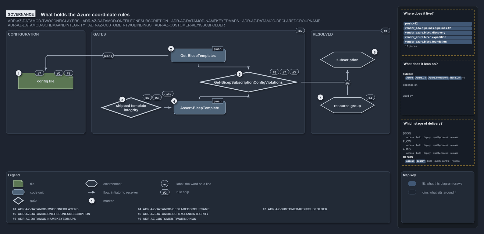

# What holds the Azure coordinate rules

```text
What holds the Azure coordinate rules.

1  config file                            the coordinate: root or customer subfolder, env and slot in the name (D1, D2, C6)
2  Get-BicepTemplates                     discovery runs the shared check per file, fail-fast (D8)
3  shipped template integrity             the integrity test that runs the validator over every shipped template (D3, D8)
4  Assert-BicepTemplate                   the collect-all validator, the second caller of the shared check (D8)
5  Get-BicepSubscriptionConfigViolations  the shared check: a subfolder is a key, one subscription, key or shortcode (D3, C6, C2)
6  subscription                           the resolved value, never a path segment or an argument (D1)
7  resource group                         its name derived by the namer; no gate checks a config for a typed one (D5, no gate)

Supports ADR-AZ-DATAMOD-TWOCONFIGLAYERS, ADR-AZ-DATAMOD-ONEFILEONESUBSCRIPTION, ADR-AZ-DATAMOD-NAMEKEYEDMAPS,
ADR-AZ-DATAMOD-DERIVEDRESOURCEGROUPNAME and ADR-AZ-DATAMOD-SCHEMAANDINTEGRITY, and ADR-AZ-CUSTOMER-TWOBINDINGS
and ADR-AZ-CUSTOMER-KEYISSUBFOLDER (governance lens).
```

Two decisions govern a config file's coordinate in cats: the templating data model, which says what the path means and that it resolves to
exactly one subscription, and the customer model, which says that a subfolder is a customer key and that a subscription may bind a customer
by key or shortcode. Every rule but one is held by a gate: the shared check that discovery and the validator both run, and the integrity
tests that run the validator over the shipped tree. The one rule without a gate, that the resource-group name is derived and never typed, is
held by the code that derives it.

```yml drawio
description:
  "The rules that govern a config file's coordinate and the gates that hold them: discovery and the validator both run the one shared check,
  an integrity test runs the validator over the shipped tree, and the derived resource-group name has no gate."
about:
  rules:
    - ADR-AZ-DATAMOD-TWOCONFIGLAYERS
    - ADR-AZ-DATAMOD-ONEFILEONESUBSCRIPTION
    - ADR-AZ-DATAMOD-NAMEKEYEDMAPS
    - ADR-AZ-DATAMOD-DERIVEDRESOURCEGROUPNAME
    - ADR-AZ-DATAMOD-SCHEMAANDINTEGRITY
    - ADR-AZ-CUSTOMER-TWOBINDINGS
    - ADR-AZ-CUSTOMER-KEYISSUBFOLDER
  lens: governance
content:
  title: What holds the Azure coordinate rules
  kind: explanation
  flow: left-to-right
  theme: dark
  bands:
    - { id: band-configuration, label: CONFIGURATION }
    - { id: band-gates, label: GATES }
    - { id: band-resolved, label: RESOLVED }
  glyphs:
    - { id: g-config, kind: file, label: config file, in: band-configuration }
    - { id: g-discovery, kind: code, label: Get-BicepTemplates, in: band-gates }
    - { id: g-integrity, kind: gate, label: shipped template integrity, in: band-gates }
    - { id: g-validator, kind: code, label: Assert-BicepTemplate, in: band-gates }
    - { id: g-check, kind: gate, label: Get-BicepSubscriptionConfigViolations, in: band-gates }
    - { id: e-subscription, kind: env, label: subscription, in: band-resolved }
    - { id: e-group, kind: env, label: resource group, in: band-resolved }
  edges:
    - { from: g-discovery, to: g-config, kind: flow, label: reads }
    - { from: g-discovery, to: g-check, kind: flow, label: "" }
    - { from: g-integrity, to: g-validator, kind: flow, label: calls }
    - { from: g-validator, to: g-check, kind: flow, label: "" }
    - { from: g-check, to: e-subscription, kind: flow, label: "" }
    - { from: e-group, to: e-subscription, kind: flow, label: in }
  markers:
    - { at: g-config, number: 1 }
    - { at: g-discovery, number: 2 }
    - { at: g-integrity, number: 3 }
    - { at: g-validator, number: 4 }
    - { at: g-check, number: 5 }
    - { at: e-subscription, number: 6 }
    - { at: e-group, number: 7 }
  chips:
    - { at: g-config, kind: rule, rule: ADR-AZ-DATAMOD-TWOCONFIGLAYERS }
    - { at: g-config, kind: rule, rule: ADR-AZ-DATAMOD-ONEFILEONESUBSCRIPTION }
    - { at: g-config, kind: rule, rule: ADR-AZ-CUSTOMER-KEYISSUBFOLDER }
    - { at: g-integrity, kind: rule, rule: ADR-AZ-DATAMOD-NAMEKEYEDMAPS }
    - { at: g-integrity, kind: rule, rule: ADR-AZ-DATAMOD-SCHEMAANDINTEGRITY }
    - { at: g-check, kind: rule, rule: ADR-AZ-DATAMOD-NAMEKEYEDMAPS }
    - { at: g-check, kind: rule, rule: ADR-AZ-CUSTOMER-KEYISSUBFOLDER }
    - { at: g-check, kind: rule, rule: ADR-AZ-CUSTOMER-TWOBINDINGS }
    - { at: band-resolved, kind: rule, rule: ADR-AZ-DATAMOD-TWOCONFIGLAYERS }
    - { at: band-gates, kind: rule, rule: ADR-AZ-DATAMOD-SCHEMAANDINTEGRITY }
    - { at: e-group, kind: rule, rule: ADR-AZ-DATAMOD-DERIVEDRESOURCEGROUPNAME, gated: false }
  legend: auto
  minimaps: [code-locations, module-neighbourhood, axis]
layout:
  band-configuration: { x: 20, y: 84, w: 260, h: 340 }
  band-gates: { x: 300, y: 84, w: 700, h: 340 }
  band-resolved: { x: 1020, y: 84, w: 260, h: 340 }
  g-config: { x: 60, y: 224, w: 180, h: 52 }
  g-discovery: { x: 560, y: 144, w: 180, h: 44 }
  g-integrity: { x: 330, y: 304, w: 200, h: 68 }
  g-validator: { x: 570, y: 316, w: 170, h: 44 }
  g-check: { x: 650, y: 220, w: 330, h: 68 }
  e-subscription: { x: 1050, y: 154, w: 180, h: 52 }
  e-group: { x: 1050, y: 304, w: 180, h: 52 }
```



## Walkthrough

1. **Config file.** The path `configuration/[<customer>/]<env>[-<slot>].yml` is ruled three times: the root is the shared platform and a
   subfolder a customer (ADR-AZ-DATAMOD-TWOCONFIGLAYERS), one file is one (customer?, env, slot), one subscription and one resource group
   (ADR-AZ-DATAMOD-ONEFILEONESUBSCRIPTION), and the subfolder is the customer key (ADR-AZ-CUSTOMER-KEYISSUBFOLDER).
2. **`Get-BicepTemplates`.** Discovery is the gate the data model names for joining the layers: it runs the shared check on every file and
   throws on the first violation (ADR-AZ-DATAMOD-SCHEMAANDINTEGRITY).
3. **Shipped template integrity.** An integrity test runs `Assert-BicepTemplate` over every shipped template without building it, and a
   second one checks the environment and customer of every slot discovery found against the identity configs. Together they are the
   "integrity tests" that ADR-AZ-DATAMOD-NAMEKEYEDMAPS and ADR-AZ-DATAMOD-SCHEMAANDINTEGRITY name beside discovery.
4. **`Assert-BicepTemplate`.** The validator is the second caller of the shared check, collecting rather than failing fast, so the rule has
   one implementation and two callers (ADR-AZ-DATAMOD-SCHEMAANDINTEGRITY).
5. **`Get-BicepSubscriptionConfigViolations`.** The shared check holds the exactly-one rule (ADR-AZ-DATAMOD-NAMEKEYEDMAPS) and the
   subfolder-is-a-key rule (ADR-AZ-CUSTOMER-KEYISSUBFOLDER), and through the resolver it honours the key-or-shortcode binding of a
   subscription's customer (ADR-AZ-CUSTOMER-TWOBINDINGS).
6. **Subscription.** The resolved subscription is a value the gate produced, never a path segment and never a deploy argument
   (ADR-AZ-DATAMOD-TWOCONFIGLAYERS).
7. **Resource group.** The group's name is derived by `Get-BicepResourceGroupName` for both the deploy target and the scope of the tracking
   tag, and never hand-typed (ADR-AZ-DATAMOD-DERIVEDRESOURCEGROUPNAME). No gate checks a resource-group-target config for a typed name,
   which is why the rule's chip is dashed: the code derives the name whatever a config says, and only a subscription-target config is
   asserted to carry none.

## Why it holds

- The subscription is resolved from the coordinate and never spelled into a path, and there is no subscription-group entity
  (ADR-AZ-DATAMOD-TWOCONFIGLAYERS).
- One config file is one (customer?, env, slot), one subscription and one resource group, and the tree is the inventory
  (ADR-AZ-DATAMOD-ONEFILEONESUBSCRIPTION).
- Every coordinate must resolve to exactly one subscription id, asserted per file at discovery and by integrity tests
  (ADR-AZ-DATAMOD-NAMEKEYEDMAPS).
- The resource-group name is derived by `Get-BicepResourceGroupName`, never hand-typed (ADR-AZ-DATAMOD-DERIVEDRESOURCEGROUPNAME).
- The link between the two layers is enforced at discovery through the shared `Get-BicepSubscriptionConfigViolations` and over the shipped
  tree by integrity tests (ADR-AZ-DATAMOD-SCHEMAANDINTEGRITY).
- A subscription binds a customer by key or shortcode through the single resolver (ADR-AZ-CUSTOMER-TWOBINDINGS), and the key is the
  subfolder name (ADR-AZ-CUSTOMER-KEYISSUBFOLDER).

## Where the code and the decision record differ

The data model states the exactly-one rule as ADR-AZ-DATAMOD-NAMEKEYEDMAPS, but the code that enforces it cites other rules: the shared
check cites ADR-AZ-DATAMOD-SCHEMAANDINTEGRITY and the filename parser cites ADR-AZ-DATAMOD-ONEFILEONESUBSCRIPTION, and no file cites #3.

## See also

- [Templating data model](../../drs/azure/azure-data-model.md) — the decision this article explains, with the
  [customer model](../../drs/azure/azure-customer-model.md) it pairs with.
- The other lenses on the same coordinate: [meta](what-a-config-files-path-resolves-to.md),
  [architecture](how-templating-and-identity-join.md), [implementation](how-discovery-resolves-a-config-coordinate.md) and
  [operations](a-bad-coordinate-stops-discovery.md).
- [The Azure explanations](index.md) · [How to read the diagrams](../index.md#how-to-read-the-diagrams)
