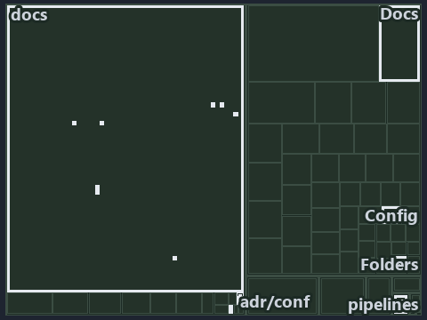

---
catzc:
  immutable:
    with_body_sha: "7c3eca86685a"
    repo_status: locked
    path: docs/explanation/configuration/.assets/an-address-is-a-read-only-walk/tree.md
    source: docs/explanation/configuration/.assets/an-address-is-a-read-only-walk/diagram.drawio.png
    role: asset-description
    language: markdown
    filetype: md
    track: docs
    tracktype: documentation
---

# A config address is a read-only walk over the one cached config, never a second reader: the tree minimap

```text
Which files cite ADR-CONF-ADDRESSING: every file of the world map is a tile, grouped by top-level folder.
15 files lit in 7 groups.
```



This is the tree minimap in the sidebar of the meta diagram of [A config address is a read-only walk over the one cached config, never a
second reader][16], which explains [ADR-CONF-ADDRESSING][1]. It lights every file that cites those codes, grouped by folder, so it shows
which files carry the decision. Each lit group has its reason below, naming the code that selects it.

## What the minimap shows

The tree draws every file of the world map as a tile, grouped by top-level folder (under `pwsh/` by module, under `docs/adr/` by ADR
domain), and lights 15 files in 7 groups, filled in ink. A lit ADR file has a white rim; a file lit only by passing mentions is a lighter
ink. Every other tile is idle, a grey box: a file the slide's ADR codes do not select.

- docs (docs/ outside docs/adr/): 8 lit files
- adr/conf (docs/adr/configuration): 2 lit files
- adr/* (the files directly in docs/adr/): 1 lit file
- pipelines: 1 lit file
- Config (pwsh/Catzc.Base.Config): 1 lit file
- Docs (pwsh/Catzc.Base.Docs): 1 lit file
- Folders (pwsh/Catzc.Base.Folders): 1 lit file

## Why each group is lit

### docs (docs/ outside docs/adr/, 8 lit files)

The group holds the files of docs/ outside docs/adr/; each sits in its world-map cell and is lit by:

- [docs/references/pwsh/.assets/bicep-template-is-a-folder/diagram.drawio.md][2], in the cell docs × markdown: selected by
  [ADR-CONF-ADDRESSING][1]: the file cites it at line 33 (text), line 33 (text), line 96 (text) and line 97 (text).
- [docs/references/pwsh/.assets/bicep-template-is-a-folder/diagram.drawio.verify.md][3], in the cell docs × markdown: selected by
  [ADR-CONF-ADDRESSING][1]: the file cites it at line 45 (text) and line 45 (text).
- [docs/references/pwsh/catzc-azure-templates/private/Resolve-BicepParameterAddresses.ps1.md][4], in the cell docs × markdown: selected by
  [ADR-CONF-ADDRESSING][1]: the file cites it at line 18 (text) and line 23 (text).
- [docs/references/pwsh/catzc-base-config/Get-ConfigValue.ps1.md][5], in the cell docs × markdown: selected by [ADR-CONF-ADDRESSING][1]: the
  file cites it at line 14 (text), line 24 (text), line 26 (text) and line 28 (text).
- [docs/references/pwsh/catzc-base-config/private/Resolve-ConfigKeyPath.ps1.md][6], in the cell docs × markdown: selected by
  [ADR-CONF-ADDRESSING][1]: the file cites it at line 14 (text), line 20 (text), line 22 (text) and line 26 (text).
- [docs/references/pwsh/catzc-base-languages/New-GoWorkspace.ps1.md][7], in the cell docs × markdown: selected by [ADR-CONF-ADDRESSING][1]:
  the file cites it at line 63 (text).
- [docs/references/pwsh/catzc-base-languages/New-PythonProject.ps1.md][8], in the cell docs × markdown: selected by
  [ADR-CONF-ADDRESSING][1]: the file cites it at line 56 (text).
- [docs/references/pwsh/catzc-tooling-environment/Write-EnvironmentSet.ps1.md][9], in the cell docs × markdown: selected by
  [ADR-CONF-ADDRESSING][1]: the file cites it at line 20 (text).

### adr/conf (docs/adr/configuration, 2 lit files)

The group holds the files of docs/adr/configuration; each sits in its world-map cell and is lit by:

- [docs/adr/configuration/config-value-addressing.md][1], in the cell docs × markdown: selected by [ADR-CONF-ADDRESSING][1]: the ADR's own
  file.
- [docs/adr/configuration/dora-explains.md][10], in the cell docs × markdown: selected by [ADR-CONF-ADDRESSING][1]: the file cites it at
  line 28 (text).

### adr/* (the files directly in docs/adr/, 1 lit file)

The group holds the files of the files directly in docs/adr/; each sits in its world-map cell and is lit by:

- [docs/adr/index.md][11], in the cell docs × markdown: selected by [ADR-CONF-ADDRESSING][1]: the file cites it at line 237 (text).

### pipelines (1 lit file)

The group holds the files of pipelines; each sits in its world-map cell and is lit by:

- [pipelines/ci-automation.yaml][12], in the cell pipelines × pipeline-yaml: selected by [ADR-CONF-ADDRESSING][1]: a pipeline that cites
  nothing itself carries its globset's citations, which cite it at `pwsh/Catzc.Base.Config/tests/Get-ConfigValue.Tests.ps1` line 37 (text),
  `pwsh/Catzc.Base.Config/tests/Get-ConfigValue.Tests.ps1` line 66 (text), `pwsh/Catzc.Base.Docs/configs/adrs.yml` line 209 (text) and
  `pwsh/Catzc.Base.Folders/tests/types/FolderWalkConfig.Tests.ps1` line 54 (text).

### Config (pwsh/Catzc.Base.Config, 1 lit file)

The group holds the files of pwsh/Catzc.Base.Config; each sits in its world-map cell and is lit by:

- [pwsh/Catzc.Base.Config/tests/Get-ConfigValue.Tests.ps1][13], in the cell pwsh × powershell: selected by [ADR-CONF-ADDRESSING][1]: the
  file cites it at line 37 (text) and line 66 (text).

### Docs (pwsh/Catzc.Base.Docs, 1 lit file)

The group holds the files of pwsh/Catzc.Base.Docs; each sits in its world-map cell and is lit by:

- [pwsh/Catzc.Base.Docs/configs/adrs.yml][14], in the cell pwsh × yaml: selected by [ADR-CONF-ADDRESSING][1]: the file cites it at line 209
  (text).

### Folders (pwsh/Catzc.Base.Folders, 1 lit file)

The group holds the files of pwsh/Catzc.Base.Folders; each sits in its world-map cell and is lit by:

- [pwsh/Catzc.Base.Folders/tests/types/FolderWalkConfig.Tests.ps1][15], in the cell pwsh × powershell: selected by [ADR-CONF-ADDRESSING][1]:
  the file cites it at line 54 (text).

## Keywords

- [world map][17]
- [track][18]
- [file language][19]
- [cell][20]
- [lit cell][21]
- [docs][22]: a track
- [pipelines][22]: a track
- [pwsh][22]: a track
- [markdown][23]: a file language
- [pipeline-yaml][23]: a file language
- [powershell][23]: a file language
- [yaml][23]: a file language

[1]: ../../../../adr/configuration/config-value-addressing.md
[2]: ../../../../references/pwsh/.assets/bicep-template-is-a-folder/diagram.drawio.md
[3]: ../../../../references/pwsh/.assets/bicep-template-is-a-folder/diagram.drawio.verify.md
[4]: ../../../../references/pwsh/catzc-azure-templates/private/Resolve-BicepParameterAddresses.ps1.md
[5]: ../../../../references/pwsh/catzc-base-config/Get-ConfigValue.ps1.md
[6]: ../../../../references/pwsh/catzc-base-config/private/Resolve-ConfigKeyPath.ps1.md
[7]: ../../../../references/pwsh/catzc-base-languages/New-GoWorkspace.ps1.md
[8]: ../../../../references/pwsh/catzc-base-languages/New-PythonProject.ps1.md
[9]: ../../../../references/pwsh/catzc-tooling-environment/Write-EnvironmentSet.ps1.md
[10]: ../../../../adr/configuration/dora-explains.md
[11]: ../../../../adr/index.md
[12]: ../../../../../pipelines/ci-automation.yaml
[13]: ../../../../../pwsh/Catzc.Base.Config/tests/Get-ConfigValue.Tests.ps1
[14]: ../../../../../pwsh/Catzc.Base.Docs/configs/adrs.yml
[15]: ../../../../../pwsh/Catzc.Base.Folders/tests/types/FolderWalkConfig.Tests.ps1
[16]: ../../an-address-is-a-read-only-walk.md
[17]: ../../../../adr/glossary.md#world-map
[18]: ../../../../adr/glossary.md#track
[19]: ../../../../adr/glossary.md#file-language
[20]: ../../../../adr/glossary.md#cell
[21]: ../../../../adr/glossary.md#lit-cell
[22]: ../../../../../pwsh/Catzc.Base.Variants/configs/variants.yml
[23]: ../../../../../pwsh/Catzc.Base.Languages/configs/languages.yml
