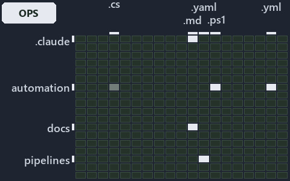

---
catzc:
  immutable:
    with_body_sha: "834df245cdcd"
    repo_status: locked
    path: docs/explanation/configuration/.assets/ask-by-name-get-the-cached-object/grid.md
    source: docs/explanation/configuration/.assets/ask-by-name-get-the-cached-object/diagram.drawio.png
    role: asset-description
    language: markdown
    filetype: md
    track: docs
    tracktype: documentation
---

# Ask for a config by name and get the cached object back: the world-map minimap

```text
Where the files that cite ADR-CONF-ADDRESSING and ADR-CONF-LOADING sit in the repository: tracks down, file languages across.
6 of 342 cells lit, holding 42 files.
```



This is the world-map minimap in the sidebar of the operations diagram of [Ask for a config by name and get the cached object back][44],
which explains [ADR-CONF-ADDRESSING][1] and [ADR-CONF-LOADING][2]. It lights every cell of the world map that holds a file citing those
codes, so it shows where the decision lives in the repository. Each lit cell has its reason below, naming the code that selects it.

## What the minimap shows

The grid crosses the 18 tracks (rows) with the 19 file languages (columns) of the world map and lights 6 cells, filled in ink. A cell lit
only by passing mentions (citations in body comments, not in a file's header or text) is touched: a lighter ink. Every other cell is idle, a
grey box: it holds files the slide's ADR codes do not select, or no file at all (288 of the 342 cells hold none). The minimap shows where
the slide sits, not how many files a cell holds; the world-map PDFs show the counts.

- .claude × markdown: 1 lit of 64 files
- docs × markdown: 32 lit of 2766 files
- pipelines × pipeline-yaml: 1 lit of 14 files
- pwsh × csharp: 3 lit of 295 files, touched
- pwsh × powershell: 4 lit of 1653 files
- pwsh × yaml: 1 lit of 115 files

## Key

A lit row prints its track's name; a lit column prints a short code, the first extension of its file language:

- `.cs`: csharp
- `.md`: markdown
- `.yaml`: pipeline-yaml
- `.ps1`: powershell
- `.yml`: yaml

## Why each cell is lit

### .claude × markdown (1 lit file)

Placed: the root folder `.claude/` names the track .claude ([ADR-DSGN-TRACK-TRACKISPLACEDCLUSTER][3]); the extension `.md` names the file
language markdown ([ADR-DSGN-TRACK-FILELANGUAGE][3]). Lit ([ADR-DSGN-TRACK-LITCELL][3]) by:

- [.claude/plans/prompt-bounded-folder-enumeration-continue.md][4]: selected by [ADR-CONF-ADDRESSING][1]: the file cites it at line 18
  (text).

### docs × markdown (32 lit files)

Placed: the root folder `docs/` names the track docs ([ADR-DSGN-TRACK-TRACKISPLACEDCLUSTER][3]); the extension `.md` names the file language
markdown ([ADR-DSGN-TRACK-FILELANGUAGE][3]). Lit ([ADR-DSGN-TRACK-LITCELL][3]) by:

- [docs/adr/configuration/config-value-addressing.md][1]: selected by [ADR-CONF-ADDRESSING][1]: the ADR's own file.
- [docs/adr/configuration/dora-explains.md][5]: selected by [ADR-CONF-ADDRESSING][1]: the file cites it at line 28 (text); selected by
  [ADR-CONF-LOADING][2]: the file cites it at line 11 (text).
- [docs/adr/configuration/module-config-loading.md][2]: selected by [ADR-CONF-LOADING][2]: the ADR's own file.
- [docs/adr/index.md][6]: selected by [ADR-CONF-ADDRESSING][1]: the file cites it at line 237 (text); selected by [ADR-CONF-LOADING][2]: the
  file cites it at line 236 (text).
- [docs/how-to/getting-started/pwsh/add-a-module.md][7]: selected by [ADR-CONF-LOADING][2]: the file cites it at line 72 (text).
- [docs/how-to/pwsh/manual-test-plan/configs.md][8]: selected by [ADR-CONF-LOADING][2]: the file cites it at line 44 (text) and line 63
  (text).
- [docs/references/pwsh/.assets/bicep-template-is-a-folder/diagram.drawio.md][9]: selected by [ADR-CONF-ADDRESSING][1]: the file cites it at
  line 32 (text), line 32 (text), line 95 (text) and line 95 (text).
- [docs/references/pwsh/.assets/bicep-template-is-a-folder/diagram.drawio.verify.md][10]: selected by [ADR-CONF-ADDRESSING][1]: the file
  cites it at line 45 (text) and line 45 (text).
- [docs/references/pwsh/.assets/invoke-tool-asserts-locked-version/diagram.drawio.md][11]: selected by [ADR-CONF-LOADING][2]: the file cites
  it at line 26 (text) and line 93 (text).
- [docs/references/pwsh/.assets/invoke-tool-asserts-locked-version/diagram.drawio.verify.md][12]: selected by [ADR-CONF-LOADING][2]: the
  file cites it at line 45 (text).
- [docs/references/pwsh/catzc-azure-templates/private/Resolve-BicepParameterAddresses.ps1.md][13]: selected by [ADR-CONF-ADDRESSING][1]: the
  file cites it at line 17 (text) and line 21 (text).
- [docs/references/pwsh/catzc-base-config/Get-ConfigValue.ps1.md][14]: selected by [ADR-CONF-ADDRESSING][1]: the file cites it at line 14
  (text), line 23 (text), line 25 (text) and line 27 (text); selected by [ADR-CONF-LOADING][2]: the file cites it at line 16 (text) and line
  20 (text).
- [docs/references/pwsh/catzc-base-config/private/Resolve-ConfigKeyPath.ps1.md][15]: selected by [ADR-CONF-ADDRESSING][1]: the file cites it
  at line 14 (text), line 20 (text), line 22 (text) and line 26 (text).
- [docs/references/pwsh/catzc-base-config/tests/Get-ConfigValue.Tests.ps1.md][16]: selected by [ADR-CONF-LOADING][2]: the file cites it at
  line 12 (text).
- [docs/references/pwsh/catzc-base-docs/Build-Readme.ps1.md][17]: selected by [ADR-CONF-LOADING][2]: the file cites it at line 26 (text).
- [docs/references/pwsh/catzc-base-docs/private/Get-CatsRuleEnforcers.ps1.md][18]: selected by [ADR-CONF-LOADING][2]: the file cites it at
  line 21 (text).
- [docs/references/pwsh/catzc-base-docs/private/Get-GlossarySources.ps1.md][19]: selected by [ADR-CONF-LOADING][2]: the file cites it at
  line 18 (text).
- [docs/references/pwsh/catzc-base-docs/types/AdrChecksConfig.cs.md][20]: selected by [ADR-CONF-LOADING][2]: the file cites it at line 16
  (text).
- [docs/references/pwsh/catzc-base-docs/types/AdrsConfig.cs.md][21]: selected by [ADR-CONF-LOADING][2]: the file cites it at line 15 (text).
- [docs/references/pwsh/catzc-base-docs/types/AgentsConfig.cs.md][22]: selected by [ADR-CONF-LOADING][2]: the file cites it at line 16
  (text).
- [docs/references/pwsh/catzc-base-docs/types/DocsConfig.cs.md][23]: selected by [ADR-CONF-LOADING][2]: the file cites it at line 16 (text).
- [docs/references/pwsh/catzc-base-execution/Resolve-ToolExecutable.ps1.md][24]: selected by [ADR-CONF-LOADING][2]: the file cites it at
  line 18 (text).
- [docs/references/pwsh/catzc-base-git/private/Get-AutoControlledGlobs.ps1.md][25]: selected by [ADR-CONF-LOADING][2]: the file cites it at
  line 19 (text).
- [docs/references/pwsh/catzc-base-git/types/GitIgnoreConfig.cs.md][26]: selected by [ADR-CONF-LOADING][2]: the file cites it at line 15
  (text).
- [docs/references/pwsh/catzc-base-languages/New-GoWorkspace.ps1.md][27]: selected by [ADR-CONF-ADDRESSING][1]: the file cites it at line 63
  (text).
- [docs/references/pwsh/catzc-base-languages/New-PythonProject.ps1.md][28]: selected by [ADR-CONF-ADDRESSING][1]: the file cites it at line
  56 (text).
- [docs/references/pwsh/catzc-base-modulesystem/Copy-CatzcModule.ps1.md][29]: selected by [ADR-CONF-LOADING][2]: the file cites it at line
  40 (text).
- [docs/references/pwsh/catzc-base-qualitygates/Test-ShippedConfigs.ps1.md][30]: selected by [ADR-CONF-LOADING][2]: the file cites it at
  line 15 (text).
- [docs/references/pwsh/catzc-base-qualitygates/private/Get-LiveIdentityTokens.ps1.md][31]: selected by [ADR-CONF-LOADING][2]: the file
  cites it at line 20 (text).
- [docs/references/pwsh/catzc-base-qualitygates/types/FileMetaConfig.cs.md][32]: selected by [ADR-CONF-LOADING][2]: the file cites it at
  line 13 (text).
- [docs/references/pwsh/catzc-base-rootconfig/types/RootConfigFiles.cs.md][33]: selected by [ADR-CONF-LOADING][2]: the file cites it at line
  15 (text).
- [docs/references/pwsh/catzc-tooling-environment/Write-EnvironmentSet.ps1.md][34]: selected by [ADR-CONF-ADDRESSING][1]: the file cites it
  at line 20 (text).

### pipelines × pipeline-yaml (1 lit file)

Placed: the root folder `pipelines/` names the track pipelines ([ADR-DSGN-TRACK-TRACKISPLACEDCLUSTER][3]); the extension `.yaml` names the
file language pipeline-yaml ([ADR-DSGN-TRACK-FILELANGUAGE][3]). Lit ([ADR-DSGN-TRACK-LITCELL][3]) by:

- [pipelines/ci-automation.yaml][35]: selected by [ADR-CONF-ADDRESSING][1]: a pipeline that cites nothing itself carries its globset's
  citations, which cite it at `pwsh/Catzc.Base.Config/tests/Get-ConfigValue.Tests.ps1` line 37 (text),
  `pwsh/Catzc.Base.Config/tests/Get-ConfigValue.Tests.ps1` line 66 (text), `pwsh/Catzc.Base.Docs/configs/adrs.yml` line 209 (text) and
  `pwsh/Catzc.Base.Folders/tests/types/FolderWalkConfig.Tests.ps1` line 54 (text); selected by [ADR-CONF-LOADING][2]: a pipeline that cites
  nothing itself carries its globset's citations, which cite it at `pwsh/Catzc.Base.Docs/configs/adrs.yml` line 208 (text),
  `pwsh/Catzc.Base.Docs/tests/Get-AdrRuleSet.Tests.ps1` line 38 (text), `pwsh/Catzc.Base.Docs/types/CapabilitiesConfig.cs` line 7 (body
  comment), `pwsh/Catzc.Base.Docs/types/CapabilityEntry.cs` line 8 (body comment), `pwsh/Catzc.Base.Globs/types/FileKindsConfig.cs` line 10
  (body comment) and `pwsh/Catzc.Base.QualityGates/tests/types/CommentsConfig.Tests.ps1` line 132 (text).

### pwsh × csharp (3 lit files, touched)

Placed: the root folder `pwsh/` names the track pwsh ([ADR-DSGN-TRACK-TRACKISPLACEDCLUSTER][3]); the extension `.cs` names the file language
csharp ([ADR-DSGN-TRACK-FILELANGUAGE][3]). Lit ([ADR-DSGN-TRACK-LITCELL][3]) by:

- [pwsh/Catzc.Base.Docs/types/CapabilitiesConfig.cs][36]: selected by [ADR-CONF-LOADING][2]: the file cites it at line 7 (body comment) (a
  passing mention only).
- [pwsh/Catzc.Base.Docs/types/CapabilityEntry.cs][37]: selected by [ADR-CONF-LOADING][2]: the file cites it at line 8 (body comment) (a
  passing mention only).
- [pwsh/Catzc.Base.Globs/types/FileKindsConfig.cs][38]: selected by [ADR-CONF-LOADING][2]: the file cites it at line 10 (body comment) (a
  passing mention only).

### pwsh × powershell (4 lit files)

Placed: the root folder `pwsh/` names the track pwsh ([ADR-DSGN-TRACK-TRACKISPLACEDCLUSTER][3]); the extension `.ps1` names the file
language powershell ([ADR-DSGN-TRACK-FILELANGUAGE][3]). Lit ([ADR-DSGN-TRACK-LITCELL][3]) by:

- [pwsh/Catzc.Base.Config/tests/Get-ConfigValue.Tests.ps1][39]: selected by [ADR-CONF-ADDRESSING][1]: the file cites it at line 37 (text)
  and line 66 (text).
- [pwsh/Catzc.Base.Docs/tests/Get-AdrRuleSet.Tests.ps1][40]: selected by [ADR-CONF-LOADING][2]: the file cites it at line 38 (text).
- [pwsh/Catzc.Base.Folders/tests/types/FolderWalkConfig.Tests.ps1][41]: selected by [ADR-CONF-ADDRESSING][1]: the file cites it at line 54
  (text).
- [pwsh/Catzc.Base.QualityGates/tests/types/CommentsConfig.Tests.ps1][42]: selected by [ADR-CONF-LOADING][2]: the file cites it at line 132
  (text).

### pwsh × yaml (1 lit file)

Placed: the root folder `pwsh/` names the track pwsh ([ADR-DSGN-TRACK-TRACKISPLACEDCLUSTER][3]); the extension `.yml` names the file
language yaml ([ADR-DSGN-TRACK-FILELANGUAGE][3]). Lit ([ADR-DSGN-TRACK-LITCELL][3]) by:

- [pwsh/Catzc.Base.Docs/configs/adrs.yml][43]: selected by [ADR-CONF-ADDRESSING][1]: the file cites it at line 209 (text); selected by
  [ADR-CONF-LOADING][2]: the file cites it at line 208 (text).

## Keywords

- [world map][45]
- [track][46]
- [file language][47]
- [cell][48]
- [lit cell][49]
- [.claude][50]: a track
- [docs][50]: a track
- [pipelines][50]: a track
- [pwsh][50]: a track
- [csharp][51]: a file language
- [markdown][51]: a file language
- [pipeline-yaml][51]: a file language
- [powershell][51]: a file language
- [yaml][51]: a file language

[1]: ../../../../adr/configuration/config-value-addressing.md
[2]: ../../../../adr/configuration/module-config-loading.md
[3]: ../../../../adr/design/tracks.md
[4]: ../../../../../.claude/plans/prompt-bounded-folder-enumeration-continue.md
[5]: ../../../../adr/configuration/dora-explains.md
[6]: ../../../../adr/index.md
[7]: ../../../../how-to/getting-started/pwsh/add-a-module.md
[8]: ../../../../how-to/pwsh/manual-test-plan/configs.md
[9]: ../../../../references/pwsh/.assets/bicep-template-is-a-folder/diagram.drawio.md
[10]: ../../../../references/pwsh/.assets/bicep-template-is-a-folder/diagram.drawio.verify.md
[11]: ../../../../references/pwsh/.assets/invoke-tool-asserts-locked-version/diagram.drawio.md
[12]: ../../../../references/pwsh/.assets/invoke-tool-asserts-locked-version/diagram.drawio.verify.md
[13]: ../../../../references/pwsh/catzc-azure-templates/private/Resolve-BicepParameterAddresses.ps1.md
[14]: ../../../../references/pwsh/catzc-base-config/Get-ConfigValue.ps1.md
[15]: ../../../../references/pwsh/catzc-base-config/private/Resolve-ConfigKeyPath.ps1.md
[16]: ../../../../references/pwsh/catzc-base-config/tests/Get-ConfigValue.Tests.ps1.md
[17]: ../../../../references/pwsh/catzc-base-docs/Build-Readme.ps1.md
[18]: ../../../../references/pwsh/catzc-base-docs/private/Get-CatsRuleEnforcers.ps1.md
[19]: ../../../../references/pwsh/catzc-base-docs/private/Get-GlossarySources.ps1.md
[20]: ../../../../references/pwsh/catzc-base-docs/types/AdrChecksConfig.cs.md
[21]: ../../../../references/pwsh/catzc-base-docs/types/AdrsConfig.cs.md
[22]: ../../../../references/pwsh/catzc-base-docs/types/AgentsConfig.cs.md
[23]: ../../../../references/pwsh/catzc-base-docs/types/DocsConfig.cs.md
[24]: ../../../../references/pwsh/catzc-base-execution/Resolve-ToolExecutable.ps1.md
[25]: ../../../../references/pwsh/catzc-base-git/private/Get-AutoControlledGlobs.ps1.md
[26]: ../../../../references/pwsh/catzc-base-git/types/GitIgnoreConfig.cs.md
[27]: ../../../../references/pwsh/catzc-base-languages/New-GoWorkspace.ps1.md
[28]: ../../../../references/pwsh/catzc-base-languages/New-PythonProject.ps1.md
[29]: ../../../../references/pwsh/catzc-base-modulesystem/Copy-CatzcModule.ps1.md
[30]: ../../../../references/pwsh/catzc-base-qualitygates/Test-ShippedConfigs.ps1.md
[31]: ../../../../references/pwsh/catzc-base-qualitygates/private/Get-LiveIdentityTokens.ps1.md
[32]: ../../../../references/pwsh/catzc-base-qualitygates/types/FileMetaConfig.cs.md
[33]: ../../../../references/pwsh/catzc-base-rootconfig/types/RootConfigFiles.cs.md
[34]: ../../../../references/pwsh/catzc-tooling-environment/Write-EnvironmentSet.ps1.md
[35]: ../../../../../pipelines/ci-automation.yaml
[36]: ../../../../../pwsh/Catzc.Base.Docs/types/CapabilitiesConfig.cs
[37]: ../../../../../pwsh/Catzc.Base.Docs/types/CapabilityEntry.cs
[38]: ../../../../../pwsh/Catzc.Base.Globs/types/FileKindsConfig.cs
[39]: ../../../../../pwsh/Catzc.Base.Config/tests/Get-ConfigValue.Tests.ps1
[40]: ../../../../../pwsh/Catzc.Base.Docs/tests/Get-AdrRuleSet.Tests.ps1
[41]: ../../../../../pwsh/Catzc.Base.Folders/tests/types/FolderWalkConfig.Tests.ps1
[42]: ../../../../../pwsh/Catzc.Base.QualityGates/tests/types/CommentsConfig.Tests.ps1
[43]: ../../../../../pwsh/Catzc.Base.Docs/configs/adrs.yml
[44]: ../../ask-by-name-get-the-cached-object.md
[45]: ../../../../adr/glossary.md#world-map
[46]: ../../../../adr/glossary.md#track
[47]: ../../../../adr/glossary.md#file-language
[48]: ../../../../adr/glossary.md#cell
[49]: ../../../../adr/glossary.md#lit-cell
[50]: ../../../../../pwsh/Catzc.Base.Variants/configs/variants.yml
[51]: ../../../../../pwsh/Catzc.Base.Languages/configs/languages.yml
