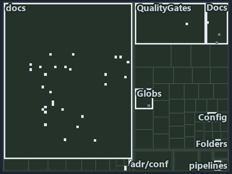

---
catzc:
  immutable:
    with_body_sha: "1943ea96e838"
    repo_status: locked
    path: docs/explanation/configuration/.assets/ask-by-name-get-the-cached-object/tree.md
    source: docs/explanation/configuration/.assets/ask-by-name-get-the-cached-object/diagram.drawio.png
    role: asset-description
    language: markdown
    filetype: md
    track: docs
    tracktype: documentation
---

# Ask for a config by name and get the cached object back: the tree minimap

```text
Which files cite ADR-CONF-ADDRESSING and ADR-CONF-LOADING: every file of the world map is a tile, grouped by top-level folder.
41 files lit in 9 groups.
```



This is the tree minimap in the sidebar of the operations diagram of [Ask for a config by name and get the cached object back][42], which
explains [ADR-CONF-ADDRESSING][1] and [ADR-CONF-LOADING][2]. It lights every file that cites those codes, grouped by folder, so it shows
which files carry the decision. Each lit group has its reason below, naming the code that selects it.

## What the minimap shows

The tree draws every file of the world map as a tile, grouped by top-level folder (under `pwsh/` by module, under `docs/adr/` by ADR
domain), and lights 41 files in 9 groups, filled in ink. A lit ADR file has a white rim; a file lit only by passing mentions is a lighter
ink. Every other tile is idle, a grey box: a file the slide's ADR codes do not select.

- docs (docs/ outside docs/adr/): 28 lit files
- Docs (pwsh/Catzc.Base.Docs): 4 lit files
- adr/conf (docs/adr/configuration): 3 lit files
- adr/* (the files directly in docs/adr/): 1 lit file
- pipelines: 1 lit file
- Config (pwsh/Catzc.Base.Config): 1 lit file
- Folders (pwsh/Catzc.Base.Folders): 1 lit file
- Globs (pwsh/Catzc.Base.Globs): 1 lit file
- QualityGates (pwsh/Catzc.Base.QualityGates): 1 lit file

## Why each group is lit

### docs (docs/ outside docs/adr/, 28 lit files)

The group holds the files of docs/ outside docs/adr/; each sits in its world-map cell and is lit by:

- [docs/how-to/getting-started/pwsh/add-a-module.md][3], in the cell docs × markdown: selected by [ADR-CONF-LOADING][2]: the file cites it
  at line 72 (text).
- [docs/how-to/pwsh/manual-test-plan/configs.md][4], in the cell docs × markdown: selected by [ADR-CONF-LOADING][2]: the file cites it at
  line 44 (text) and line 64 (text).
- [docs/references/pwsh/.assets/bicep-template-is-a-folder/diagram.drawio.md][5], in the cell docs × markdown: selected by
  [ADR-CONF-ADDRESSING][1]: the file cites it at line 33 (text), line 33 (text), line 96 (text) and line 97 (text).
- [docs/references/pwsh/.assets/bicep-template-is-a-folder/diagram.drawio.verify.md][6], in the cell docs × markdown: selected by
  [ADR-CONF-ADDRESSING][1]: the file cites it at line 45 (text) and line 45 (text).
- [docs/references/pwsh/.assets/invoke-tool-asserts-locked-version/diagram.drawio.md][7], in the cell docs × markdown: selected by
  [ADR-CONF-LOADING][2]: the file cites it at line 26 (text) and line 94 (text).
- [docs/references/pwsh/.assets/invoke-tool-asserts-locked-version/diagram.drawio.verify.md][8], in the cell docs × markdown: selected by
  [ADR-CONF-LOADING][2]: the file cites it at line 45 (text).
- [docs/references/pwsh/catzc-azure-templates/private/Resolve-BicepParameterAddresses.ps1.md][9], in the cell docs × markdown: selected by
  [ADR-CONF-ADDRESSING][1]: the file cites it at line 18 (text) and line 23 (text).
- [docs/references/pwsh/catzc-base-config/Get-ConfigValue.ps1.md][10], in the cell docs × markdown: selected by [ADR-CONF-ADDRESSING][1]:
  the file cites it at line 14 (text), line 24 (text), line 26 (text) and line 28 (text); selected by [ADR-CONF-LOADING][2]: the file cites
  it at line 16 (text) and line 21 (text).
- [docs/references/pwsh/catzc-base-config/private/Resolve-ConfigKeyPath.ps1.md][11], in the cell docs × markdown: selected by
  [ADR-CONF-ADDRESSING][1]: the file cites it at line 14 (text), line 20 (text), line 22 (text) and line 26 (text).
- [docs/references/pwsh/catzc-base-config/tests/Get-ConfigValue.Tests.ps1.md][12], in the cell docs × markdown: selected by
  [ADR-CONF-LOADING][2]: the file cites it at line 12 (text).
- [docs/references/pwsh/catzc-base-docs/Build-Readme.ps1.md][13], in the cell docs × markdown: selected by [ADR-CONF-LOADING][2]: the file
  cites it at line 26 (text).
- [docs/references/pwsh/catzc-base-docs/private/Get-CatsRuleEnforcers.ps1.md][14], in the cell docs × markdown: selected by
  [ADR-CONF-LOADING][2]: the file cites it at line 22 (text).
- [docs/references/pwsh/catzc-base-docs/private/Get-GlossarySources.ps1.md][15], in the cell docs × markdown: selected by
  [ADR-CONF-LOADING][2]: the file cites it at line 18 (text).
- [docs/references/pwsh/catzc-base-docs/types/AdrChecksConfig.cs.md][16], in the cell docs × markdown: selected by [ADR-CONF-LOADING][2]:
  the file cites it at line 16 (text).
- [docs/references/pwsh/catzc-base-docs/types/AdrsConfig.cs.md][17], in the cell docs × markdown: selected by [ADR-CONF-LOADING][2]: the
  file cites it at line 15 (text).
- [docs/references/pwsh/catzc-base-docs/types/AgentsConfig.cs.md][18], in the cell docs × markdown: selected by [ADR-CONF-LOADING][2]: the
  file cites it at line 16 (text).
- [docs/references/pwsh/catzc-base-docs/types/DocsConfig.cs.md][19], in the cell docs × markdown: selected by [ADR-CONF-LOADING][2]: the
  file cites it at line 16 (text).
- [docs/references/pwsh/catzc-base-execution/Resolve-ToolExecutable.ps1.md][20], in the cell docs × markdown: selected by
  [ADR-CONF-LOADING][2]: the file cites it at line 18 (text).
- [docs/references/pwsh/catzc-base-git/private/Get-AutoControlledGlobs.ps1.md][21], in the cell docs × markdown: selected by
  [ADR-CONF-LOADING][2]: the file cites it at line 19 (text).
- [docs/references/pwsh/catzc-base-git/types/GitIgnoreConfig.cs.md][22], in the cell docs × markdown: selected by [ADR-CONF-LOADING][2]: the
  file cites it at line 15 (text).
- [docs/references/pwsh/catzc-base-languages/New-GoWorkspace.ps1.md][23], in the cell docs × markdown: selected by [ADR-CONF-ADDRESSING][1]:
  the file cites it at line 63 (text).
- [docs/references/pwsh/catzc-base-languages/New-PythonProject.ps1.md][24], in the cell docs × markdown: selected by
  [ADR-CONF-ADDRESSING][1]: the file cites it at line 56 (text).
- [docs/references/pwsh/catzc-base-modulesystem/Copy-CatzcModule.ps1.md][25], in the cell docs × markdown: selected by
  [ADR-CONF-LOADING][2]: the file cites it at line 40 (text).
- [docs/references/pwsh/catzc-base-qualitygates/Test-ShippedConfigs.ps1.md][26], in the cell docs × markdown: selected by
  [ADR-CONF-LOADING][2]: the file cites it at line 15 (text).
- [docs/references/pwsh/catzc-base-qualitygates/private/Get-LiveIdentityTokens.ps1.md][27], in the cell docs × markdown: selected by
  [ADR-CONF-LOADING][2]: the file cites it at line 20 (text).
- [docs/references/pwsh/catzc-base-qualitygates/types/FileMetaConfig.cs.md][28], in the cell docs × markdown: selected by
  [ADR-CONF-LOADING][2]: the file cites it at line 13 (text).
- [docs/references/pwsh/catzc-base-rootconfig/types/RootConfigFiles.cs.md][29], in the cell docs × markdown: selected by
  [ADR-CONF-LOADING][2]: the file cites it at line 15 (text).
- [docs/references/pwsh/catzc-tooling-environment/Write-EnvironmentSet.ps1.md][30], in the cell docs × markdown: selected by
  [ADR-CONF-ADDRESSING][1]: the file cites it at line 20 (text).

### Docs (pwsh/Catzc.Base.Docs, 4 lit files)

The group holds the files of pwsh/Catzc.Base.Docs; each sits in its world-map cell and is lit by:

- [pwsh/Catzc.Base.Docs/configs/adrs.yml][31], in the cell pwsh × yaml: selected by [ADR-CONF-ADDRESSING][1]: the file cites it at line 209
  (text); selected by [ADR-CONF-LOADING][2]: the file cites it at line 208 (text).
- [pwsh/Catzc.Base.Docs/tests/Get-AdrRuleSet.Tests.ps1][32], in the cell pwsh × powershell: selected by [ADR-CONF-LOADING][2]: the file
  cites it at line 38 (text).
- [pwsh/Catzc.Base.Docs/types/CapabilitiesConfig.cs][33], in the cell pwsh × csharp: selected by [ADR-CONF-LOADING][2]: the file cites it at
  line 7 (body comment) (a passing mention only).
- [pwsh/Catzc.Base.Docs/types/CapabilityEntry.cs][34], in the cell pwsh × csharp: selected by [ADR-CONF-LOADING][2]: the file cites it at
  line 8 (body comment) (a passing mention only).

### adr/conf (docs/adr/configuration, 3 lit files)

The group holds the files of docs/adr/configuration; each sits in its world-map cell and is lit by:

- [docs/adr/configuration/config-value-addressing.md][1], in the cell docs × markdown: selected by [ADR-CONF-ADDRESSING][1]: the ADR's own
  file.
- [docs/adr/configuration/dora-explains.md][35], in the cell docs × markdown: selected by [ADR-CONF-ADDRESSING][1]: the file cites it at
  line 28 (text); selected by [ADR-CONF-LOADING][2]: the file cites it at line 11 (text).
- [docs/adr/configuration/module-config-loading.md][2], in the cell docs × markdown: selected by [ADR-CONF-LOADING][2]: the ADR's own file.

### adr/* (the files directly in docs/adr/, 1 lit file)

The group holds the files of the files directly in docs/adr/; each sits in its world-map cell and is lit by:

- [docs/adr/index.md][36], in the cell docs × markdown: selected by [ADR-CONF-ADDRESSING][1]: the file cites it at line 237 (text); selected
  by [ADR-CONF-LOADING][2]: the file cites it at line 236 (text).

### pipelines (1 lit file)

The group holds the files of pipelines; each sits in its world-map cell and is lit by:

- [pipelines/ci-automation.yaml][37], in the cell pipelines × pipeline-yaml: selected by [ADR-CONF-ADDRESSING][1]: a pipeline that cites
  nothing itself carries its globset's citations, which cite it at `pwsh/Catzc.Base.Config/tests/Get-ConfigValue.Tests.ps1` line 37 (text),
  `pwsh/Catzc.Base.Config/tests/Get-ConfigValue.Tests.ps1` line 66 (text), `pwsh/Catzc.Base.Docs/configs/adrs.yml` line 209 (text) and
  `pwsh/Catzc.Base.Folders/tests/types/FolderWalkConfig.Tests.ps1` line 54 (text); selected by [ADR-CONF-LOADING][2]: a pipeline that cites
  nothing itself carries its globset's citations, which cite it at `pwsh/Catzc.Base.Docs/configs/adrs.yml` line 208 (text),
  `pwsh/Catzc.Base.Docs/tests/Get-AdrRuleSet.Tests.ps1` line 38 (text), `pwsh/Catzc.Base.Docs/types/CapabilitiesConfig.cs` line 7 (body
  comment), `pwsh/Catzc.Base.Docs/types/CapabilityEntry.cs` line 8 (body comment), `pwsh/Catzc.Base.Globs/types/FileKindsConfig.cs` line 10
  (body comment) and `pwsh/Catzc.Base.QualityGates/tests/types/CommentsConfig.Tests.ps1` line 132 (text).

### Config (pwsh/Catzc.Base.Config, 1 lit file)

The group holds the files of pwsh/Catzc.Base.Config; each sits in its world-map cell and is lit by:

- [pwsh/Catzc.Base.Config/tests/Get-ConfigValue.Tests.ps1][38], in the cell pwsh × powershell: selected by [ADR-CONF-ADDRESSING][1]: the
  file cites it at line 37 (text) and line 66 (text).

### Folders (pwsh/Catzc.Base.Folders, 1 lit file)

The group holds the files of pwsh/Catzc.Base.Folders; each sits in its world-map cell and is lit by:

- [pwsh/Catzc.Base.Folders/tests/types/FolderWalkConfig.Tests.ps1][39], in the cell pwsh × powershell: selected by [ADR-CONF-ADDRESSING][1]:
  the file cites it at line 54 (text).

### Globs (pwsh/Catzc.Base.Globs, 1 lit file)

The group holds the files of pwsh/Catzc.Base.Globs; each sits in its world-map cell and is lit by:

- [pwsh/Catzc.Base.Globs/types/FileKindsConfig.cs][40], in the cell pwsh × csharp: selected by [ADR-CONF-LOADING][2]: the file cites it at
  line 10 (body comment) (a passing mention only).

### QualityGates (pwsh/Catzc.Base.QualityGates, 1 lit file)

The group holds the files of pwsh/Catzc.Base.QualityGates; each sits in its world-map cell and is lit by:

- [pwsh/Catzc.Base.QualityGates/tests/types/CommentsConfig.Tests.ps1][41], in the cell pwsh × powershell: selected by [ADR-CONF-LOADING][2]:
  the file cites it at line 132 (text).

## Keywords

- [world map][43]
- [track][44]
- [file language][45]
- [cell][46]
- [lit cell][47]
- [docs][48]: a track
- [pipelines][48]: a track
- [pwsh][48]: a track
- [csharp][49]: a file language
- [markdown][49]: a file language
- [pipeline-yaml][49]: a file language
- [powershell][49]: a file language
- [yaml][49]: a file language

[1]: ../../../../adr/configuration/config-value-addressing.md
[2]: ../../../../adr/configuration/module-config-loading.md
[3]: ../../../../how-to/getting-started/pwsh/add-a-module.md
[4]: ../../../../how-to/pwsh/manual-test-plan/configs.md
[5]: ../../../../references/pwsh/.assets/bicep-template-is-a-folder/diagram.drawio.md
[6]: ../../../../references/pwsh/.assets/bicep-template-is-a-folder/diagram.drawio.verify.md
[7]: ../../../../references/pwsh/.assets/invoke-tool-asserts-locked-version/diagram.drawio.md
[8]: ../../../../references/pwsh/.assets/invoke-tool-asserts-locked-version/diagram.drawio.verify.md
[9]: ../../../../references/pwsh/catzc-azure-templates/private/Resolve-BicepParameterAddresses.ps1.md
[10]: ../../../../references/pwsh/catzc-base-config/Get-ConfigValue.ps1.md
[11]: ../../../../references/pwsh/catzc-base-config/private/Resolve-ConfigKeyPath.ps1.md
[12]: ../../../../references/pwsh/catzc-base-config/tests/Get-ConfigValue.Tests.ps1.md
[13]: ../../../../references/pwsh/catzc-base-docs/Build-Readme.ps1.md
[14]: ../../../../references/pwsh/catzc-base-docs/private/Get-CatsRuleEnforcers.ps1.md
[15]: ../../../../references/pwsh/catzc-base-docs/private/Get-GlossarySources.ps1.md
[16]: ../../../../references/pwsh/catzc-base-docs/types/AdrChecksConfig.cs.md
[17]: ../../../../references/pwsh/catzc-base-docs/types/AdrsConfig.cs.md
[18]: ../../../../references/pwsh/catzc-base-docs/types/AgentsConfig.cs.md
[19]: ../../../../references/pwsh/catzc-base-docs/types/DocsConfig.cs.md
[20]: ../../../../references/pwsh/catzc-base-execution/Resolve-ToolExecutable.ps1.md
[21]: ../../../../references/pwsh/catzc-base-git/private/Get-AutoControlledGlobs.ps1.md
[22]: ../../../../references/pwsh/catzc-base-git/types/GitIgnoreConfig.cs.md
[23]: ../../../../references/pwsh/catzc-base-languages/New-GoWorkspace.ps1.md
[24]: ../../../../references/pwsh/catzc-base-languages/New-PythonProject.ps1.md
[25]: ../../../../references/pwsh/catzc-base-modulesystem/Copy-CatzcModule.ps1.md
[26]: ../../../../references/pwsh/catzc-base-qualitygates/Test-ShippedConfigs.ps1.md
[27]: ../../../../references/pwsh/catzc-base-qualitygates/private/Get-LiveIdentityTokens.ps1.md
[28]: ../../../../references/pwsh/catzc-base-qualitygates/types/FileMetaConfig.cs.md
[29]: ../../../../references/pwsh/catzc-base-rootconfig/types/RootConfigFiles.cs.md
[30]: ../../../../references/pwsh/catzc-tooling-environment/Write-EnvironmentSet.ps1.md
[31]: ../../../../../pwsh/Catzc.Base.Docs/configs/adrs.yml
[32]: ../../../../../pwsh/Catzc.Base.Docs/tests/Get-AdrRuleSet.Tests.ps1
[33]: ../../../../../pwsh/Catzc.Base.Docs/types/CapabilitiesConfig.cs
[34]: ../../../../../pwsh/Catzc.Base.Docs/types/CapabilityEntry.cs
[35]: ../../../../adr/configuration/dora-explains.md
[36]: ../../../../adr/index.md
[37]: ../../../../../pipelines/ci-automation.yaml
[38]: ../../../../../pwsh/Catzc.Base.Config/tests/Get-ConfigValue.Tests.ps1
[39]: ../../../../../pwsh/Catzc.Base.Folders/tests/types/FolderWalkConfig.Tests.ps1
[40]: ../../../../../pwsh/Catzc.Base.Globs/types/FileKindsConfig.cs
[41]: ../../../../../pwsh/Catzc.Base.QualityGates/tests/types/CommentsConfig.Tests.ps1
[42]: ../../ask-by-name-get-the-cached-object.md
[43]: ../../../../adr/glossary.md#world-map
[44]: ../../../../adr/glossary.md#track
[45]: ../../../../adr/glossary.md#file-language
[46]: ../../../../adr/glossary.md#cell
[47]: ../../../../adr/glossary.md#lit-cell
[48]: ../../../../../pwsh/Catzc.Base.Variants/configs/variants.yml
[49]: ../../../../../pwsh/Catzc.Base.Languages/configs/languages.yml
