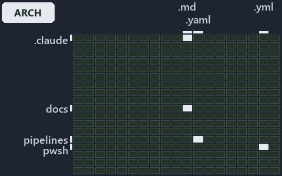

---
catzc:
  immutable:
    with_body_sha: b32707eeea6c
    repo_status: locked
    path: docs/explanation/configuration/.assets/callers-depend-on-one-config-module/grid.md
    source: docs/explanation/configuration/.assets/callers-depend-on-one-config-module/diagram.drawio.png
    role: asset-description
    language: markdown
    filetype: md
    track: docs
    tracktype: documentation
---

# Callers in any module read config through one module: the world-map minimap

```text
Where the files that cite ADR-CONF-LOADING sit in the repository: tracks down, file languages across.
4 of 342 cells lit, holding 12 files.
```



This is the world-map minimap in the sidebar of the architecture diagram of [Callers in any module read config through one module][14],
which explains [ADR-CONF-LOADING][1]. It lights every cell of the world map that holds a file citing those codes, so it shows where the
decision lives in the repository. Each lit cell has its reason below, naming the code that selects it.

## What the minimap shows

The grid crosses the 18 tracks (rows) with the 19 file languages (columns) of the world map and lights 4 cells, filled in ink. A cell lit
only by passing mentions (citations in body comments, not in a file's header or text) is touched: a lighter ink. Every other cell is idle, a
grey box: it holds files the slide's ADR codes do not select, or no file at all (288 of the 342 cells hold none). The minimap shows where
the slide sits, not how many files a cell holds; the world-map PDFs show the counts.

- .claude × markdown: 1 lit of 89 files
- docs × markdown: 9 lit of 2763 files
- pipelines × pipeline-yaml: 1 lit of 14 files
- pwsh × yaml: 1 lit of 115 files

## Key

A lit row prints its track's name; a lit column prints a short code, the first extension of its file language:

- `.md`: markdown
- `.yaml`: pipeline-yaml
- `.yml`: yaml

## Why each cell is lit

### .claude × markdown (1 lit file)

Placed: the root folder `.claude/` names the track .claude ([ADR-DSGN-TRACK-TRACKISPLACEDCLUSTER][2]); the extension `.md` names the file
language markdown ([ADR-DSGN-TRACK-FILELANGUAGE][2]). Lit ([ADR-DSGN-TRACK-LITCELL][2]) by:

- [.claude/plans/decisions-2026-10-16.md][3]: selected by [ADR-CONF-LOADING][1]: the file cites it at line 32 (text).

### docs × markdown (9 lit files)

Placed: the root folder `docs/` names the track docs ([ADR-DSGN-TRACK-TRACKISPLACEDCLUSTER][2]); the extension `.md` names the file language
markdown ([ADR-DSGN-TRACK-FILELANGUAGE][2]). Lit ([ADR-DSGN-TRACK-LITCELL][2]) by:

- [docs/adr/configuration/dora-explains.md][4]: selected by [ADR-CONF-LOADING][1]: the file cites it at line 11 (text).
- [docs/adr/configuration/module-config-loading.md][1]: selected by [ADR-CONF-LOADING][1]: the ADR's own file.
- [docs/adr/index.md][5]: selected by [ADR-CONF-LOADING][1]: the file cites it at line 238 (text).
- [docs/references/pwsh/catzc-base-docs/Build-Readme.ps1.md][6]: selected by [ADR-CONF-LOADING][1]: the file cites it at line 26 (text).
- [docs/references/pwsh/catzc-base-docs/types/DocsConfig.cs.md][7]: selected by [ADR-CONF-LOADING][1]: the file cites it at line 16 (text).
- [docs/references/pwsh/catzc-base-git/types/GitIgnoreConfig.cs.md][8]: selected by [ADR-CONF-LOADING][1]: the file cites it at line 15
  (text).
- [docs/references/pwsh/catzc-base-modulesystem/Copy-CatzcModule.ps1.md][9]: selected by [ADR-CONF-LOADING][1]: the file cites it at line 40
  (text).
- [docs/references/pwsh/catzc-base-qualitygates/private/Get-LiveIdentityTokens.ps1.md][10]: selected by [ADR-CONF-LOADING][1]: the file
  cites it at line 20 (text).
- [docs/references/pwsh/catzc-base-rootconfig/types/RootConfigFiles.cs.md][11]: selected by [ADR-CONF-LOADING][1]: the file cites it at line
  15 (text).

### pipelines × pipeline-yaml (1 lit file)

Placed: the root folder `pipelines/` names the track pipelines ([ADR-DSGN-TRACK-TRACKISPLACEDCLUSTER][2]); the extension `.yaml` names the
file language pipeline-yaml ([ADR-DSGN-TRACK-FILELANGUAGE][2]). Lit ([ADR-DSGN-TRACK-LITCELL][2]) by:

- [pipelines/ci-automation.yaml][12]: selected by [ADR-CONF-LOADING][1]: a pipeline that cites nothing itself carries its globset's
  citations, which cite it at `pwsh/Catzc.Base.Docs/configs/adrs.yml` line 208 (text).

### pwsh × yaml (1 lit file)

Placed: the root folder `pwsh/` names the track pwsh ([ADR-DSGN-TRACK-TRACKISPLACEDCLUSTER][2]); the extension `.yml` names the file
language yaml ([ADR-DSGN-TRACK-FILELANGUAGE][2]). Lit ([ADR-DSGN-TRACK-LITCELL][2]) by:

- [pwsh/Catzc.Base.Docs/configs/adrs.yml][13]: selected by [ADR-CONF-LOADING][1]: the file cites it at line 208 (text).

## Keywords

- [world map][15]
- [track][16]
- [file language][17]
- [cell][18]
- [lit cell][19]
- [.claude][20]: a track
- [docs][20]: a track
- [pipelines][20]: a track
- [pwsh][20]: a track
- [markdown][21]: a file language
- [pipeline-yaml][21]: a file language
- [yaml][21]: a file language

[1]: ../../../../adr/configuration/module-config-loading.md
[2]: ../../../../adr/design/tracks.md
[3]: ../../../../../.claude/plans/decisions-2026-10-16.md
[4]: ../../../../adr/configuration/dora-explains.md
[5]: ../../../../adr/index.md
[6]: ../../../../references/pwsh/catzc-base-docs/Build-Readme.ps1.md
[7]: ../../../../references/pwsh/catzc-base-docs/types/DocsConfig.cs.md
[8]: ../../../../references/pwsh/catzc-base-git/types/GitIgnoreConfig.cs.md
[9]: ../../../../references/pwsh/catzc-base-modulesystem/Copy-CatzcModule.ps1.md
[10]: ../../../../references/pwsh/catzc-base-qualitygates/private/Get-LiveIdentityTokens.ps1.md
[11]: ../../../../references/pwsh/catzc-base-rootconfig/types/RootConfigFiles.cs.md
[12]: ../../../../../pipelines/ci-automation.yaml
[13]: ../../../../../pwsh/Catzc.Base.Docs/configs/adrs.yml
[14]: ../../callers-depend-on-one-config-module.md
[15]: ../../../../adr/glossary.md#world-map
[16]: ../../../../adr/glossary.md#track
[17]: ../../../../adr/glossary.md#file-language
[18]: ../../../../adr/glossary.md#cell
[19]: ../../../../adr/glossary.md#lit-cell
[20]: ../../../../../pwsh/Catzc.Base.Variants/configs/variants.yml
[21]: ../../../../../pwsh/Catzc.Base.Languages/configs/languages.yml
