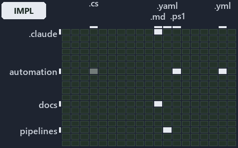

---
catzc:
  immutable:
    with_body_sha: "1eda8439e4e2"
    repo_status: locked
    path: docs/explanation/.assets/grid/adr-conf-loading--three-caches-back-one-reader--implementation.grid.md
    source: docs/explanation/.assets/adr-conf-loading--three-caches-back-one-reader--implementation.drawio.png
    role: asset-description
    language: markdown
    filetype: md
    track: docs
    tracktype: documentation
---

# Three session caches back the one config reader: the world-map minimap

```text
Where the files that cite ADR-CONF-LOADING sit in the repository: tracks down, file languages across.
6 of 342 cells lit, holding 35 files.
```



This is the world-map minimap in the sidebar of the implementation diagram of [Three session caches back the one config reader][39], which
explains [ADR-CONF-LOADING][1]. It lights every cell of the world map that holds a file citing those codes, so it shows where the decision
lives in the repository. Each lit cell has its reason below, naming the code that selects it.

## What the minimap shows

The grid crosses the 18 tracks (rows) with the 19 file languages (columns) of the world map and lights 6 cells, filled in ink. A cell lit
only by passing mentions (citations in body comments, not in a file's header or text) is touched: a lighter ink. Every other cell is idle, a
grey box: it holds files the slide's ADR codes do not select, or no file at all (288 of the 342 cells hold none). The minimap shows where
the slide sits, not how many files a cell holds; the world-map PDFs show the counts.

- .claude × markdown: 4 lit of 90 files
- automation × csharp: 3 lit of 289 files, touched
- automation × powershell: 2 lit of 1629 files
- automation × yaml: 1 lit of 112 files
- docs × markdown: 24 lit of 2742 files
- pipelines × pipeline-yaml: 1 lit of 9 files

## Key

A lit row prints its track's name; a lit column prints a short code, the first extension of its file language:

- `.cs`: csharp
- `.md`: markdown
- `.yaml`: pipeline-yaml
- `.ps1`: powershell
- `.yml`: yaml

## Why each cell is lit

### .claude × markdown (4 lit files)

Placed: the root folder `.claude/` names the track .claude ([ADR-DSGN-TRACK#1][2]); the extension `.md` names the file language markdown
([ADR-DSGN-TRACK#6][3]). Lit ([ADR-DSGN-TRACK#12][4]) by:

- [.claude/plans/decisions-2026-10-16.md][5]: selected by [ADR-CONF-LOADING][1]: the file cites it at line 32 (text).
- [.claude/plans/plan-bounded-folder-enumeration.md][6]: selected by [ADR-CONF-LOADING][1]: the file cites it at line 198 (text).
- [.claude/plans/plan-config-defaults.md][7]: selected by [ADR-CONF-LOADING][1]: the file cites it at line 72 (text), line 169 (text) and
  line 258 (text).
- [.claude/plans/prompt-config-defaults-continue.md][8]: selected by [ADR-CONF-LOADING][1]: the file cites it at line 15 (text) and line 36
  (text).

### automation × csharp (3 lit files, touched)

Placed: the root folder `automation/` names the track automation ([ADR-DSGN-TRACK#1][2]); the extension `.cs` names the file language csharp
([ADR-DSGN-TRACK#6][3]). Lit ([ADR-DSGN-TRACK#12][4]) by:

- [pwsh/Catzc.Base.Docs/types/CapabilitiesConfig.cs][9]: selected by [ADR-CONF-LOADING][1]: the file cites it at line 7 (body comment) (a
  passing mention only).
- [pwsh/Catzc.Base.Docs/types/CapabilityEntry.cs][10]: selected by [ADR-CONF-LOADING][1]: the file cites it at line 8 (body comment) (a
  passing mention only).
- [pwsh/Catzc.Base.Globs/types/FileKindsConfig.cs][11]: selected by [ADR-CONF-LOADING][1]: the file cites it at line 10 (body comment) (a
  passing mention only).

### automation × powershell (2 lit files)

Placed: the root folder `automation/` names the track automation ([ADR-DSGN-TRACK#1][2]); the extension `.ps1` names the file language
powershell ([ADR-DSGN-TRACK#6][3]). Lit ([ADR-DSGN-TRACK#12][4]) by:

- [pwsh/Catzc.Base.Docs/tests/Get-AdrRuleSet.Tests.ps1][12]: selected by [ADR-CONF-LOADING][1]: the file cites it at line 38 (text).
- [pwsh/Catzc.Base.QualityGates/tests/types/CommentsConfig.Tests.ps1][13]: selected by [ADR-CONF-LOADING][1]: the file cites it at line 132
  (text).

### automation × yaml (1 lit file)

Placed: the root folder `automation/` names the track automation ([ADR-DSGN-TRACK#1][2]); the extension `.yml` names the file language yaml
([ADR-DSGN-TRACK#6][3]). Lit ([ADR-DSGN-TRACK#12][4]) by:

- [pwsh/Catzc.Base.Docs/configs/adrs.yml][14]: selected by [ADR-CONF-LOADING][1]: the file cites it at line 208 (text).

### docs × markdown (24 lit files)

Placed: the root folder `docs/` names the track docs ([ADR-DSGN-TRACK#1][2]); the extension `.md` names the file language markdown
([ADR-DSGN-TRACK#6][3]). Lit ([ADR-DSGN-TRACK#12][4]) by:

- [docs/adr/configuration/dora-explains.md][15]: selected by [ADR-CONF-LOADING][1]: the file cites it at line 11 (text).
- [docs/adr/configuration/module-config-loading.md][1]: selected by [ADR-CONF-LOADING][1]: the ADR's own file.
- [docs/adr/index.md][16]: selected by [ADR-CONF-LOADING][1]: the file cites it at line 236 (text).
- [docs/how-to/pwsh/manual-test-plan/configs.md][17]: selected by [ADR-CONF-LOADING][1]: the file cites it at line 44 (text) and line 63
  (text).
- [docs/how-to/getting-started/pwsh/add-a-module.md][18]: selected by [ADR-CONF-LOADING][1]: the file cites it at line 72 (text).
- [docs/references/.assets/automation/catzc-tooling-core/invoke-tool-asserts-locked-version.drawio.verify.md][19]: selected by
  [ADR-CONF-LOADING][1]: the file cites it at line 45 (text).
- [docs/references/pwsh/catzc-base-config/Get-ConfigValue.ps1.md][20]: selected by [ADR-CONF-LOADING][1]: the file cites it at line 16
  (text) and line 20 (text).
- [docs/references/pwsh/catzc-base-config/tests/Get-ConfigValue.Tests.ps1.md][21]: selected by [ADR-CONF-LOADING][1]: the file cites it at
  line 12 (text).
- [docs/references/pwsh/catzc-base-docs/Build-Readme.ps1.md][22]: selected by [ADR-CONF-LOADING][1]: the file cites it at line 26 (text).
- [docs/references/pwsh/catzc-base-docs/private/Get-CatsRuleEnforcers.ps1.md][23]: selected by [ADR-CONF-LOADING][1]: the file cites it at
  line 21 (text).
- [docs/references/pwsh/catzc-base-docs/private/Get-GlossarySources.ps1.md][24]: selected by [ADR-CONF-LOADING][1]: the file cites it at
  line 18 (text).
- [docs/references/pwsh/catzc-base-docs/types/AdrChecksConfig.cs.md][25]: selected by [ADR-CONF-LOADING][1]: the file cites it at line 16
  (text).
- [docs/references/pwsh/catzc-base-docs/types/AdrsConfig.cs.md][26]: selected by [ADR-CONF-LOADING][1]: the file cites it at line 15 (text).
- [docs/references/pwsh/catzc-base-docs/types/AgentsConfig.cs.md][27]: selected by [ADR-CONF-LOADING][1]: the file cites it at line 16
  (text).
- [docs/references/pwsh/catzc-base-docs/types/DocsConfig.cs.md][28]: selected by [ADR-CONF-LOADING][1]: the file cites it at line 16 (text).
- [docs/references/pwsh/catzc-base-execution/Resolve-ToolExecutable.ps1.md][29]: selected by [ADR-CONF-LOADING][1]: the file cites it at
  line 18 (text).
- [docs/references/pwsh/catzc-base-git/private/Get-AutoControlledGlobs.ps1.md][30]: selected by [ADR-CONF-LOADING][1]: the file cites it at
  line 19 (text).
- [docs/references/pwsh/catzc-base-git/types/GitIgnoreConfig.cs.md][31]: selected by [ADR-CONF-LOADING][1]: the file cites it at line 15
  (text).
- [docs/references/pwsh/catzc-base-modulesystem/Copy-Automation.ps1.md][32]: selected by [ADR-CONF-LOADING][1]: the file cites it at line 40
  (text).
- [docs/references/pwsh/catzc-base-qualitygates/Test-ShippedConfigs.ps1.md][33]: selected by [ADR-CONF-LOADING][1]: the file cites it at
  line 15 (text).
- [docs/references/pwsh/catzc-base-qualitygates/private/Get-LiveIdentityTokens.ps1.md][34]: selected by [ADR-CONF-LOADING][1]: the file
  cites it at line 20 (text).
- [docs/references/pwsh/catzc-base-qualitygates/types/FileMetaConfig.cs.md][35]: selected by [ADR-CONF-LOADING][1]: the file cites it at
  line 13 (text).
- [docs/references/pwsh/catzc-base-rootconfig/types/RootConfigFiles.cs.md][36]: selected by [ADR-CONF-LOADING][1]: the file cites it at line
  15 (text).
- [docs/references/pwsh/catzc-tooling-core/invoke-tool-asserts-locked-version.drawio.md][37]: selected by [ADR-CONF-LOADING][1]: the file
  cites it at line 26 (text) and line 93 (text).

### pipelines × pipeline-yaml (1 lit file)

Placed: the root folder `pipelines/` names the track pipelines ([ADR-DSGN-TRACK#1][2]); the extension `.yaml` names the file language
pipeline-yaml ([ADR-DSGN-TRACK#6][3]). Lit ([ADR-DSGN-TRACK#12][4]) by:

- [pipelines/ci-automation.yaml][38]: selected by [ADR-CONF-LOADING][1]: a pipeline that cites nothing itself carries its globset's
  citations, which cite it at `pwsh/Catzc.Base.Docs/configs/adrs.yml` line 208 (text), `pwsh/Catzc.Base.Docs/tests/Get-AdrRuleSet.Tests.ps1`
  line 38 (text), `pwsh/Catzc.Base.Docs/types/CapabilitiesConfig.cs` line 7 (body comment), `pwsh/Catzc.Base.Docs/types/CapabilityEntry.cs`
  line 8 (body comment), `pwsh/Catzc.Base.Globs/types/FileKindsConfig.cs` line 10 (body comment) and
  `pwsh/Catzc.Base.QualityGates/tests/types/CommentsConfig.Tests.ps1` line 132 (text).

## Keywords

- [world map][40]
- [track][41]
- [file language][42]
- [cell][43]
- [lit cell][44]
- [.claude][45]: a track
- [automation][45]: a track
- [docs][45]: a track
- [pipelines][45]: a track
- [csharp][46]: a file language
- [markdown][46]: a file language
- [pipeline-yaml][46]: a file language
- [powershell][46]: a file language
- [yaml][46]: a file language

[1]: ../../../../adr/configuration/module-config-loading.md
[2]: ../../../../adr/design/tracks.md#rule-adr-dsgn-track1
[3]: ../../../../adr/design/tracks.md#rule-adr-dsgn-track6
[4]: ../../../../adr/design/tracks.md#rule-adr-dsgn-track12
[5]: ../../../../../.claude/plans/decisions-2026-10-16.md
[6]: ../../../../../.claude/plans/plan-bounded-folder-enumeration.md
[7]: ../../../../../.claude/plans/plan-config-defaults.md
[8]: ../../../../../.claude/plans/prompt-config-defaults-continue.md
[9]: ../../../../../pwsh/Catzc.Base.Docs/types/CapabilitiesConfig.cs
[10]: ../../../../../pwsh/Catzc.Base.Docs/types/CapabilityEntry.cs
[11]: ../../../../../pwsh/Catzc.Base.Globs/types/FileKindsConfig.cs
[12]: ../../../../../pwsh/Catzc.Base.Docs/tests/Get-AdrRuleSet.Tests.ps1
[13]: ../../../../../pwsh/Catzc.Base.QualityGates/tests/types/CommentsConfig.Tests.ps1
[14]: ../../../../../pwsh/Catzc.Base.Docs/configs/adrs.yml
[15]: ../../../../adr/configuration/dora-explains.md
[16]: ../../../../adr/index.md
[17]: ../../../../how-to/pwsh/manual-test-plan/configs.md
[18]: ../../../../how-to/getting-started/pwsh/add-a-module.md
[19]: ../../../../references/.assets/automation/catzc-tooling-core/invoke-tool-asserts-locked-version.drawio.verify.md
[20]: ../../../../references/pwsh/catzc-base-config/Get-ConfigValue.ps1.md
[21]: ../../../../references/pwsh/catzc-base-config/tests/Get-ConfigValue.Tests.ps1.md
[22]: ../../../../references/pwsh/catzc-base-docs/Build-Readme.ps1.md
[23]: ../../../../references/pwsh/catzc-base-docs/private/Get-CatsRuleEnforcers.ps1.md
[24]: ../../../../references/pwsh/catzc-base-docs/private/Get-GlossarySources.ps1.md
[25]: ../../../../references/pwsh/catzc-base-docs/types/AdrChecksConfig.cs.md
[26]: ../../../../references/pwsh/catzc-base-docs/types/AdrsConfig.cs.md
[27]: ../../../../references/pwsh/catzc-base-docs/types/AgentsConfig.cs.md
[28]: ../../../../references/pwsh/catzc-base-docs/types/DocsConfig.cs.md
[29]: ../../../../references/pwsh/catzc-base-execution/Resolve-ToolExecutable.ps1.md
[30]: ../../../../references/pwsh/catzc-base-git/private/Get-AutoControlledGlobs.ps1.md
[31]: ../../../../references/pwsh/catzc-base-git/types/GitIgnoreConfig.cs.md
[32]: ../../../../references/pwsh/catzc-base-modulesystem/Copy-Automation.ps1.md
[33]: ../../../../references/pwsh/catzc-base-qualitygates/Test-ShippedConfigs.ps1.md
[34]: ../../../../references/pwsh/catzc-base-qualitygates/private/Get-LiveIdentityTokens.ps1.md
[35]: ../../../../references/pwsh/catzc-base-qualitygates/types/FileMetaConfig.cs.md
[36]: ../../../../references/pwsh/catzc-base-rootconfig/types/RootConfigFiles.cs.md
[37]: ../../../../references/pwsh/catzc-tooling-core/invoke-tool-asserts-locked-version.drawio.md
[38]: ../../../../../pipelines/ci-automation.yaml
[39]: ../../three-caches-back-one-reader.md
[40]: ../../../../adr/glossary.md#world-map
[41]: ../../../../adr/glossary.md#track
[42]: ../../../../adr/glossary.md#file-language
[43]: ../../../../adr/glossary.md#cell
[44]: ../../../../adr/glossary.md#lit-cell
[45]: ../../../../../pwsh/Catzc.Base.Variants/configs/variants.yml
[46]: ../../../../../pwsh/Catzc.Base.Languages/configs/languages.yml
