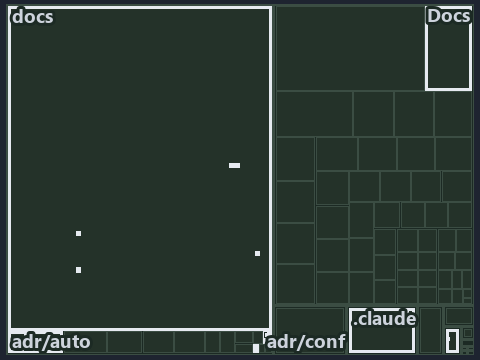

---
catzc:
  immutable:
    with_body_sha: b8a509ef4f78
    repo_status: locked
    path: docs/explanation/configuration/.assets/two-test-files-check-the-address-rules/tree.md
    source: docs/explanation/configuration/.assets/two-test-files-check-the-address-rules/diagram.drawio.png
    role: asset-description
    language: markdown
    filetype: md
    track: docs
    tracktype: documentation
---

# Two L0 test files check the address rules; read-only and committed-only rest on convention: the tree minimap

```text
Which files cite ADR-AUTO-ENVVAR and ADR-CONF-ADDRESSING: every file of the world map is a tile, grouped by top-level folder.
13 files lit in 7 groups.
```



This is the tree minimap in the sidebar of the governance diagram of [Two L0 test files check the address rules; read-only and
committed-only rest on convention][14], which explains [ADR-AUTO-ENVVAR][1] and [ADR-CONF-ADDRESSING][2]. It lights every file that cites
those codes, grouped by folder, so it shows which files carry the decision. Each lit group has its reason below, naming the code that
selects it.

## What the minimap shows

The tree draws every file of the world map as a tile, grouped by top-level folder (under `pwsh/` by module, under `docs/adr/` by ADR
domain), and lights 13 files in 7 groups, filled in ink. A lit ADR file has a white rim; a file lit only by passing mentions is a lighter
ink. Every other tile is idle, a grey box: a file the slide's ADR codes do not select.

- docs (docs/ outside docs/adr/): 5 lit files
- adr/auto (docs/adr/automation): 2 lit files
- adr/conf (docs/adr/configuration): 2 lit files
- .claude: 1 lit file
- adr/* (the files directly in docs/adr/): 1 lit file
- pipelines: 1 lit file
- Docs (pwsh/Catzc.Base.Docs): 1 lit file

## Why each group is lit

### docs (docs/ outside docs/adr/, 5 lit files)

The group holds the files of docs/ outside docs/adr/; each sits in its world-map cell and is lit by:

- [docs/references/pwsh/catzc-base-config/Get-ConfigValue.ps1.md][3], in the cell docs × markdown: selected by [ADR-CONF-ADDRESSING][2]: the
  file cites it at line 14 (text).
- [docs/references/pwsh/catzc-base-config/private/Resolve-ConfigKeyPath.ps1.md][4], in the cell docs × markdown: selected by
  [ADR-CONF-ADDRESSING][2]: the file cites it at line 14 (text).
- [docs/references/pwsh/catzc-base-languages/New-GoWorkspace.ps1.md][5], in the cell docs × markdown: selected by [ADR-CONF-ADDRESSING][2]:
  the file cites it at line 63 (text).
- [docs/references/pwsh/catzc-base-languages/New-PythonProject.ps1.md][6], in the cell docs × markdown: selected by
  [ADR-CONF-ADDRESSING][2]: the file cites it at line 56 (text).
- [docs/references/pwsh/catzc-tooling-environment/Write-EnvironmentSet.ps1.md][7], in the cell docs × markdown: selected by
  [ADR-CONF-ADDRESSING][2]: the file cites it at line 20 (text).

### adr/auto (docs/adr/automation, 2 lit files)

The group holds the files of docs/adr/automation; each sits in its world-map cell and is lit by:

- [docs/adr/automation/dora-explains.md][8], in the cell docs × markdown: selected by [ADR-AUTO-ENVVAR][1]: the file cites it at line 383
  (text).
- [docs/adr/automation/environment-variables.md][1], in the cell docs × markdown: selected by [ADR-AUTO-ENVVAR][1]: the ADR's own file.

### adr/conf (docs/adr/configuration, 2 lit files)

The group holds the files of docs/adr/configuration; each sits in its world-map cell and is lit by:

- [docs/adr/configuration/config-value-addressing.md][2], in the cell docs × markdown: selected by [ADR-CONF-ADDRESSING][2]: the ADR's own
  file.
- [docs/adr/configuration/dora-explains.md][9], in the cell docs × markdown: selected by [ADR-CONF-ADDRESSING][2]: the file cites it at line
  28 (text).

### .claude (1 lit file)

The group holds the files of .claude; each sits in its world-map cell and is lit by:

- [.claude/plans/plan-layers-vocabulary-rename-contracts.md][10], in the cell .claude × markdown: selected by [ADR-AUTO-ENVVAR][1]: the file
  cites it at line 216 (text).

### adr/* (the files directly in docs/adr/, 1 lit file)

The group holds the files of the files directly in docs/adr/; each sits in its world-map cell and is lit by:

- [docs/adr/index.md][11], in the cell docs × markdown: selected by [ADR-AUTO-ENVVAR][1]: the file cites it at line 172 (text); selected by
  [ADR-CONF-ADDRESSING][2]: the file cites it at line 239 (text).

### pipelines (1 lit file)

The group holds the files of pipelines; each sits in its world-map cell and is lit by:

- [pipelines/ci-automation.yaml][12], in the cell pipelines × pipeline-yaml: selected by [ADR-AUTO-ENVVAR][1]: a pipeline that cites nothing
  itself carries its globset's citations, which cite it at `pwsh/Catzc.Base.Docs/configs/adrs.yml` line 139 (text); selected by
  [ADR-CONF-ADDRESSING][2]: a pipeline that cites nothing itself carries its globset's citations, which cite it at
  `pwsh/Catzc.Base.Docs/configs/adrs.yml` line 209 (text).

### Docs (pwsh/Catzc.Base.Docs, 1 lit file)

The group holds the files of pwsh/Catzc.Base.Docs; each sits in its world-map cell and is lit by:

- [pwsh/Catzc.Base.Docs/configs/adrs.yml][13], in the cell pwsh × yaml: selected by [ADR-AUTO-ENVVAR][1]: the file cites it at line 139
  (text); selected by [ADR-CONF-ADDRESSING][2]: the file cites it at line 209 (text).

## Keywords

- [world map][15]
- [track][16]
- [file language][17]
- [cell][18]
- [lit cell][19]
- [.claude][20]: a track
- [docs][20]: a track
- [pipelines][20]: a track
- [pwsh][20]: a track
- [markdown][21]: a file language
- [pipeline-yaml][21]: a file language
- [yaml][21]: a file language

[1]: ../../../../adr/automation/environment-variables.md
[2]: ../../../../adr/configuration/config-value-addressing.md
[3]: ../../../../references/pwsh/catzc-base-config/Get-ConfigValue.ps1.md
[4]: ../../../../references/pwsh/catzc-base-config/private/Resolve-ConfigKeyPath.ps1.md
[5]: ../../../../references/pwsh/catzc-base-languages/New-GoWorkspace.ps1.md
[6]: ../../../../references/pwsh/catzc-base-languages/New-PythonProject.ps1.md
[7]: ../../../../references/pwsh/catzc-tooling-environment/Write-EnvironmentSet.ps1.md
[8]: ../../../../adr/automation/dora-explains.md
[9]: ../../../../adr/configuration/dora-explains.md
[10]: ../../../../../.claude/plans/plan-layers-vocabulary-rename-contracts.md
[11]: ../../../../adr/index.md
[12]: ../../../../../pipelines/ci-automation.yaml
[13]: ../../../../../pwsh/Catzc.Base.Docs/configs/adrs.yml
[14]: ../../two-test-files-check-the-address-rules.md
[15]: ../../../../adr/glossary.md#world-map
[16]: ../../../../adr/glossary.md#track
[17]: ../../../../adr/glossary.md#file-language
[18]: ../../../../adr/glossary.md#cell
[19]: ../../../../adr/glossary.md#lit-cell
[20]: ../../../../../pwsh/Catzc.Base.Variants/configs/variants.yml
[21]: ../../../../../pwsh/Catzc.Base.Languages/configs/languages.yml
